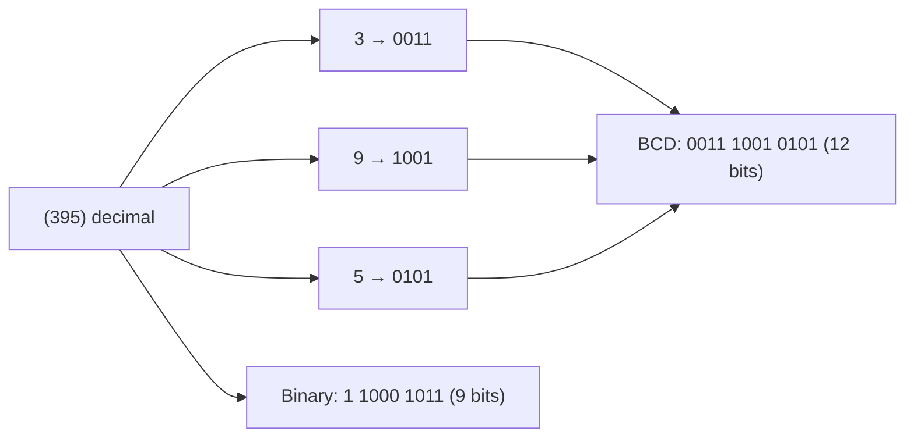

## Why should you care?

Look at a petrol pump display, a digital wall clock, an auto-rickshaw fare meter or a calculator. They all show **decimal digits**, one digit per window. A pure binary number would make this hard: to show 395 on three seven-segment windows, the circuit would first need to divide by 10 repeatedly to separate the 3, the 9 and the 5.

**BCD** (Binary Coded Decimal) avoids that division. It stores **each decimal digit separately** in 4 bits, so each window can be driven directly by its own group of bits.

This lecture covers the two BCD codes in your syllabus, **8421** and **2421**, and where each is used.

## In one line

BCD (Binary Coded Decimal) represents each decimal digit separately by a 4-bit code: in 8421 BCD the bit weights are 8, 4, 2, 1, and in 2421 code they are 2, 4, 2, 1, which makes it self-complementing.

## Explained

### Q1. What is a code? What is BCD?

==A code is a rule that represents numbers, letters or symbols as groups of bits.== Pure binary is one way to write a number; codes are other agreed ways.

==BCD (Binary Coded Decimal) represents each decimal digit separately by its own 4-bit group.==

- ==**4 bits per digit,**== because 3 bits give only 8 patterns and we need 10 (digits 0–9).
- ==**Weighted code:**== each bit position has a fixed weight; the digit is the sum of weights where the bit is 1.
- ==**Two common forms:**== 8421 (natural BCD) and 2421.

### Q2. What is 8421 BCD? ⭐

==8421 BCD gives the four bits the weights 8, 4, 2 and 1,== the same as ordinary 4-bit binary.

| Decimal | 8421 BCD | Decimal | 8421 BCD |
|---|---|---|---|
| 0 | 0000 | 5 | 0101 |
| 1 | 0001 | 6 | 0110 |
| 2 | 0010 | 7 | 0111 |
| 3 | 0011 | 8 | 1000 |
| 4 | 0100 | 9 | 1001 |

- ==**Only 10 of the 16 patterns are used.**==
- ==**Six patterns are invalid:**== 1010, 1011, 1100, 1101, 1110, 1111 (10 to 15). They never appear in correct BCD.
- It is also called **natural BCD** or simply **BCD**.

### Q3. Worked example: decimal to 8421 BCD [2M]

Convert $(395)_{10}$ to BCD and to binary.

**BCD:** replace each digit with its 4-bit code.

| Digit | 3 | 9 | 5 |
|---|---|---|---|
| BCD | 0011 | 1001 | 0101 |

$(395)_{10} = (0011\;1001\;0101)_{BCD}$, 12 bits.

**Binary (for comparison):** $395 = 256 + 128 + 8 + 2 + 1$, so $(395)_{10} = (1\,1000\,1011)_2$, only 9 bits.

BCD is **not** the same as binary. It needs more bits, but each digit stays visible.

### Q4. Worked example: 8421 BCD to decimal [2M]

==Split the bits into groups of 4 from the right, and convert each group to one decimal digit.==

**(a)** $(1001\;0111\;0100)_{BCD}$: 1001 = 9, 0111 = 7, 0100 = 4, so the number is **974**.

**(b)** $(1\,0110\,0011)_{BCD}$: pad the left group to 0001. Groups 0001, 0110, 0011 give **163**.

**(c)** $(1011\;0010)_{BCD}$: the group 1011 is 11, which is not a decimal digit. This is **not a valid BCD number**.

### Q5. What is the 2421 code? ⭐

==The 2421 code is a weighted BCD code with bit weights 2, 4, 2 and 1.==

| Decimal | 2421 | Decimal | 2421 |
|---|---|---|---|
| 0 | 0000 | 5 | 1011 |
| 1 | 0001 | 6 | 1100 |
| 2 | 0010 | 7 | 1101 |
| 3 | 0011 | 8 | 1110 |
| 4 | 0100 | 9 | 1111 |

- ==**Check a value with the weights:**== 7 = 1101 = 2 + 4 + 0 + 1.
- ==**Self-complementing:**== inverting the bits of a digit gives its **9's complement** (9 − digit). For example 3 = 0011 → 1100 = 6, and 9 − 3 = 6.
- Some digits could be written two ways (5 = 0101 or 1011); the standard table above uses the choice that keeps the code self-complementing. It is also called the **Aiken code**.
- ==**Digits 5–9 all start with 1,**== and 0–4 all start with 0.

### Q6. Worked example: decimal to 2421, and the self-complement [2M]

Convert $(52)_{10}$ to 2421 code.

| Digit | 5 | 2 |
|---|---|---|
| 2421 | 1011 | 0010 |

$(52)_{10} = (1011\;0010)_{2421}$

**Self-complement check:** invert all bits: 0100 1101. In 2421, 0100 = 4 and 1101 = 7, giving **47**. And $99 - 52 = 47$, the 9's complement of 52. Correct.

This lets a decimal machine find the 9's complement (used for decimal subtraction) with only NOT gates.

### Q7. Compare BCD with pure binary ⭐

| Point | Pure binary | 8421 BCD |
|---|---|---|
| ==**Bits for 395**== | 9 | 12 |
| ==**Storage**== | Efficient | Wastes 6 of 16 patterns per digit |
| ==**Conversion to decimal display**== | Needs repeated division by 10 | Direct: one 4-bit group per digit |
| ==**Arithmetic circuits**== | Simple | Need a correction step (beyond syllabus) |
| ==**Decimal fractions like 0.1**== | Often inexact | Exact |
| ==**Typical use**== | Processors, memory, files | Displays, clocks, meters, calculators |

### Q8. Where are BCD codes used? ⭐

- ==**Seven-segment displays:**== a BCD-to-7-segment decoder chip (such as the 7447) takes 4 BCD bits and lights one digit.
- ==**Digital clocks and real-time clock chips:**== the DS1307 RTC, common with microcontrollers, stores seconds, minutes and hours in BCD.
- ==**Calculators, petrol pumps, fare meters, energy meters:**== anywhere digits are counted and shown.
- ==**Money and finance:**== decimal storage avoids binary rounding errors in paise.
- ==**2421 code:**== decimal arithmetic circuits, where self-complementing makes 9's complement subtraction easy.

### Q9. Convert $(729)_{10}$ to 8421 BCD and to binary. Compare the number of bits. [2M]

**BCD** (each digit in 4 bits): 7 = 0111, 2 = 0010, 9 = 1001

$(729)_{10} = (0111\;0010\;1001)_{BCD}$: **12 bits**

**Binary:** $729 = 512 + 128 + 64 + 16 + 8 + 1$

$(729)_{10} = (10\,1101\,1001)_2$: **10 bits**

==BCD needs 2 more bits here,== because each 4-bit group uses only 10 of its 16 patterns.

### Q10. Convert $(0100\;1000\;0110)_{BCD}$ to decimal. [2M]

==Split into 4-bit groups and convert each to one digit:==

| Group | 0100 | 1000 | 0110 |
|---|---|---|---|
| Digit | 4 | 8 | 6 |

$(0100\;1000\;0110)_{BCD} = (486)_{10}$

All three groups are 0000–1001, so the number is valid BCD.

### Q11. What is a self-complementing code? Show that 2421 is self-complementing. [2M]

==A self-complementing code is one where inverting the bits of a digit's code gives the code of its 9's complement (9 − digit).==

**2421 example:** 4 = 0100. Inverting gives 1011, which is 5 in 2421, and $9 - 4 = 5$.

| Digit | 2421 | Inverted | Gives | 9 − digit |
|---|---|---|---|---|
| 1 | 0001 | 1110 | 8 | 8 |
| 3 | 0011 | 1100 | 6 | 6 |
| 4 | 0100 | 1011 | 5 | 5 |

8421 BCD is **not** self-complementing: 4 = 0100 inverts to 1011, which is invalid.

> [!beyond] Beyond the syllabus
> **BCD addition** needs a correction. Add two BCD digits in binary; if the result is more than 9 (or a carry is produced), add 6 (0110). Example: 7 + 5 = 0111 + 0101 = 1100 (invalid). Add 0110: 1100 + 0110 = 1 0010, which is 0001 0010 in BCD, that is, 12. Adding 6 skips the six invalid patterns.

## Analogy and real-life example

### Analogy: writing a cheque digit by digit

On some forms, an amount like ₹395 is written in separate boxes: [3] [9] [5]. Each box holds one digit, so anyone can read it at a glance, even though boxes waste a little space. Pure binary is like writing the whole amount as one long word with no boxes: compact, but hard to read. BCD is the box-per-digit form.

### Real system: the DS1307 clock chip

Many 8051 and Arduino clock projects (you will see the 8051 in Sem 4) use a DS1307 real-time clock chip. If the time is 10:59:30, its seconds register holds `0x30` = 0011 0000: the **3** and the **0** sit in separate nibbles. The microcontroller can send each nibble straight to a seven-segment digit, with no division by 10.

## Diagram

## Key points

> [!important] Key points
> - BCD: each decimal digit is coded separately in 4 bits.
> - 8421 BCD: weights 8, 4, 2, 1; digits 0–9 = 0000–1001.
> - Invalid 8421 patterns: 1010 to 1111 (six patterns).
> - BCD is not binary: 395 = 0011 1001 0101 (BCD) but 110001011 (binary).
> - 2421 code: weights 2, 4, 2, 1; 5 = 1011, 6 = 1100, 7 = 1101, 8 = 1110, 9 = 1111.
> - 2421 is self-complementing: inverting the bits gives the 9's complement.
> - BCD uses more bits than binary but converts directly to decimal displays.
> - Uses: seven-segment displays, clocks (RTC chips), calculators, meters, finance.

## Common mistakes

> [!warning] Common mistake
> **Converting the whole number to binary.** BCD converts **each digit** separately. $(25)_{10}$ in BCD is 0010 0101, not 11001.

> [!warning] Common mistake
> **Dropping leading zeros inside a group.** Every digit takes exactly 4 bits. 905 in BCD is 1001 0000 0101; writing the 0 as "0" instead of "0000" breaks the grouping.

> [!warning] Common mistake
> **Accepting 1010–1111 as digits.** These six patterns are invalid in 8421 BCD. A BCD number containing one of them is an error.

## Sources

- M. Morris Mano, *Digital Logic and Computer Design*, Prentice Hall, Ch. 1, binary codes and BCD (verify).
- R. P. Jain, *Modern Digital Electronics*, Tata McGraw Hill, Ch. 2, codes (verify).
- Analog Devices (formerly Maxim Integrated), *DS1307 64 x 8, Serial, I²C Real-Time Clock* datasheet, timekeeper registers in BCD format.
- University syllabus, BSc DS Sem 2, course UDSII-005, Unit 1 (BOS 05/06/2026).
