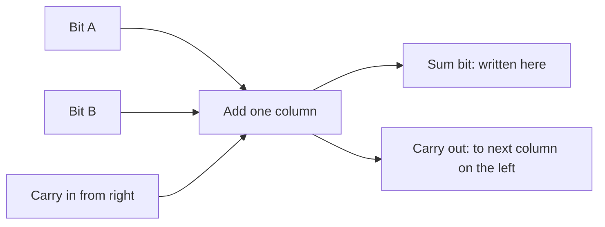

## Why should you care?

When you train a machine learning model, the GPU does trillions of additions every second. When your phone adds ₹40 to your UPI spending total, the processor adds two binary numbers. Every multiplication, average, loss value and pixel brightness is built, in the end, from **binary addition**.

The rules are much simpler than decimal: there are only four cases to learn, compared with a hundred in the decimal addition table. In Unit 3 you will build circuits (half adders and full adders) that follow exactly these rules. Today you learn to do it by hand.

## In one line

Binary addition and subtraction work column by column like decimal, except that 1 + 1 gives 0 with a carry of 1, and 0 − 1 gives 1 with a borrow of 1 from the next column.

## Explained

### Q1. What are the rules of binary addition? ⭐

==Binary addition follows four basic rules,== plus one for when a carry comes in.

| A | B | Carry in | Sum | Carry out | Why |
|---|---|---|---|---|---|
| 0 | 0 | 0 | 0 | 0 | 0 + 0 = 0 |
| 0 | 1 | 0 | 1 | 0 | 0 + 1 = 1 |
| 1 | 0 | 0 | 1 | 0 | 1 + 0 = 1 |
| 1 | 1 | 0 | 0 | 1 | ==1 + 1 = 2 = $(10)_2$:== write 0, carry 1 |
| 1 | 1 | 1 | 1 | 1 | ==1 + 1 + 1 = 3 = $(11)_2$:== write 1, carry 1 |

==Add column by column from the right (LSB),== carrying into the next column, just as in decimal.

### Q2. Worked example: adding two binary integers [2M]

Add $(1011)_2$ and $(0110)_2$ (that is, 11 + 6).

| Column | 4 | 3 | 2 | 1 | 0 |
|---|---|---|---|---|---|
| Carry | 1 | 1 | 1 | 0 | |
| A | | 1 | 0 | 1 | 1 |
| B | | 0 | 1 | 1 | 0 |
| **Sum** | **1** | **0** | **0** | **0** | **1** |

Step by step, from the right:
- Column 0: 1 + 0 = 1, no carry.
- Column 1: 1 + 1 = 10 → write 0, carry 1.
- Column 2: 0 + 1 + carry 1 = 10 → write 0, carry 1.
- Column 3: 1 + 0 + carry 1 = 10 → write 0, carry 1.
- Column 4: only the carry → write 1.

$(1011)_2 + (0110)_2 = (10001)_2 = 17$. Correct.

### Q3. Worked example: adding numbers with fractions [2M]

==Line up the binary points first,== then add as usual. A carry can cross the point.

Add $(101.11)_2 + (11.01)_2$ (that is, 5.75 + 3.25).

| Column | 3 | 2 | 1 | 0 | . | −1 | −2 |
|---|---|---|---|---|---|---|---|
| Carry | 1 | 1 | 1 | 1 | | 1 | |
| A | | 1 | 0 | 1 | . | 1 | 1 |
| B | | 0 | 1 | 1 | . | 0 | 1 |
| **Sum** | **1** | **0** | **0** | **1** | **.** | **0** | **0** |

From the right:
- Column −2: 1 + 1 = 10 → 0, carry 1.
- Column −1: 1 + 0 + 1 = 10 → 0, carry 1 (it crosses the point).
- Column 0: 1 + 1 + 1 = 11 → 1, carry 1.
- Column 1: 0 + 1 + 1 = 10 → 0, carry 1.
- Column 2: 1 + 0 + 1 = 10 → 0, carry 1.
- Column 3: only the carry → 1.

Result: $(1001.00)_2 = 9$. Correct, since 5.75 + 3.25 = 9.

### Q4. What are the rules of binary subtraction? ⭐

| A | B | Difference | Borrow | Why |
|---|---|---|---|---|
| 0 | 0 | 0 | 0 | 0 − 0 = 0 |
| 1 | 0 | 1 | 0 | 1 − 0 = 1 |
| 1 | 1 | 0 | 0 | 1 − 1 = 0 |
| 0 | 1 | 1 | 1 | ==0 − 1: borrow 1 from the next column,== so it becomes $(10)_2 - 1 = 1$ |

- ==**A borrow is worth 2 in the current column**== (not 10, as in decimal).
- ==**The column you borrowed from loses 1.**==
- ==**If that column is 0, it borrows in turn**== from the next one: a **borrow chain**.

### Q5. Worked example: binary subtraction with borrow [2M]

Subtract $(1101)_2 - (0110)_2$ (that is, 13 − 6).

| Column | 3 | 2 | 1 | 0 |
|---|---|---|---|---|
| A | 1 | 1 | 0 | 1 |
| B | 0 | 1 | 1 | 0 |

- Column 0: 1 − 0 = **1**.
- Column 1: 0 − 1 → borrow from column 2. Column 2 becomes 0; column 1 becomes 10 − 1 = **1**.
- Column 2: now 0 − 1 → borrow from column 3. Column 3 becomes 0; column 2 becomes 10 − 1 = **1**.
- Column 3: now 0 − 0 = **0**.

Reading top to bottom from column 3: $(1101)_2 - (0110)_2 = (0111)_2 = 7$. Correct.

### Q6. Worked example: a long borrow chain [2M]

Subtract $(10000)_2 - (00011)_2$ (that is, 16 − 3).

Column 0 needs to borrow, but columns 1, 2 and 3 are all 0. The borrow travels to column 4:

- Column 4 gives 1 and becomes **0**.
- Columns 3, 2, 1 each receive 10, pass 1 to the right, and keep **1**.
- Column 0 receives 10.

Now subtract column by column:

| Column | 4 | 3 | 2 | 1 | 0 |
|---|---|---|---|---|---|
| A after borrowing | 0 | 1 | 1 | 1 | 10 |
| B | 0 | 0 | 0 | 1 | 1 |
| **Difference** | **0** | **1** | **1** | **0** | **1** |

Result: $(01101)_2 = 13$. Correct.

### Q7. What is a carry out (overflow) in fixed-width addition? ⭐

==A circuit adds numbers of a fixed width, n bits.== The largest n-bit unsigned value is $2^n - 1$.

- ==**If the sum is larger,**== it needs an extra bit: the **carry out** of the MSB.
- In Q2, two 4-bit numbers gave a 5-bit sum (10001). A 4-bit adder shows only 0001 and sets a **carry flag** to 1.
- ==**Processors keep this carry in a flag**== (the 8051 calls it CY), so programs can detect it or chain additions for larger numbers.
- ==**Ignoring it gives a wrong answer:**== 11 + 6 would appear as 1.

### Q8. Add $(110110)_2$ and $(101011)_2$ and verify in decimal. [2M]

| Carry | 1 | 1 | 1 | 1 | 1 | 0 | |
|---|---|---|---|---|---|---|---|
| A | | 1 | 1 | 0 | 1 | 1 | 0 |
| B | | 1 | 0 | 1 | 0 | 1 | 1 |
| **Sum** | **1** | **1** | **0** | **0** | **0** | **0** | **1** |

$(110110)_2 + (101011)_2 = (1100001)_2$

**Verify:** $54 + 43 = 97 = 64 + 32 + 1$. Correct.

### Q9. Subtract $(101001)_2 - (011110)_2$ using the borrow method. [2M]

| Column | 5 | 4 | 3 | 2 | 1 | 0 |
|---|---|---|---|---|---|---|
| A | 1 | 0 | 1 | 0 | 0 | 1 |
| B | 0 | 1 | 1 | 1 | 1 | 0 |
| **Difference** | **0** | **0** | **1** | **0** | **1** | **1** |

- Col 0: 1 − 0 = 1. Col 1: 0 − 1, borrow from col 3 (col 2 is 0) → 1.
- Col 2: now 1 − 1 = 0. Col 3: now 0 − 1, borrow from col 5 → 1. Col 4: now 1 − 1 = 0. Col 5: 0.

Result $(001011)_2 = 11$. **Verify:** $41 - 30 = 11$. Correct.

### Q10. Add $(1101.101)_2$ and $(111.011)_2$. [2M]

==Line up the binary points, then add from the right.==

| Column | 4 | 3 | 2 | 1 | 0 | . | −1 | −2 | −3 |
|---|---|---|---|---|---|---|---|---|---|
| Carry | 1 | 1 | 1 | 1 | 1 | | 1 | 1 | |
| A | | 1 | 1 | 0 | 1 | . | 1 | 0 | 1 |
| B | | 0 | 1 | 1 | 1 | . | 0 | 1 | 1 |
| **Sum** | **1** | **0** | **1** | **0** | **1** | **.** | **0** | **0** | **0** |

The carry from column −1 crosses the point into column 0.

$(1101.101)_2 + (111.011)_2 = (10101.000)_2$

**Verify:** $13.625 + 7.375 = 21$. Correct.

### Q11. Perform (a) $(11101)_2 + (10111)_2$, (b) $(110000)_2 - (000101)_2$, (c) $(1010.11)_2 + (110.01)_2$. What happens to (a) in a 5-bit adder? ⭐

| Part | Working (right to left) | Result | Check |
|---|---|---|---|
| (a) | 1+1 = 0 c1; 0+1+1 = 0 c1; 1+1+1 = 1 c1; 1+0+1 = 0 c1; 1+1+1 = 1 c1; carry 1 | $(110100)_2$ | 29 + 23 = 52 |
| (b) | Col 0 borrows from col 4 (cols 1–3 become 1); 10−1 = 1, 1−0 = 1, 1−1 = 0, 1−0 = 1, 0−0 = 0, 1−0 = 1 | $(101011)_2$ | 48 − 5 = 43 |
| (c) | Line up points; .11 + .01 = 1.00 (carry crosses the point); 1010 + 110 + 1 = 10001 | $(10001.00)_2$ | 10.75 + 6.25 = 17 |

==**5-bit adder:**== the sum 110100 needs 6 bits. The adder shows only the lower 5 bits, **10100** (20), and ==sets the carry flag to 1==. Without the carry, the answer is wrong.

> [!beyond] Beyond the syllabus
> **Binary multiplication** is shift-and-add. Multiplying by $(10)_2$ shifts the number one place left, just as multiplying by 10 in decimal does. So $1011 \times 101 = 1011 \times 100 + 1011 \times 1 = 101100 + 1011 = 110111$ (11 × 5 = 55). Multiplier circuits in GPUs are large arrays of adders doing exactly this.

## Analogy and real-life example

### Analogy: exchanging coins

In decimal, when a column reaches 10 you carry 1 to the next column, like exchanging ten ₹1 coins for one ₹10 note. In binary, you exchange as soon as you have **two**: two ₹1 coins become one "₹2 coin", two of those become one "₹4 coin", and so on. A borrow is the reverse: breaking one bigger coin into two smaller ones.

### Real system: the ALU in every processor

The **Arithmetic Logic Unit (ALU)** is the part of a CPU that adds. When Python runs `a + b` on two integers, the CPU sends their binary forms to an adder circuit. It produces the sum and also sets flags such as **carry** and **zero**, which `if` statements later test. In Unit 3 you will design that adder from logic gates.

## Diagram

## Key points

> [!important] Key points
> - Addition rules: 0+0 = 0; 0+1 = 1; 1+0 = 1; 1+1 = 10 (sum 0, carry 1); 1+1+1 = 11 (sum 1, carry 1).
> - Subtraction rules: 0−0 = 0; 1−0 = 1; 1−1 = 0; 0−1 = 1 with a borrow of 1.
> - A borrow is worth 2 in the current column; a 0 column borrows in turn (borrow chain).
> - Work from the LSB (right) to the MSB (left); line up the binary points first.
> - n-bit unsigned range is 0 to $2^n - 1$; a larger sum produces a carry out (carry flag).
> - Always check by converting to decimal.

## Common mistakes

> [!warning] Common mistake
> **Writing 1 + 1 = 2.** There is no digit 2 in binary. 1 + 1 = 10: write 0 and carry 1.

> [!warning] Common mistake
> **Forgetting the column you borrowed from.** After borrowing, that column is one less (1 becomes 0). Students often subtract with its old value.

> [!warning] Common mistake
> **Dropping the final carry.** In Q2 the answer is 10001 (17), not 0001. Write the last carry unless the question fixes the width to n bits.

## Sources

- M. Morris Mano, *Digital Logic and Computer Design*, Prentice Hall, Ch. 1, arithmetic in binary (verify).
- Floyd, *Digital Fundamentals*, Pearson, Ch. 2, binary arithmetic (verify).
- University syllabus, BSc DS Sem 2, course UDSII-005, Unit 1 (BOS 05/06/2026).
