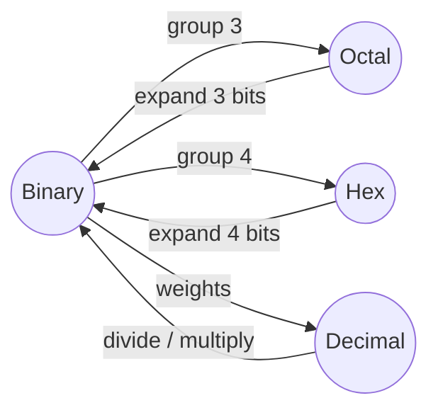

## Why should you care?

A memory address on a 32-bit machine looks like this in binary:

`0111 1111 1111 1110 0000 0000 1010 0100`

Try reading that aloud, or copying it without a mistake. In hexadecimal the same address is just `7FFE00A4`: eight characters instead of thirty-two.

That is why programmers, debuggers, network tools and the 8051 datasheets you will meet in Sem 4 all show binary as **hex** (or sometimes octal). Converting between them needs no division at all. Because 8 and 16 are powers of 2, you just **group the bits**. Once you know the trick, you can do it in your head.

## In one line

Since $8 = 2^3$ and $16 = 2^4$, one octal digit equals exactly 3 bits and one hex digit equals exactly 4 bits, so binary converts to octal or hex by grouping bits from the point, and back by replacing each digit with its bit group.

## Explained

### Q1. Why are octal and hexadecimal so closely linked to binary? ⭐

==Because their bases are powers of 2.==

- ==**Octal: $8 = 2^3$,**== so each octal digit (0–7) is exactly **3 bits** (000–111).
- ==**Hexadecimal: $16 = 2^4$,**== so each hex digit (0–F) is exactly **4 bits** (0000–1111).
- ==**No arithmetic is needed:**== conversion is just grouping or expanding bits.
- ==**Decimal is different:**== 10 is not a power of 2, so decimal needs the division method of the last lecture.

This is why octal and hex are used as **short forms of binary**: hex shrinks binary to a quarter of its length, octal to a third.

### Q2. How do you convert binary to octal? ⭐

==Group the bits in threes, starting from the binary point, and replace each group with its octal digit.==

1. ==**Integer part:** group from the point towards the left.==
2. ==**Fraction part:** group from the point towards the right.==
3. ==**Pad with zeros** to complete the outer groups:== add zeros on the far left of the integer part and the far right of the fraction part. This does not change the value.
4. ==**Replace each group**== with its octal digit (000 = 0 … 111 = 7).

### Q3. Worked example: binary to octal

Convert $(11010111.1011)_2$ to octal.

**Integer part** 11010111: group from the point leftwards, pad one zero on the left.

| Group | 011 | 010 | 111 |
|---|---|---|---|
| Octal | 3 | 2 | 7 |

**Fraction part** .1011: group from the point rightwards, pad two zeros on the right.

| Group | 101 | 100 |
|---|---|---|
| Octal | 5 | 4 |

$$(11010111.1011)_2 = (327.54)_8$$

**Check through decimal:** $327_8 = 192 + 16 + 7 = 215$, and $11010111_2 = 128 + 64 + 16 + 4 + 2 + 1 = 215$. Correct.

### Q4. How do you convert binary to hexadecimal? Worked example

==Same method, but group the bits in fours from the binary point.==

Convert the same number $(11010111.1011)_2$ to hex.

| Part | Groups of 4 | Hex digits |
|---|---|---|
| Integer | 1101 · 0111 | D · 7 |
| Fraction | 1011 | B |

$$(11010111.1011)_2 = (D7.B)_{16}$$

**Check:** $D7_{16} = 13 \times 16 + 7 = 215$, and $.B_{16} = 11/16 = 0.6875 = .1011_2$. Correct.

**Another one:** $(1111111001)_2$ → pad to 0011 · 1111 · 1001 → $(3F9)_{16}$.

### Q5. How do you convert octal or hex back to binary?

==Replace each digit with its 3-bit (octal) or 4-bit (hex) group,== keeping the point where it is. Then drop leading zeros on the left and trailing zeros on the right.

**Octal to binary:** $(725.6)_8$

| Digit | 7 | 2 | 5 | . | 6 |
|---|---|---|---|---|---|
| Bits | 111 | 010 | 101 | . | 110 |

$(725.6)_8 = (111010101.11)_2$ (the last 0 of 110 is dropped)

**Hex to binary:** $(3F9)_{16}$

| Digit | 3 | F | 9 |
|---|---|---|---|
| Bits | 0011 | 1111 | 1001 |

$(3F9)_{16} = (1111111001)_2$ (leading 00 dropped)

### Q6. How do you convert between octal and hexadecimal? ⭐

==Go through binary: expand to bits, then regroup.== Going through decimal also works, but it needs division and is slower.

**Octal to hex:** $(725)_8$
1. Expand to 3-bit groups: 111 010 101
2. Regroup in fours from the right: 0001 · 1101 · 0101
3. Replace: 1 · D · 5

$(725)_8 = (1D5)_{16}$. Check: $7 \times 64 + 2 \times 8 + 5 = 469$ and $1 \times 256 + 13 \times 16 + 5 = 469$. Correct.

**Hex to octal:** $(2AF)_{16}$
1. Expand to 4-bit groups: 0010 1010 1111
2. Regroup in threes from the right: 001 · 010 · 101 · 111
3. Replace: 1 · 2 · 5 · 7

$(2AF)_{16} = (1257)_8$. Both equal 687 in decimal.

### Q7. Which method do you use for which conversion? ⭐

| From → To | Method |
|---|---|
| Any base → decimal | ==Multiply each digit by its weight and add== (lecture 1) |
| Decimal → any base | ==Divide (integer) / multiply (fraction) repeatedly== (lecture 2) |
| Binary → octal / hex | ==Group bits in 3s / 4s from the point== |
| Octal / hex → binary | ==Replace each digit by 3 / 4 bits== |
| Octal ↔ hex | ==Go through binary:== expand, then regroup |

## Analogy and real-life example

### Analogy: phone numbers in groups

A mobile number 9876543210 is easy to misread, so we say it as 98765 43210. Grouping does not change the number, it only makes it easier to read and copy. Hex is binary read in groups of four; octal is binary read in groups of three. Same bits, friendlier form.

### Real systems

- **Linux file permissions (octal):** `chmod 755 run.sh`. Each octal digit is 3 bits: read, write, execute. 7 = 111 = `rwx` for the owner; 5 = 101 = `r-x` for group and others. So 755 = `rwxr-xr-x`.
- **Memory and registers (hex):** in Keil µVision (Sem 4), the 8051's Port 1 lives at address `0x90` = 1001 0000. Writing `P1 = 0x0F;` (0000 1111) sets the lower four pins to 1 and the upper four to 0.
- **MAC and IPv6 addresses (hex):** `3C:52:82:1A:9F:04`; each pair of hex digits is one byte.

## Diagram

## Key points

> [!important] Key points
> - $8 = 2^3$: one octal digit = 3 bits. $16 = 2^4$: one hex digit = 4 bits.
> - Binary → octal/hex: group bits in 3s/4s starting from the binary point (leftwards for integer, rightwards for fraction).
> - Pad with zeros on the far left (integer) or far right (fraction) to complete groups.
> - Octal/hex → binary: replace each digit with its 3-bit/4-bit group.
> - Octal ↔ hex: go through binary (expand, then regroup).
> - Hex is the standard short form of binary in programming: 1 byte = 2 hex digits.

## Common mistakes

> [!warning] Common mistake
> **Grouping from the wrong end.** Groups always start at the binary point. Grouping 11010111 in threes from the left gives 110 101 11, which is wrong. Correct: 011 010 111.

> [!warning] Common mistake
> **Padding the fraction on the left.** For .1011, the padding zeros go on the **right**: .101 100 = .54. Padding on the left (.001 011) changes the value.

> [!warning] Common mistake
> **Using 3-bit groups for a hex digit.** Every hex digit is 4 bits, even small ones: 2 is 0010, not 10 or 010.

## Exam questions

**Short answer (2–3 marks)**
1. Why are octal and hexadecimal called short forms of binary? ⭐
2. Convert $(1011011101.0111)_2$ to octal and hexadecimal. ⭐
3. Convert $(5A3.C)_{16}$ to binary and octal.
4. Convert $(4762)_8$ to hexadecimal through binary.

**Long answer (5 marks)**
1. Explain with examples how to convert binary to octal and hexadecimal, and back. ⭐
2. Convert $(BEE.8)_{16}$ to binary, octal and decimal, showing all steps. ⭐

## Sources

- M. Morris Mano, *Digital Logic and Computer Design*, Prentice Hall, Ch. 1, octal and hexadecimal numbers (verify).
- Floyd, *Digital Fundamentals*, Pearson, Ch. 2, hexadecimal and octal numbers (verify).
- University syllabus, BSc DS Sem 2, course UDSII-005, Unit 1 (BOS 05/06/2026).
