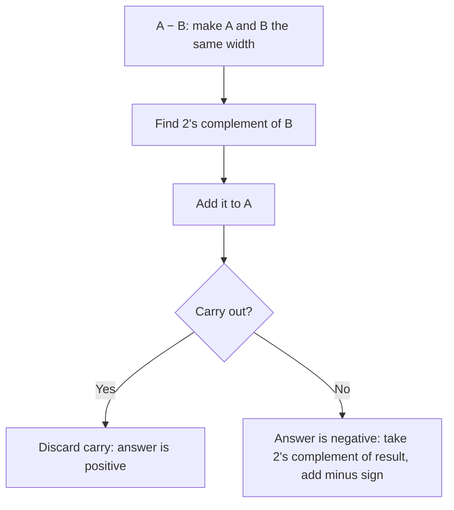

## Why should you care?

At a petrol pump, the meter shows ₹500 prepaid, and fuel worth ₹347 is filled. The machine must work out ₹500 − ₹347 = ₹153 to return. Inside, there is no "subtract" circuit at all: the processor **adds** a complement instead.

Borrowing, as you did by hand in lecture 4, is awkward for a circuit: a borrow may have to travel across many columns. Adding a complement uses the **same adder** that already exists, plus a row of NOT gates. That is how every ALU subtracts.

This lecture turns the complements from the last lecture into a working method for subtraction, a favourite 5-mark numerical in exams.

## In one line

To subtract B from A, add the complement of B to A: with 1's complement, an end-around carry is added back to the result; with 2's complement, the final carry is discarded; and if there is no carry, the result is negative and must be complemented again.

## Explained

### Q1. Why subtract using complements? ⭐

==Because $A - B = A + (-B)$, and the complement of B represents −B.==

- ==**One adder does both jobs:**== the same circuit adds and subtracts.
- ==**No borrow chains:**== a complement is just NOT gates (plus a +1 for 2's complement).
- ==**Negative results are handled automatically:**== the carry tells us the sign.
- ==**Rule before you start:**== write A and B with the **same number of bits**, padding with leading zeros.

### Q2. What are the steps for subtraction using 1's complement? ⭐

To find $A - B$:

1. ==Make A and B the same width.==
2. ==Find the 1's complement of B.==
3. ==Add it to A.==
4. ==**If there is a carry out:**== remove it and **add it to the LSB** of the result (the **end-around carry**). The answer is **positive**.
5. ==**If there is no carry:**== the answer is **negative**. Take the 1's complement of the sum and put a minus sign in front.

### Q3. Worked example: 1's complement, positive result [2M]

$(1101)_2 - (0110)_2$, that is, 13 − 6.

| Step | Working |
|---|---|
| 1's complement of B = 0110 | 1001 |
| A + complement | 1101 + 1001 = **1** 0110 |
| Carry out = 1, so end-around carry | 0110 + 1 = 0111 |
| **Answer** | **+0111 = +7** |

**Check:** 13 − 6 = 7. Correct.

### Q4. Worked example: 1's complement, negative result [2M]

$(0110)_2 - (1101)_2$, that is, 6 − 13.

| Step | Working |
|---|---|
| 1's complement of B = 1101 | 0010 |
| A + complement | 0110 + 0010 = 1000 |
| No carry out, so the result is negative | 1's complement of 1000 = 0111 |
| **Answer** | **−0111 = −7** |

**Check:** 6 − 13 = −7. Correct.

### Q5. What are the steps for subtraction using 2's complement? ⭐

To find $A - B$:

1. ==Make A and B the same width.==
2. ==Find the 2's complement of B== (1's complement + 1, or the shortcut).
3. ==Add it to A.==
4. ==**If there is a carry out:**== **discard** it. The answer is **positive**.
5. ==**If there is no carry:**== the answer is **negative**. Take the 2's complement of the sum and put a minus sign in front.

The only difference from the 1's complement method is step 4: **discard** the carry instead of adding it back.

### Q6. Worked example: 2's complement, positive result [2M]

$(1101)_2 - (0110)_2$, that is, 13 − 6.

| Step | Working |
|---|---|
| 2's complement of B = 0110 | 1001 + 1 = 1010 |
| A + complement | 1101 + 1010 = **1** 0111 |
| Carry out = 1, so discard it | 0111 |
| **Answer** | **+0111 = +7** |

### Q7. Worked example: 2's complement, negative result [2M]

$(0110)_2 - (1101)_2$, that is, 6 − 13.

| Step | Working |
|---|---|
| 2's complement of B = 1101 | 0010 + 1 = 0011 |
| A + complement | 0110 + 0011 = 1001 |
| No carry out, so the result is negative | 2's complement of 1001 = 0111 |
| **Answer** | **−0111 = −7** |

Note that 1001 is already −7 in 4-bit 2's complement. Complementing it again only converts it into sign-and-size form for writing.

### Q8. Worked example: decimal numbers in 8 bits

**(a) 45 − 20 using 2's complement.**

| Step | Working |
|---|---|
| A = 45, B = 20 | 0010 1101, 0001 0100 |
| 2's complement of B | 1110 1100 |
| A + complement | 0010 1101 + 1110 1100 = **1** 0001 1001 |
| Carry 1, discard | 0001 1001 = **+25** |

**(b) 20 − 45 using 2's complement.**

| Step | Working |
|---|---|
| A = 20, B = 45 | 0001 0100, 0010 1101 |
| 2's complement of B | 1101 0011 |
| A + complement | 0001 0100 + 1101 0011 = 1110 0111 |
| No carry: negative | 2's complement of 1110 0111 = 0001 1001 = 25 → **−25** |

### Q9. Compare 1's and 2's complement subtraction ⭐

| Point | 1's complement | 2's complement |
|---|---|---|
| ==**Complement of B**== | Invert bits | Invert bits, then add 1 |
| ==**Carry out = 1**== | Add it to the LSB (end-around carry) | Discard it |
| ==**No carry**== | Negative: take 1's complement of result | Negative: take 2's complement of result |
| ==**Number of additions**== | Can need two (sum + end-around carry) | Always one |
| ==**Zero**== | Two zeros can appear (0000, 1111) | Only one zero |
| ==**Used in computers**== | Rarely | Always |

### Q10. Subtract $(1010)_2 - (0111)_2$ using 1's complement. [2M]

| Step | Working |
|---|---|
| 1's complement of B = 0111 | 1000 |
| A + complement | 1010 + 1000 = **1** 0010 |
| ==Carry 1: end-around carry== | 0010 + 1 = 0011 |
| **Answer** | **+0011 = +3** |

**Check:** 10 − 7 = 3. Correct.

### Q11. Subtract $(0101)_2 - (1100)_2$ using 2's complement. [2M]

| Step | Working |
|---|---|
| 2's complement of B = 1100 | 0011 + 1 = 0100 |
| A + complement | 0101 + 0100 = 1001 |
| ==No carry: result is negative== | 2's complement of 1001 = 0111 |
| **Answer** | **−0111 = −7** |

**Check:** 5 − 12 = −7. Correct.

### Q12. What is an end-around carry? [2M]

==An end-around carry is the carry out of the MSB that is added back to the LSB in 1's complement subtraction.==

- ==**When it appears:**== the sum of A and the 1's complement of B produces a carry out.
- ==**What it means:**== the result is positive.
- ==**Why it is needed:**== 1's complement is one less than the true negative, so adding the carry back corrects the result by 1.
- Example: 1101 + 1001 = **1** 0110 → 0110 + 1 = 0111 (13 − 6 = 7).

### Q13. Perform $(11011)_2 - (10101)_2$ using both 1's and 2's complement. ⭐

A = 11011 (27), B = 10101 (21).

**1's complement method:**

| Step | Working |
|---|---|
| ==1's complement of B== | 01010 |
| ==A + complement== | 11011 + 01010 = **1** 00101 |
| ==Carry: end-around carry== | 00101 + 1 = 00110 |
| **Answer** | **+6** |

**2's complement method:**

| Step | Working |
|---|---|
| ==2's complement of B== | 01010 + 1 = 01011 |
| ==A + complement== | 11011 + 01011 = **1** 00110 |
| ==Carry: discard it== | 00110 |
| **Answer** | **+6** |

**Check:** 27 − 21 = 6. Correct.

### Q14. Perform (a) 58 − 23 and (b) 23 − 58 in 8 bits using 2's complement.

58 = 0011 1010, 23 = 0001 0111.

**(a) 58 − 23:**

| Step | Working |
|---|---|
| 2's complement of 23 | 1110 1001 |
| 0011 1010 + 1110 1001 | **1** 0010 0011 |
| Carry: discard | 0010 0011 = **+35** |

**(b) 23 − 58:**

| Step | Working |
|---|---|
| 2's complement of 58 | 1100 0110 |
| 0001 0111 + 1100 0110 | 1101 1101 |
| No carry: negative | 2's complement = 0010 0011 = 35 → **−35** |

## Analogy and real-life example

### Analogy: giving change the shopkeeper's way

To give change from ₹500 for a ₹347 bill, many shopkeepers do not subtract. They **count up**: "347, 350, 400, 500" and hand over 3 + 50 + 100 = ₹153. Subtraction turned into addition. Complement subtraction is the same trick done in binary: instead of taking B away, add the amount that "completes" B.

### Real system: the ALU's subtract mode

An ALU adder has a control line called SUB. When SUB = 1, every bit of B passes through an **XOR gate** that inverts it, and the adder's carry-in is set to 1. Inverted B plus 1 is the 2's complement of B, so the adder computes $A + (-B) = A - B$. One adder plus a row of XOR gates gives both operations. You will meet XOR gates in Unit 2 and adders in Unit 3.

## Diagram

## Key points

> [!important] Key points
> - $A - B = A + (-B)$; the complement of B stands for −B, so an adder can subtract.
> - First make A and B the same width.
> - 1's complement method: add 1's complement of B; if carry, add it back to the LSB (end-around carry), result positive; if no carry, result negative, take 1's complement.
> - 2's complement method: add 2's complement of B; if carry, discard it, result positive; if no carry, result negative, take 2's complement.
> - 2's complement needs only one addition and has one zero, so computers use it.
> - In hardware: XOR gates invert B and carry-in = 1 adds the 1.

## Common mistakes

> [!warning] Common mistake
> **Complementing A instead of B.** Only the number being subtracted (the subtrahend, B) is complemented.

> [!warning] Common mistake
> **Mixing up the carry rules.** End-around carry belongs to the **1's** complement method; discarding the carry belongs to the **2's** complement method.

> [!warning] Common mistake
> **Unequal widths.** For 1101 − 110, complementing 110 gives 001, which is wrong. Pad first: 0110, whose 1's complement is 1001.

> [!warning] Common mistake
> **Forgetting the minus sign.** When there is no carry, the complemented result is the **size** of the answer; the answer itself is negative.

## Sources

- M. Morris Mano, *Digital Logic and Computer Design*, Prentice Hall, Ch. 1, subtraction with complements (verify).
- Floyd, *Digital Fundamentals*, Pearson, Ch. 2, arithmetic operations with signed numbers (verify).
- University syllabus, Sem 2 Digital Electronics: BSc IT UITII-004 and BSc DS UDSII-005 (same units), Unit 1 (BOS 05/06/2026).
