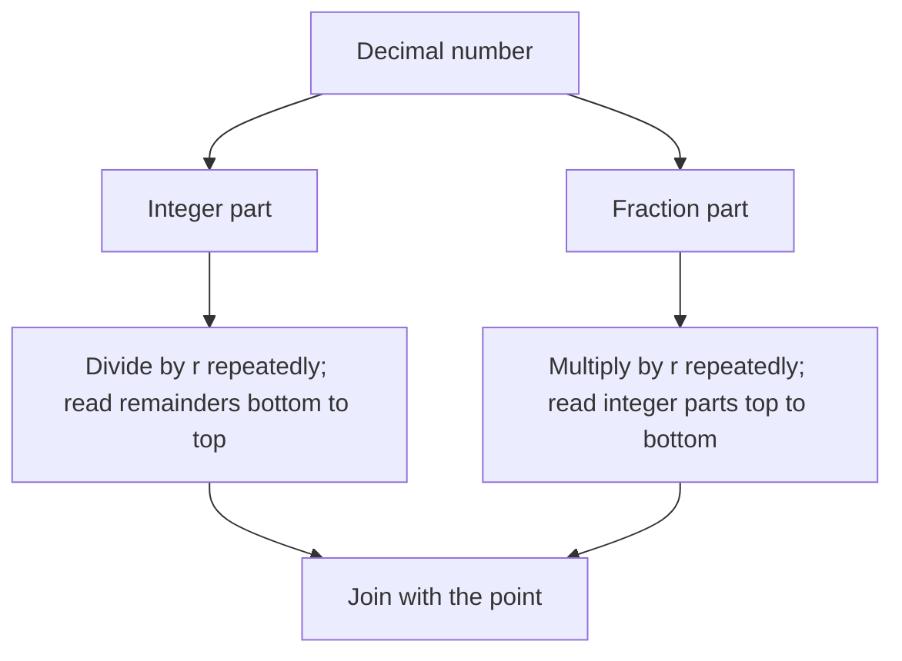

## Why should you care?

Your home Wi-Fi router has the address `192.168.1.1`. You type decimal numbers, but the router stores each part in binary: 192 becomes `11000000`. Subnet masks, firewall rules and network classes all make sense only once you can see that binary.

Now open Python and type `0.1 + 0.2`. The answer is `0.30000000000000004`, not `0.3`. The reason is in this lecture: some simple decimal fractions **cannot be written exactly in binary**, so the computer stores a close approximation.

In the last lecture you went from any base **to** decimal. Today you go the other way: from decimal **to** binary, octal and hexadecimal.

## In one line

To convert a decimal integer to base r, divide repeatedly by r and read the remainders from bottom to top; to convert a decimal fraction, multiply repeatedly by r and read the integer parts from top to bottom.

## Explained

### Q1. How do you convert a decimal integer to another base? ⭐

==Use the repeated division method: divide by the new base again and again, and collect the remainders.==

**Steps:**
1. ==Divide the number by the base r== (2, 8 or 16).
2. ==Write down the remainder;== it is always between 0 and r − 1.
3. ==Divide the quotient again by r,== and repeat.
4. ==Stop when the quotient becomes 0.==
5. ==Read the remainders from bottom to top.== The first remainder is the LSB; the last is the MSB.

For hexadecimal, ==write remainders 10–15 as A–F.==

### Q2. Worked example: decimal to binary

Convert $(25)_{10}$ to binary.

| Division | Quotient | Remainder |
|---|---|---|
| 25 ÷ 2 | 12 | 1 (LSB) |
| 12 ÷ 2 | 6 | 0 |
| 6 ÷ 2 | 3 | 0 |
| 3 ÷ 2 | 1 | 1 |
| 1 ÷ 2 | 0 | 1 (MSB) |

Reading remainders bottom to top: $(25)_{10} = (11001)_2$

**Check:** $16 + 8 + 0 + 0 + 1 = 25$. Correct.

The router example: dividing 192 by 2 repeatedly gives remainders 0, 0, 0, 0, 0, 0, 1, 1, so $(192)_{10} = (11000000)_2$.

### Q3. Worked example: decimal to octal

Convert $(175)_{10}$ to octal.

| Division | Quotient | Remainder |
|---|---|---|
| 175 ÷ 8 | 21 | 7 |
| 21 ÷ 8 | 2 | 5 |
| 2 ÷ 8 | 0 | 2 |

Bottom to top: $(175)_{10} = (257)_8$

**Check:** $2 \times 64 + 5 \times 8 + 7 = 128 + 40 + 7 = 175$. Correct. (This is the same number we converted the other way in the last lecture.)

### Q4. Worked example: decimal to hexadecimal

Convert $(687)_{10}$ to hexadecimal.

| Division | Quotient | Remainder |
|---|---|---|
| 687 ÷ 16 | 42 | 15 → F |
| 42 ÷ 16 | 2 | 10 → A |
| 2 ÷ 16 | 0 | 2 |

Bottom to top: $(687)_{10} = (2AF)_{16}$

**Check:** $2 \times 256 + 10 \times 16 + 15 = 512 + 160 + 15 = 687$. Correct.

**Tip for the division:** $687 \div 16$: $16 \times 42 = 672$, and $687 - 672 = 15$.

### Q5. How do you convert a decimal fraction to another base? ⭐

==Use the repeated multiplication method: multiply the fraction by the new base, and collect the integer parts.==

**Steps:**
1. ==Multiply the fraction by the base r.==
2. ==Write down the integer part== (0 to r − 1) of the result.
3. ==Keep only the fraction part== and multiply it again.
4. ==Stop when the fraction becomes 0,== or when you have enough digits (usually 4–5).
5. ==Read the integer parts from top to bottom.== The first one goes right after the point.

Some fractions never reach 0. Then the answer is an **approximation**, and you write how many places you kept.

### Q6. Worked example: fraction to binary

**(a) Convert $(0.625)_{10}$ to binary.**

| Multiplication | Result | Integer part |
|---|---|---|
| 0.625 × 2 | 1.25 | 1 (first) |
| 0.25 × 2 | 0.5 | 0 |
| 0.5 × 2 | 1.0 | 1 (last) |

Fraction is now 0, so stop. Top to bottom: $(0.625)_{10} = (0.101)_2$

**(b) Convert $(0.3)_{10}$ to binary (5 places).**

| Multiplication | Result | Integer part |
|---|---|---|
| 0.3 × 2 | 0.6 | 0 |
| 0.6 × 2 | 1.2 | 1 |
| 0.2 × 2 | 0.4 | 0 |
| 0.4 × 2 | 0.8 | 0 |
| 0.8 × 2 | 1.6 | 1 |

$(0.3)_{10} \approx (0.01001)_2$. The pattern 1001 repeats forever, because 0.6 appears again. This is why `0.1 + 0.2` is not exactly 0.3 in Python.

### Q7. Worked example: a mixed number to all three bases

==Convert the integer and fraction parts separately, then join them with the point.==

Convert $(10.5)_{10}$:

| Target | Integer part 10 | Fraction part 0.5 | Answer |
|---|---|---|---|
| Binary | 10 → 1010 | 0.5 × 2 = **1**.0 → .1 | $(1010.1)_2$ |
| Octal | 10 → 12 | 0.5 × 8 = **4**.0 → .4 | $(12.4)_8$ |
| Hex | 10 → A | 0.5 × 16 = **8**.0 → .8 | $(A.8)_{16}$ |

And $(25.625)_{10} = (11001.101)_2$, using the answers of Q2 and Q6(a).

### Q8. Is there a faster way to convert small numbers to binary? ⭐

==Yes: the subtraction (powers of 2) method.== It is quicker in your head for numbers up to about 255.

1. ==List the powers of 2:== 128, 64, 32, 16, 8, 4, 2, 1.
2. ==Take the largest power that fits,== subtract it, and put a 1 in its place.
3. ==Repeat with the remainder;== put 0 under every power you skip.

**Example:** $(45)_{10}$. $45 = 32 + 8 + 4 + 1$.

| 32 | 16 | 8 | 4 | 2 | 1 |
|---|---|---|---|---|---|
| 1 | 0 | 1 | 1 | 0 | 1 |

$(45)_{10} = (101101)_2$

## Analogy and real-life example

### Analogy: making change

You must pay ₹687 using only ₹256, ₹16 and ₹1 coins, using the biggest coins first. Two ₹256 coins (512) leave 175. Ten ₹16 coins (160) leave 15. Fifteen ₹1 coins finish it. The counts **2, 10, 15** are the hex digits **2, A, F**. Repeated division is just a careful way of counting coins of each size.

### Real system: floating-point numbers in Python and NumPy

A `float` in Python stores numbers in binary. Since 0.1 and 0.2 become endless binary fractions (like 0.3 in Q6), they are cut off after 52 binary places. The tiny error shows up in `0.1 + 0.2`. Data scientists meet this every day: never test floats with `==`; use `math.isclose()` or `numpy.isclose()` instead. Banking software avoids the problem by storing money in decimal formats (Python's `decimal` module) or in whole paise.

## Diagram

## Key points

> [!important] Key points
> - Integer part: divide by the base repeatedly; remainders read bottom to top (first remainder = LSB).
> - Fraction part: multiply by the base repeatedly; integer parts read top to bottom (first = just after the point).
> - Convert integer and fraction parts separately, then join them.
> - In hexadecimal, remainders 10–15 are written A–F.
> - Some decimal fractions (e.g. 0.1, 0.3) give endless binary fractions; keep a fixed number of places.
> - Shortcut for binary: break the number into powers of 2 (45 = 32 + 8 + 4 + 1 = 101101).
> - Always check by converting the answer back to decimal.

## Common mistakes

> [!warning] Common mistake
> **Reading the remainders top to bottom.** For the integer part, the first remainder is the LSB, so the remainders are read from the **bottom** up. Reading them downwards gives $(10011)_2$ for 25, which is 19.

> [!warning] Common mistake
> **Reading the fraction digits bottom to top.** For the fraction part it is the opposite: the **first** integer part goes right after the point.

> [!warning] Common mistake
> **Writing "15" as a hex digit.** A remainder of 15 is one hex digit, F. Writing it as "15" gives two digits and a wrong number.

## Exam questions

**Short answer (2–3 marks)**
1. Explain the repeated division method for converting a decimal integer to binary. ⭐
2. Convert $(156)_{10}$ to binary, octal and hexadecimal. ⭐
3. Convert $(0.8125)_{10}$ to binary, octal and hexadecimal.
4. Why can $(0.1)_{10}$ not be stored exactly in binary?

**Long answer (5 marks)**
1. Explain the methods of converting the integer part and the fraction part of a decimal number to another base. Convert $(43.375)_{10}$ to binary. ⭐
2. Convert $(250.75)_{10}$ to binary, octal and hexadecimal, showing all steps. ⭐

## Sources

- M. Morris Mano, *Digital Logic and Computer Design*, Prentice Hall, Ch. 1, conversion of decimal numbers (verify).
- Floyd, *Digital Fundamentals*, Pearson, Ch. 2, decimal-to-binary conversion (verify).
- Python documentation, *Floating Point Arithmetic: Issues and Limitations* (docs.python.org/3/tutorial/floatingpoint.html).
- University syllabus, BSc DS Sem 2, course UDSII-005, Unit 1 (BOS 05/06/2026).
