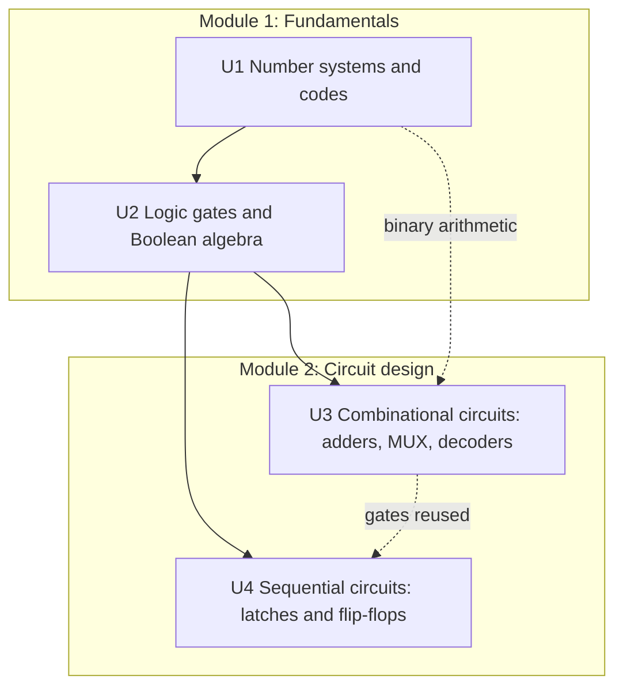

## Why this subject matters

You pay ₹40 for chai with UPI. Your phone turns the amount into a pattern of 0s and 1s, checks it, encrypts it and sends it, all in under a second.

Inside the phone there is no "40", no rupee sign and no QR code. There are only billions of tiny switches, each either **on (1)** or **off (0)**. Every photo, song, message, spreadsheet and machine learning model you will ever use is stored and processed this way.

Digital electronics is the study of how these simple on/off switches are combined to **count, add, compare, choose and remember**. It is the bottom layer of every computer, and the layer that every program you write finally runs on.

## A short story

In 1854 an English mathematician, **George Boole**, wrote an algebra for logic, where statements are only *true* or *false*. For over 80 years it looked like pure philosophy with no practical use.

In 1937 a 21-year-old student at MIT, **Claude Shannon**, noticed something. Telephone exchanges were full of relay switches that were either closed or open, and Boole's true/false algebra described them exactly. In his master's thesis he showed that any switching circuit could be **designed and simplified on paper using Boolean algebra**.

That idea turned circuit design from trial and error into mathematics. Every chip since then, from calculators to the GPUs that train today's AI models, is designed using it. You will learn the same algebra in Unit 2.

## Where it is used today

- **Phones and computers:** the processor, memory and storage are built entirely from logic gates and flip-flops.
- **Payments:** card readers, UPI soundboxes and ATMs.
- **Home and city:** digital clocks, microwave timers, set-top boxes, traffic signals, electricity smart meters.
- **Transport:** car engine controllers, FASTag readers, railway and metro signalling.
- **AI and data centres:** GPUs and AI accelerators are huge arrays of adders and multipliers, the same circuits you will design in Unit 3.
- **India's chip mission:** India is building its first semiconductor fabrication and chip-packaging plants (for example in Gujarat and Assam), creating demand for people who understand digital design.

## What you will be able to do

By the end of this course you will be able to:

- Convert numbers between binary, octal, decimal and hexadecimal, and do binary arithmetic.
- Represent negative numbers using 1's and 2's complement, and encode digits in BCD.
- Explain every basic and universal logic gate with its truth table.
- Simplify logic expressions using Boolean laws and De Morgan's theorem.
- Design adders, subtractors, multiplexers, demultiplexers and decoders.
- Explain how latches and flip-flops store a bit, and how a clock controls them.
- Build and test small circuits in a free browser simulator (CircuitVerse).

## Careers that use it

- **VLSI design and verification engineer:** designs and tests chips. Bengaluru, Hyderabad and Noida host large chip design centres of global semiconductor companies.
- **Embedded systems / firmware engineer:** programs the small computers inside devices.
- **AI hardware engineer:** works on GPUs and AI accelerators that run machine learning models fast.
- **Data and ML engineers** do not design circuits, but they choose hardware, tune memory use and understand why `float32` and `int8` behave differently. That understanding starts with number systems and binary arithmetic.

**Where this leads in your degree:** Sem 3 *Fundamentals of Microprocessor and Microcontroller* and Sem 4 *Embedded System* build directly on this course.

## Map of the subject

## Sources

- M. Morris Mano, *Digital Logic and Computer Design*, Prentice Hall, Ch. 1 (verify).
- Floyd, *Digital Fundamentals*, Pearson, Ch. 1 (verify).
- C. E. Shannon, *A Symbolic Analysis of Relay and Switching Circuits*, MIT master's thesis (1937), published in *Transactions of the AIEE*, 1938.
- G. Boole, *An Investigation of the Laws of Thought*, 1854.
- University syllabus, BSc DS Sem 2, course UDSII-005 (BOS 05/06/2026).
