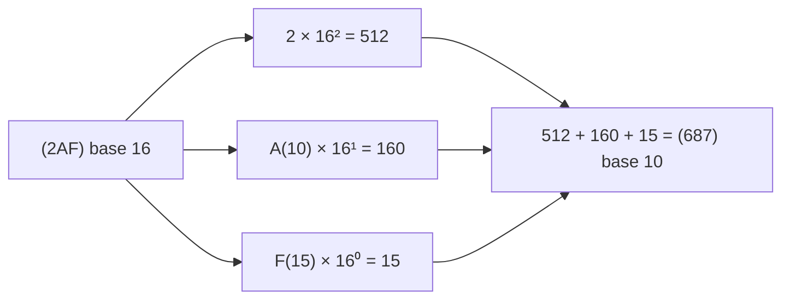

## Why should you care?

The saffron in the Indian flag, on a website, is written as `#FF9933`. A Linux file permission is written as `755`. Your phone stores the number 25 as `11001`.

These look like three different kinds of numbers, but they are the same idea: **writing a quantity using a fixed set of digits**. Only the number of digits allowed changes.

Computers work in binary (only 0 and 1). Programmers read memory addresses and colours in hexadecimal, because long strings of 0s and 1s are hard to read. To understand any digital circuit, or even a Python error showing `0x7f3a`, you must be able to move between these systems.

## In one line

A number system writes quantities using a fixed set of digits, where each digit's value depends on its position and on the base (radix), the number of distinct digits the system uses.

## Explained

### Q1. What is a number system? ⭐

==A number system is a way of representing quantities using a fixed set of symbols called digits.==

- ==**Base (radix), r:**== the number of distinct digits the system uses.
- ==**Digits run from 0 to r − 1.**== Base 10 uses 0–9; base 2 uses only 0 and 1.
- ==**The base is written as a subscript:**== $(101)_2$, $(101)_{10}$ and $(101)_{16}$ are three different numbers.

The systems we study are all **positional**: the same digit means different amounts in different places, like the 5 in 500 and in 50.

### Q2. What is positional weight?

==Each position has a weight equal to the base raised to the power of that position.==

- ==**Positions are counted from 0, starting just left of the point.**==
- ==**Moving left multiplies the weight by r;**== moving right divides it by r.
- ==**After the point, powers become negative:**== $r^{-1}, r^{-2}, \dots$

For base 10:

| Position | 2 | 1 | 0 | . | −1 | −2 |
|---|---|---|---|---|---|---|
| Weight | $10^2 = 100$ | $10^1 = 10$ | $10^0 = 1$ | . | $10^{-1} = 0.1$ | $10^{-2} = 0.01$ |

So $(345.67)_{10} = 3 \times 100 + 4 \times 10 + 5 \times 1 + 6 \times 0.1 + 7 \times 0.01$.

### Q3. What are the four number systems used in digital electronics? ⭐

| System | Base | Digits | Example | Where you see it |
|---|---|---|---|---|
| ==**Binary**== | 2 | 0, 1 | $(1011)_2$ | Inside every digital circuit |
| ==**Octal**== | 8 | 0–7 | $(257)_8$ | Linux file permissions |
| ==**Decimal**== | 10 | 0–9 | $(375)_{10}$ | Everyday human use |
| ==**Hexadecimal**== | 16 | 0–9, A–F | $(2AF)_{16}$ | Memory addresses, colour codes, MAC addresses |

In hexadecimal, ==the letters stand for values: A = 10, B = 11, C = 12, D = 13, E = 14, F = 15.==

### Q4. Why do digital systems use binary? ⭐

- ==**Two states are easy to build:**== a transistor is either on or off; a voltage is either high (about 5 V or 3.3 V) or low (about 0 V).
- ==**Reliable against noise:**== a slightly wrong voltage is still clearly "high" or "low", so small disturbances do not change the value.
- ==**Simple circuits:**== the logic for two values is much simpler than for ten.
- ==**Matches logic:**== 1 and 0 map directly to true and false, so Boolean algebra (Unit 2) can design the circuits.

### Q5. What are bit, nibble, byte, MSB and LSB? [2M]

| Term | Meaning |
|---|---|
| ==**Bit**== | One binary digit, 0 or 1 |
| ==**Nibble**== | 4 bits (one hex digit) |
| ==**Byte**== | 8 bits (two hex digits) |
| ==**MSB**== | Most significant bit: the leftmost bit, highest weight |
| ==**LSB**== | Least significant bit: the rightmost bit, weight $2^0 = 1$ |

In $(1\,0110)_2$, the MSB is the leftmost 1 (weight 16) and the LSB is the rightmost 0 (weight 1).

With n bits you can write $2^n$ different patterns: 8 bits give $2^8 = 256$ values, 0 to 255.

### Q6. How do you convert any base to decimal? ⭐

==Multiply each digit by its positional weight and add the results.==

$$N_{10} = d_{n-1} r^{n-1} + \dots + d_1 r^1 + d_0 r^0 + d_{-1} r^{-1} + d_{-2} r^{-2} + \dots$$

where $d_i$ is the digit at position $i$ and $r$ is the base.

**Steps:**
1. ==Number the positions:== 0, 1, 2 … leftwards from the point; −1, −2 … rightwards.
2. ==Write each weight== as $r^{\text{position}}$.
3. ==Multiply digit × weight== (convert A–F to 10–15 first).
4. ==Add all the products.==

### Q7. Worked example: binary to decimal [2M]

Convert $(1011.101)_2$ to decimal.

| Digit | 1 | 0 | 1 | 1 | . | 1 | 0 | 1 |
|---|---|---|---|---|---|---|---|---|
| Position | 3 | 2 | 1 | 0 | . | −1 | −2 | −3 |
| Weight | 8 | 4 | 2 | 1 | . | 0.5 | 0.25 | 0.125 |
| Product | 8 | 0 | 2 | 1 | . | 0.5 | 0 | 0.125 |

Integer part: $8 + 0 + 2 + 1 = 11$
Fraction part: $0.5 + 0 + 0.125 = 0.625$

$$(1011.101)_2 = (11.625)_{10}$$

**Shortcut for binary:** only the 1s count, so just add the weights under the 1s.

### Q8. Worked example: octal to decimal [2M]

Convert $(257)_8$ to decimal.

| Digit | 2 | 5 | 7 |
|---|---|---|---|
| Position | 2 | 1 | 0 |
| Weight | $8^2 = 64$ | $8^1 = 8$ | $8^0 = 1$ |
| Product | $2 \times 64 = 128$ | $5 \times 8 = 40$ | $7 \times 1 = 7$ |

$$(257)_8 = 128 + 40 + 7 = (175)_{10}$$

**With a fraction:** $(17.4)_8 = 1 \times 8 + 7 \times 1 + 4 \times 8^{-1} = 8 + 7 + 0.5 = (15.5)_{10}$

### Q9. Worked example: hexadecimal to decimal [2M]

Convert $(2AF)_{16}$ to decimal. First replace letters: A = 10, F = 15.

| Digit | 2 | A (10) | F (15) |
|---|---|---|---|
| Position | 2 | 1 | 0 |
| Weight | $16^2 = 256$ | $16^1 = 16$ | $16^0 = 1$ |
| Product | $2 \times 256 = 512$ | $10 \times 16 = 160$ | $15 \times 1 = 15$ |

$$(2AF)_{16} = 512 + 160 + 15 = (687)_{10}$$

**Back to the flag:** `#FF9933` is three hex pairs for red, green and blue. FF = $15 \times 16 + 15 = 255$, 99 = $9 \times 16 + 9 = 153$, 33 = $3 \times 16 + 3 = 51$. So saffron is red 255, green 153, blue 51.

### Q10. How do you count in each system? [2M]

When a position runs out of digits, it ==resets to 0 and carries 1 to the next position== on the left.

| Decimal | Binary | Octal | Hex |
|---|---|---|---|
| 0 | 0000 | 0 | 0 |
| 1 | 0001 | 1 | 1 |
| 2 | 0010 | 2 | 2 |
| 3 | 0011 | 3 | 3 |
| 4 | 0100 | 4 | 4 |
| 5 | 0101 | 5 | 5 |
| 6 | 0110 | 6 | 6 |
| 7 | 0111 | 7 | 7 |
| 8 | 1000 | 10 | 8 |
| 9 | 1001 | 11 | 9 |
| 10 | 1010 | 12 | A |
| 11 | 1011 | 13 | B |
| 12 | 1100 | 14 | C |
| 13 | 1101 | 15 | D |
| 14 | 1110 | 16 | E |
| 15 | 1111 | 17 | F |
| 16 | 1 0000 | 20 | 10 |

Learn this table by heart: the next two lectures (decimal to other bases, and binary ↔ octal ↔ hex grouping) use it constantly.

### Q11. Convert $(110101.11)_2$ to decimal. [2M]

| Digit | 1 | 1 | 0 | 1 | 0 | 1 | . | 1 | 1 |
|---|---|---|---|---|---|---|---|---|---|
| Weight | 32 | 16 | 8 | 4 | 2 | 1 | . | 0.5 | 0.25 |

==Add the weights under the 1s:==
- Integer: $32 + 16 + 4 + 1 = 53$
- Fraction: $0.5 + 0.25 = 0.75$

$$(110101.11)_2 = (53.75)_{10}$$

### Q12. Convert $(3B7)_{16}$ and $(645)_8$ to decimal. [2M]

**Hex:** B = 11.

$(3B7)_{16} = 3 \times 16^2 + 11 \times 16^1 + 7 \times 16^0 = 768 + 176 + 7 = (951)_{10}$

**Octal:**

$(645)_8 = 6 \times 8^2 + 4 \times 8^1 + 5 \times 8^0 = 384 + 32 + 5 = (421)_{10}$

### Q13. Convert $(10110.011)_2$, $(127.4)_8$ and $(1C.8)_{16}$ to decimal. ⭐

==Multiply each digit by its positional weight and add.==

**(a) Binary:**
- Integer 10110: $16 + 4 + 2 = 22$
- Fraction .011: $0 \times 0.5 + 1 \times 0.25 + 1 \times 0.125 = 0.375$
- $(10110.011)_2 = (22.375)_{10}$

**(b) Octal:**
- $1 \times 64 + 2 \times 8 + 7 \times 1 + 4 \times 8^{-1} = 64 + 16 + 7 + 0.5$
- $(127.4)_8 = (87.5)_{10}$

**(c) Hex** (C = 12):
- $1 \times 16 + 12 \times 1 + 8 \times 16^{-1} = 16 + 12 + 0.5$
- $(1C.8)_{16} = (28.5)_{10}$

> [!beyond] Beyond the syllabus
> The positional decimal system with a symbol for zero was developed in India. Brahmagupta (628 CE) gave rules for calculating with zero, and the system reached Europe through Arab mathematicians, which is why the digits are called "Hindu-Arabic numerals". Binary, octal and hex are the same place-value idea with a different base.

## Analogy and real-life example

### Analogy: the odometer

A scooter's odometer has wheels with digits 0–9. When a wheel passes 9, it rolls back to 0 and pushes the next wheel up by one: 0009 becomes 0010.

A **binary odometer** would have wheels with only 0 and 1. It rolls over after 1: 0001 becomes 0010. A **hex odometer** would roll over after F: 000F becomes 0010. Same machine, different number of digits per wheel. That number is the base.

### Real systems

- **Web colours:** `#FF9933` (saffron), `#138808` (India green) are hex.
- **Linux permissions:** `chmod 755 script.sh` uses octal: each digit packs three permission bits (read, write, execute).
- **Memory addresses:** Python shows object addresses like `0x7f3a2c` in hex. In Sem 4 Embedded Systems, the 8051's registers are written as `0x80`, `0xA0` and so on.
- **Network cards:** a MAC address such as `3C:52:82:1A:9F:04` is six hex bytes.

## Diagram

## Key points

> [!important] Key points
> - Number system: digits 0 to r − 1, where r is the base (radix).
> - Positional weight = $r^{\text{position}}$; positions 0, 1, 2 … leftwards from the point, −1, −2 … rightwards.
> - Binary (2): 0, 1. Octal (8): 0–7. Decimal (10): 0–9. Hexadecimal (16): 0–9, A–F (A = 10 … F = 15).
> - Any base to decimal: multiply each digit by its weight and add.
> - Binary is used because two states are easy to build, reliable against noise and match true/false logic.
> - Bit = 1 binary digit; nibble = 4 bits; byte = 8 bits. MSB is leftmost, LSB is rightmost.
> - n bits give $2^n$ patterns (8 bits: 0 to 255).

## Common mistakes

> [!warning] Common mistake
> **Reading binary 10 as "ten".** $(10)_2$ is two, $(10)_8$ is eight, $(10)_{16}$ is sixteen. Always write the base subscript in exams; without it the examiner may assume decimal.

> [!warning] Common mistake
> **Using a digit the base does not have.** There is no digit 8 or 9 in octal and no digit 2 in binary. $(189)_8$ is not a valid number.

> [!warning] Common mistake
> **Starting positions at 1.** The digit just left of the point is position 0 (weight $r^0 = 1$), and the first digit after the point is position −1, not 0.

## Sources

- M. Morris Mano, *Digital Logic and Computer Design*, Prentice Hall, Ch. 1, number systems and base conversion (verify).
- Floyd, *Digital Fundamentals*, Pearson, Ch. 2, number systems (verify).
- R. P. Jain, *Modern Digital Electronics*, Tata McGraw Hill, Ch. 2 (verify).
- University syllabus, BSc DS Sem 2, course UDSII-005, Unit 1 (BOS 05/06/2026).
