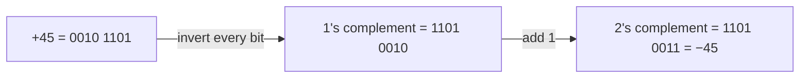

## Why should you care?

Your phone's processor has a circuit to **add**. Does it also have a separate circuit to **subtract**, and another to handle negative numbers?

No. Engineers found a trick: write negative numbers in a special form called **2's complement**, and the same adder handles positive numbers, negative numbers and subtraction. Fewer circuits mean a smaller, cheaper and faster chip.

Every computer, phone, microcontroller and GPU in use today stores signed integers in 2's complement. When Python prints `-1` or NumPy stores an `int8`, the bits underneath are 2's complement. This lecture shows how to form it and why it wins.

## In one line

The 1's complement of a binary number is formed by inverting every bit, and the 2's complement is the 1's complement plus 1; in 2's complement form, a negative number −N is stored as the 2's complement of N.

## Explained

### Q1. What is the 1's complement of a binary number? ⭐

==The 1's complement is obtained by inverting every bit: change each 0 to 1 and each 1 to 0.==

| Number | 1's complement |
|---|---|
| 0101 (5) | 1010 |
| 0010 1101 (45) | 1101 0010 |

- ==**As a representation:**== −N is written as the 1's complement of +N. In 4 bits, +5 = 0101, so −5 = 1010.
- ==**The MSB still shows the sign:**== 1 means negative.
- ==**Range (n bits):**== $-(2^{n-1}-1)$ to $+(2^{n-1}-1)$; 8 bits gives −127 to +127.
- ==**Drawback: still two zeros**== (0000 and 1111).

In a circuit, a 1's complement is just a row of NOT gates.

### Q2. How do you find the 2's complement? ⭐

==The 2's complement is the 1's complement plus 1.==

**Method 1 (invert, then add 1):**
1. ==Write the number with the full width== (e.g. 8 bits).
2. ==Invert every bit== (1's complement).
3. ==Add 1== to the result.

**Method 2 (shortcut):**
1. ==Start from the right (LSB).==
2. ==Copy every bit up to and including the first 1.==
3. ==Invert all the remaining bits== to the left.

Both methods always give the same answer. Use Method 2 to save time; use Method 1 to check.

### Q3. Worked example: 2's complement by both methods [2M]

Find the 2's complement of $(0010\,1101)_2$ (that is, +45) to get −45.

**Method 1:**

| Step | Bits |
|---|---|
| Number | 0010 1101 |
| 1's complement | 1101 0010 |
| Add 1 | + 0000 0001 |
| **2's complement** | **1101 0011** |

**Method 2:** the first 1 from the right is the very last bit. Copy it (1), invert the rest: 0010110 → 1101001.
Result: **1101 0011**. Same answer.

So in 8-bit 2's complement, **−45 = 1101 0011**.

**Check:** $256 - 45 = 211$, and $(1101\,0011)_2 = 128 + 64 + 16 + 2 + 1 = 211$. Correct.

### Q4. Worked example: the shortcut on a number ending in zeros [2M]

Find the 2's complement of $(0110\,1000)_2$ (+104).

| Part | Bits | Action |
|---|---|---|
| Rightmost bits up to the first 1 | 1000 | copy as it is |
| Remaining bits | 0110 | invert → 1001 |

Result: **1001 1000** = −104.

**Check:** $256 - 104 = 152 = 128 + 16 + 8 = (1001\,1000)_2$. Correct.

### Q5. How do you read a negative 2's complement number?

If the MSB is 0, read it normally. If the MSB is 1, the number is negative. Two ways to find its value:

- ==**Take the 2's complement again**== and put a minus sign. 1101 0011 → 0010 1101 = 45, so the value is **−45**.
- ==**Give the MSB a negative weight,** $-2^{n-1}$.== In 8 bits, the weights are −128, 64, 32, 16, 8, 4, 2, 1.
  1101 0011 = −128 + 64 + 16 + 2 + 1 = **−45**.

==Taking the 2's complement twice gives back the original number.==

Useful patterns (8-bit): 1111 1111 = −1, 1000 0000 = −128 (the most negative), 0111 1111 = +127.

### Q6. Why do all computers use 2's complement? ⭐

- ==**Only one zero:**== 0000 0000. Inverting it gives 1111 1111; adding 1 gives 1 0000 0000, and the extra carry is dropped, so we are back to zero.
- ==**One extra value:**== the range is −128 to +127 for 8 bits, instead of −127 to +127.
- ==**Addition just works:**== add the bit patterns with an ordinary adder and drop the final carry; the result is correct for positive and negative numbers.
- ==**Subtraction becomes addition:**== $A - B = A + (\text{2's complement of } B)$. No separate subtractor is needed (next lecture).
- ==**Simple hardware:**== NOT gates plus an adder with carry-in set to 1.

**Example:** +5 + (−3) in 4 bits: 0101 + 1101 = **1** 0010. Drop the carry: 0010 = +2. Correct.

### Q7. How do the three signed forms compare? ⭐

All values in 4 bits:

| Decimal | Sign-magnitude | 1's complement | 2's complement |
|---|---|---|---|
| +7 | 0111 | 0111 | 0111 |
| +5 | 0101 | 0101 | 0101 |
| +0 | 0000 | 0000 | 0000 |
| −0 | 1000 | 1111 | (none) |
| −1 | 1001 | 1110 | 1111 |
| −5 | 1101 | 1010 | 1011 |
| −7 | 1111 | 1000 | 1001 |
| −8 | (none) | (none) | 1000 |
| ==**Zeros**== | two | two | one |
| ==**Range**== | −7 to +7 | −7 to +7 | −8 to +7 |

### Q8. Find the 1's and 2's complement of $(1011\,0100)_2$. [2M]

| Step | Bits |
|---|---|
| Number | 1011 0100 |
| ==1's complement (invert every bit)== | 0100 1011 |
| ==2's complement (add 1)== | 0100 1100 |

**Shortcut check:** copy "100" (up to the first 1 from the right), invert "10110" → "01001": 0100 1100. Same answer.

### Q9. Represent −37 in 8-bit sign-magnitude, 1's complement and 2's complement form. [2M]

First, $+37 = 32 + 4 + 1 = 0010\,0101$.

| Form | Method | −37 |
|---|---|---|
| ==Sign-magnitude== | Set the sign bit to 1 | 1010 0101 |
| ==1's complement== | Invert every bit of +37 | 1101 1010 |
| ==2's complement== | 1's complement + 1 | 1101 1011 |

**Check (2's):** $-128 + 64 + 16 + 8 + 2 + 1 = -37$. Correct.

### Q10. Find the decimal value of the 8-bit 2's complement number 1110 0110. [2M]

==MSB is 1, so the number is negative.==

**Method 1 (negative MSB weight):** $-128 + 64 + 32 + 4 + 2 = -26$

**Method 2 (complement again):** 2's complement of 1110 0110 = 0001 1010 = 26, so the value is **−26**.

## Analogy and real-life example

### Analogy: the scooter odometer going backwards

A 4-digit odometer reads 0000. Roll it back by one km and it shows 9999. Roll back five and it shows 9995. If we agree that numbers near 9999 mean "just below zero", then 9995 means −5, and adding works naturally: 9995 + 7 = 1 0002, and the odometer shows 0002, which is −5 + 7 = 2.

2's complement is this odometer in binary. In 4 bits, one step back from 0000 is 1111 (−1), five steps back is 1011 (−5).

### Real system: `-1` in Python and C

In C on the 8051 (Sem 4), `signed char x = -1;` stores 1111 1111 (`0xFF`) in memory. Python shows this too: `(-1) & 0xFF` gives `255`, because it reveals the 8-bit 2's complement pattern of −1. Network checksums, CPU flags and audio samples (16-bit 2's complement in WAV files) all use the same idea.

## Diagram

## Key points

> [!important] Key points
> - 1's complement: invert every bit (0 ↔ 1).
> - 2's complement: 1's complement + 1.
> - Shortcut: from the right, copy bits up to and including the first 1, invert the rest.
> - Negative numbers: −N is stored as the complement of +N at the full width; the MSB becomes 1.
> - 1's complement: two zeros (0000, 1111); range $-(2^{n-1}-1)$ to $+(2^{n-1}-1)$.
> - 2's complement: one zero; range $-2^{n-1}$ to $+(2^{n-1}-1)$ (8-bit: −128 to +127).
> - In 2's complement the MSB has weight $-2^{n-1}$ (8-bit: −128).
> - All modern computers use 2's complement: one zero, and subtraction becomes addition.

## Common mistakes

> [!warning] Common mistake
> **Not fixing the width first.** The 2's complement of 101 (5) depends on the width: in 4 bits it is 1011, in 8 bits it is 1111 1011. Always pad with leading zeros to the given width **before** inverting.

> [!warning] Common mistake
> **Inverting the copied part in the shortcut.** In 0110 1000, the bits "1000" (up to and including the first 1 from the right) stay as they are. Only the bits to their left are inverted.

> [!warning] Common mistake
> **Reading 1101 0011 as 211.** If the number is declared signed (2's complement), an MSB of 1 means negative: it is −45, not 211.

## Sources

- M. Morris Mano, *Digital Logic and Computer Design*, Prentice Hall, Ch. 1, complements and signed binary numbers (verify).
- Floyd, *Digital Fundamentals*, Pearson, Ch. 2, 1's and 2's complements (verify).
- University syllabus, Sem 2 Digital Electronics: BSc IT UITII-004 and BSc DS UDSII-005 (same units), Unit 1 (BOS 05/06/2026).
