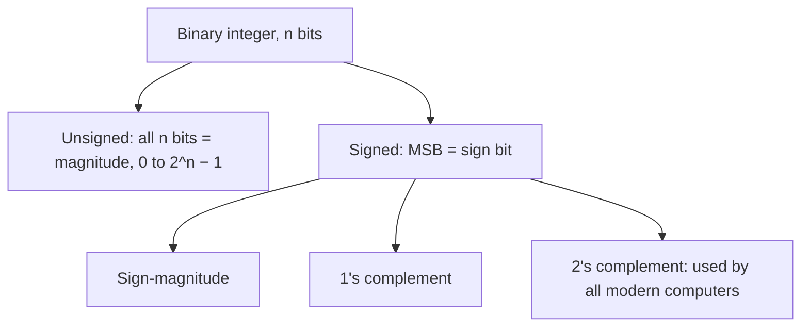

## Why should you care?

In 2014, YouTube's view counter for the song *Gangnam Style* hit a wall at **2,147,483,647** views. That number is $2^{31} - 1$, the largest value a 32-bit **signed** integer can hold. YouTube had to switch the counter to a 64-bit integer.

Closer to home: a cold-storage sensor must show −18 °C, a bank statement must show a negative balance, and a photo stores each pixel as a number from 0 to 255. Some quantities can be negative and some cannot.

A circuit only has bits, with no "minus sign" key. So we must **agree** on how a bit pattern shows a negative number, and know how far each kind of number can go before it overflows.

## In one line

An unsigned number uses all n bits for magnitude (range 0 to $2^n - 1$), while a signed number uses the MSB as a sign bit (0 for positive, 1 for negative) so it can represent both positive and negative values.

## Explained

### Q1. What is an unsigned number? ⭐

==An unsigned number has no sign: all n bits represent the magnitude,== so it can only be zero or positive.

- ==**Range:** 0 to $2^n - 1$.==
- ==**Example (8 bits):**== 0000 0000 = 0 and 1111 1111 = 255.
- ==**Used for quantities that are never negative:**== pixel values, memory addresses, counts, ages, ASCII codes.

| Bits n | Unsigned range |
|---|---|
| 4 | 0 to 15 |
| 8 | 0 to 255 |
| 16 | 0 to 65,535 |

### Q2. What is a signed number?

==A signed number can be positive or negative; the MSB is used as the sign bit.==

- ==**Sign bit 0 means positive;**== sign bit 1 means negative.
- ==**The remaining n − 1 bits**== hold the magnitude, in one of three ways.
- ==**Three representations:**== sign-magnitude, 1's complement and 2's complement.

In all three, **positive numbers look the same**: a 0 sign bit followed by the ordinary binary value. They differ only in how they write **negative** numbers. This lecture covers sign-magnitude; the next covers the complements.

### Q3. What is sign-magnitude representation? ⭐

==The MSB is the sign and the other n − 1 bits are the magnitude in plain binary.==

| Decimal | 4-bit | 8-bit |
|---|---|---|
| +5 | **0**101 | **0**000 0101 |
| −5 | **1**101 | **1**000 0101 |
| +0 | **0**000 | **0**000 0000 |
| −0 | **1**000 | **1**000 0000 |

- ==**To negate a number, flip only the sign bit.**==
- ==**Range:** $-(2^{n-1} - 1)$ to $+(2^{n-1} - 1)$.== For 8 bits: −127 to +127.

It is the way humans write numbers (a sign, then the size), which makes it easy to read.

### Q4. What are the problems with sign-magnitude? ⭐

- ==**Two zeros:**== +0 (0000) and −0 (1000). Every comparison with zero must check both, which wastes hardware.
- ==**Addition needs extra logic:**== to add +5 and −3, the circuit must compare signs and sizes, then decide whether to add or subtract. Simply adding the bit patterns gives a wrong answer: 0101 + 1011 = 10000, not +2.
- ==**One value is wasted**== on the second zero, so the range is one smaller than it could be.

These problems are why computers use **2's complement** instead (next lecture). Sign-magnitude survives where readability matters, for example in the sign bit of floating-point numbers.

### Q5. Can one bit pattern mean different numbers?

==Yes: a bit pattern has no meaning until you know the representation.== The same 4 bits, read four ways:

| Pattern | Unsigned | Sign-magnitude | 1's complement | 2's complement |
|---|---|---|---|---|
| 0101 | 5 | +5 | +5 | +5 |
| 1101 | 13 | −5 | −2 | −3 |
| 1000 | 8 | −0 | −7 | −8 |
| 1111 | 15 | −7 | −0 | −1 |

Positive patterns (MSB 0) agree everywhere. Patterns with MSB 1 disagree. That is why every programming language makes you declare a type: `unsigned char` or `char` in C, `uint8` or `int8` in NumPy.

### Q6. How do the ranges compare? ⭐

| Representation | n-bit range | 8-bit range | Zeros |
|---|---|---|---|
| Unsigned | ==0 to $2^n - 1$== | 0 to 255 | one |
| Sign-magnitude | ==$-(2^{n-1}-1)$ to $+(2^{n-1}-1)$== | −127 to +127 | two |
| 1's complement | ==$-(2^{n-1}-1)$ to $+(2^{n-1}-1)$== | −127 to +127 | two |
| 2's complement | ==$-2^{n-1}$ to $+(2^{n-1}-1)$== | −128 to +127 | one |

All n-bit systems have $2^n$ patterns. Signed systems spend half of them on negative values, so the largest positive value is about half the unsigned one.

**Gangnam Style again:** a 32-bit signed counter tops out at $2^{31} - 1 = 2{,}147{,}483{,}647$.

## Analogy and real-life example

### Analogy: a thermometer and a measuring tape

A measuring tape starts at 0 and only goes up: it is **unsigned**. A thermometer has a 0 in the middle and goes both ways: it is **signed**. Both may have the same number of markings, but the thermometer spends half of them below zero, so it cannot go as high.

### Real system: `uint8` and `int8` in NumPy

Images are stored as `uint8` arrays (pixels 0–255). Small AI models on phones are often **quantized** to `int8` (−128 to 127) to save memory. Going past the range does not raise an error; the value **wraps around**:

```python
import numpy as np
print(np.array([250], dtype=np.uint8) + np.uint8(10))   # 260 does not fit in 0–255
print(np.array([127], dtype=np.int8) + np.int8(1))      # 128 does not fit in −128..127
```

```output
[4]
[-128]
```

260 wraps to 260 − 256 = 4. 127 + 1 wraps to −128. Brightening an image without converting it to a wider type first turns bright pixels dark for exactly this reason.

## Diagram



## Key points

> [!important] Key points
> - Unsigned: all n bits are magnitude; range 0 to $2^n - 1$ (8-bit: 0 to 255).
> - Signed: MSB is the sign bit, 0 = positive, 1 = negative.
> - Three signed forms: sign-magnitude, 1's complement, 2's complement. Positive numbers look the same in all three.
> - Sign-magnitude: sign bit + plain magnitude; range $-(2^{n-1}-1)$ to $+(2^{n-1}-1)$ (8-bit: −127 to +127).
> - Sign-magnitude problems: two zeros (0000 and 1000), addition needs sign comparison logic.
> - 2's complement range: $-2^{n-1}$ to $+(2^{n-1}-1)$ (8-bit: −128 to +127).
> - A bit pattern's meaning depends on the representation chosen.

## Common mistakes

> [!warning] Common mistake
> **Writing −5 as 1101 without fixing the width.** The sign bit is always the **MSB of the fixed width**. In 8 bits, −5 in sign-magnitude is 1000 0101, not 0000 1101.

> [!warning] Common mistake
> **Thinking a 1 in front always means negative.** 1101 is 13 if the number is unsigned. Only a signed representation treats the MSB as a sign.

## Exam questions

**Short answer (2–3 marks)**
1. Differentiate between signed and unsigned numbers. ⭐
2. Represent +45 and −45 in 8-bit sign-magnitude form. ⭐
3. What is the range of an 8-bit unsigned number and an 8-bit sign-magnitude number?
4. Why does sign-magnitude representation have two zeros?

**Long answer (5 marks)**
1. Explain signed and unsigned number representation. Explain sign-magnitude representation with examples and its drawbacks. ⭐
2. Write the range of n-bit numbers in unsigned, sign-magnitude, 1's complement and 2's complement form. Give the 8-bit ranges and explain why they differ. ⭐

## Sources

- M. Morris Mano, *Digital Logic and Computer Design*, Prentice Hall, Ch. 1, signed binary numbers (verify).
- Floyd, *Digital Fundamentals*, Pearson, Ch. 2, signed numbers (verify).
- NumPy documentation, *Data types* and overflow behaviour (numpy.org/doc/stable/user/basics.types.html).
- University syllabus, BSc DS Sem 2, course UDSII-005, Unit 1 (BOS 05/06/2026).
