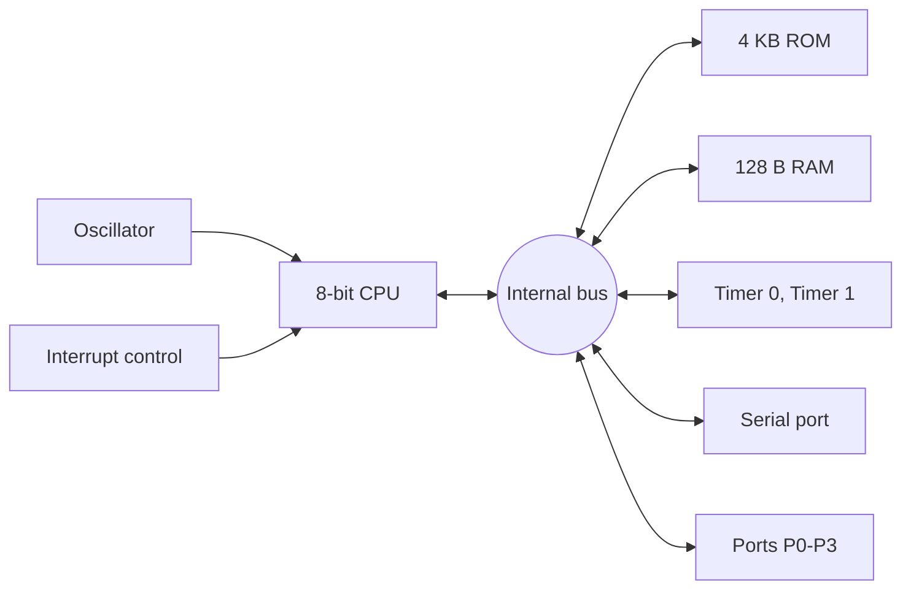

## Aim

To study the architecture and programming environment of the 8051 microcontroller, and to write, compile and execute a basic Embedded C program that adds two numbers and displays the result on Port 1.

<!-- Covers syllabus practicals 1 and 2 of Unit 1 (architecture study; write, compile, execute), as grouped in _index.md. -->

## Concepts used

- [[embedded-vs-general-purpose-systems]]
- [[8051-architecture]] (theory, Unit 3)

## Before the lab

- **Install:** Keil µVision 5 with the **C51** compiler (free evaluation version from keil.com; the 2 KB code limit is enough for all our practicals).
- **Revise first:** [[embedded-vs-general-purpose-systems]] (what firmware is), and hexadecimal-to-binary conversion (0x59 = 0101 1001).
- **Know these words:** project, device, build, HEX file, simulator. They are explained in Part B of the Explanation.
- **Have ready:** a folder on your PC for Embedded Systems practicals, one sub-folder per practical.

## Setup

### Tool

Keil µVision 5 with the C51 compiler (free evaluation version, enough for all our practicals). No board is needed: Keil's built-in simulator runs the program. Proteus is used from later practicals, when we attach LEDs and displays.

## Steps

1. Open **Keil µVision 5**.
   *You should see:* the µVision window, with an empty **Project** pane on the left.
2. Click **Project → New µVision Project**, make a new folder named `add_p1`, type the project name `add_p1` and click **Save**.
   *You should see:* the **Select Device for Target** window.
3. Type `AT89C51` in the search box, select it (under Microchip, or Atmel in older versions) and click **OK**.
   *You should see:* a question asking whether to copy `STARTUP.A51` to the project folder.
4. Click **No** (the C51 library already has start-up code).
   *You should see:* **Target 1 → Source Group 1** in the Project pane.
5. Click **Project → Options for Target 'Target 1'**, and on the **Target** tab set **Xtal (MHz)** to `11.0592`.
   *You should see:* 11.0592 in the Xtal box.
6. On the **Output** tab, tick **Create HEX File**, then click **OK**.
   *You should see:* the dialog close.
7. Click **File → New**, type the code from the **Code** section below, then **File → Save As** `main.c` in the project folder.
   *You should see:* the code turn coloured (keywords in blue) once it is saved as a `.c` file.
8. Right-click **Source Group 1 → Add Existing Files to Group 'Source Group 1'**, select `main.c`, click **Add**, then **Close**.
   *You should see:* `main.c` listed under Source Group 1.
9. Press **F7** (Build).
   *You should see:* the Build Output window end with `"add_p1" - 0 Error(s), 0 Warning(s).` and a line `creating hex file from "add_p1"...`.
10. Press **Ctrl+F5** (Start/Stop Debug Session).
    *You should see:* an evaluation-mode message about the 2K code size limit (click **OK**), then the debug layout with registers on the left.
11. Click **Peripherals → I/O-Ports → Port 1**.
    *You should see:* the Port 1 window showing P1 = 0xFF, with all eight boxes ticked (the reset value).
12. Press **F5** (Run).
    *You should see:* P1 change to **0x59**, with boxes ticked for bits 0, 3, 4 and 6.
13. Press **Ctrl+F5** again to end the debug session.
    *You should see:* the normal editor layout return.

## Code

```c
#include <reg51.h>   // names for the 8051's special function registers: P0-P3, ACC, PSW...

void main(void)
{
    unsigned char a = 0x25;   // first number  (37 in decimal)
    unsigned char b = 0x34;   // second number (52 in decimal)
    unsigned char sum;

    sum = a + b;              // 0x25 + 0x34 = 0x59 (89 in decimal)
    P1 = sum;                 // send the result to the 8 pins of Port 1

    while (1);                // stay here forever: an embedded program never "ends"
}
```

## Output

```output
Build Output:  "add_p1" - 0 Error(s), 0 Warning(s).

Peripherals -> I/O-Ports -> Port 1
P1 = 0x59     bits 7..0 = 0 1 0 1 1 0 0 1
```

<!-- For Prathamesh: P1 = 0x59 (0b01011001) was verified by compiling the same program with SDCC and running it
     in the s51 8051 simulator (Keil's reg51.h swapped for SDCC's 8051.h). Take a Keil screenshot of the Port 1
     window for the journal and save it as ../assets/img/embedded-systems/add-p1-port1.png, with alt text. -->

## Explanation

### Part A: the 8051 at a glance

==The 8051 is an 8-bit **microcontroller**==: processor, memory, I/O ports and timers on one chip.

| Feature | 8051 |
|---|---|
| CPU | 8-bit (works on one byte at a time) |
| On-chip ROM (program) | 4 KB |
| On-chip RAM (data) | 128 bytes |
| I/O ports | 4 ports, P0–P3, 8 pins each (32 I/O lines) |
| Timers/counters | 2, each 16-bit (Timer 0, Timer 1) |
| Serial port | 1 full-duplex UART |
| Interrupt sources | 5 (2 external, 2 timer, 1 serial) |
| Package | 40-pin DIP |

==The 8051 has 4 KB ROM, 128 bytes RAM, four 8-bit ports, two 16-bit timers and one serial port.==

### Part A: block diagram



Our program used three blocks: **ROM** (holds the program), **RAM** (holds `a`, `b`, `sum`) and **Port 1** (shows the result).

### Part B: the programming environment

==Embedded C program → compiler → HEX file → simulator or microcontroller.==

- ==**Keil µVision** is an IDE== (integrated development environment): editor, compiler, linker and simulator in one window.
- The **C51 compiler** turns C into 8051 machine code. Because it runs on a PC but produces code for a different processor, ==it is called a **cross compiler**==.
- ==The **HEX file** is the machine code in a text format==. Later, a programmer device "burns" it into the real chip's ROM.
- ==The **simulator** pretends to be an 8051== on your PC, so you can test without hardware.

### Part B: line by line

- `#include <reg51.h>` gives names to the 8051's special function registers. Without it, the compiler would not know what `P1` means.
- `unsigned char` is 8 bits (0 to 255). It matches the 8051's 8-bit registers, so it is the fastest and most common type in 8051 C.
- `P1 = sum;` writes the byte to Port 1. Each bit drives one pin: a 1 makes the pin high, a 0 makes it low.
- `while (1);` keeps the CPU busy forever. A microcontroller has no operating system to return to, so `main()` must never end.

### Why 0x59?

0x25 + 0x34:
- Low digit: 5 + 4 = 9
- High digit: 2 + 3 = 5
- Result: 0x59 = 0101 1001 in binary = 89 in decimal.

In the Port 1 window, pins P1.0, P1.3, P1.4 and P1.6 are ticked (high), matching the 1-bits of 0101 1001 read from bit 0 upwards. On a real board with LEDs on Port 1, those four LEDs would change state.

## Common errors and fixes

| Message or symptom | Cause | Fix |
|---|---|---|
| `main.c(10): error C202: 'P1': undefined identifier` | `#include <reg51.h>` is missing or misspelt, so the compiler does not know the name P1 | Add `#include <reg51.h>` as the first line |
| `error C141: syntax error near ...` | A missing `;` or `}` on the line shown or the line **before** it | Check the end of the previous line first |
| Build Output shows only `linking...`, no `compiling main.c...` | `main.c` was saved but never added to Source Group 1 | Do step 8 |
| No `creating hex file` line; no `.hex` file in the folder | **Create HEX File** was not ticked | Do step 6, then build again |
| Port 1 window still shows 0xFF | The program was not run, or the window was opened outside a debug session | Start debugging (Ctrl+F5), then press F5 |
| Code is black, not coloured, and will not compile | The file was saved as `.txt` or without an extension | Save it again as `main.c` |

## Try it

Change the numbers to `a = 200;` and `b = 100;`. Before running, predict what Port 1 will show.

> [!answer]- Answer: P1 = 0x2C (44)
> 200 + 100 = 300, but an `unsigned char` holds only 0 to 255. The extra 256 is lost (it would be the carry), so 300 − 256 = 44 = 0x2C. This is why choosing the right data type matters on an 8-bit microcontroller.

## Viva questions

1. **What is a microcontroller? How is it different from a microprocessor?** A microcontroller has CPU, memory, I/O ports and timers on one chip; a microprocessor has only the CPU and needs external chips for the rest.
2. **State the on-chip ROM, RAM, ports and timers of the 8051.** 4 KB ROM, 128 bytes RAM, four 8-bit ports, two 16-bit timers.
3. **What is a cross compiler?** A compiler that runs on one machine (the PC) but produces code for another processor (the 8051).
4. **What is a HEX file and why do we create it?** It holds the machine code in text form; it is loaded into the microcontroller's ROM using a programmer.
5. **Why does an embedded C program end with `while(1)`?** There is no operating system to return to, so the program must keep running.
6. **Why do we use `unsigned char` so often in 8051 C?** It is 8 bits, the natural size of the 8051's registers, so it uses the least memory and runs fastest.
7. **What is the use of `reg51.h`?** It defines names such as P0–P3 and ACC for the special function registers.
8. **Why is 11.0592 MHz a common crystal frequency for the 8051?** It divides evenly to give standard serial baud rates such as 9600.

## Sources

- Muhammad Ali Mazidi and Janice Mazidi, *The 8051 Microcontroller and Embedded Systems*, Pearson, Ch. 1 (8051 features) and Ch. 7 (8051 programming in C) (verify).
- Arm Keil, *µVision User's Guide* and *C51 Compiler documentation*, keil.com.
- Intel, *MCS-51 Microcontroller Family User's Manual* (verify).
