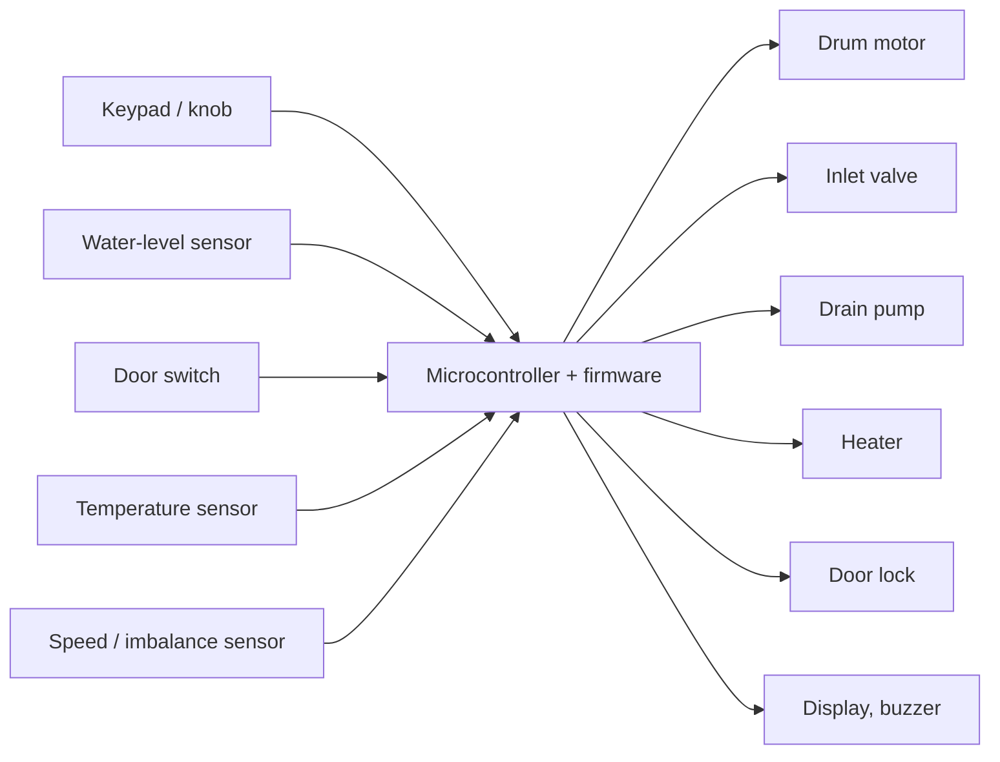

## Why should you care?

Put clothes in a fully automatic washing machine, choose "Cotton", press Start, and walk away. Over the next hour the machine fills water to the right level, heats it, tumbles the drum one way and the other, drains, rinses three times, spins at high speed and beeps when done. If you open the door mid-cycle, it refuses. If the load is unbalanced, it slows down instead of shaking itself across the floor.

No one is watching it. A small embedded system inside does all of this, reading half a dozen sensors and driving motors and valves in the right order.

The washing machine is the classic example of an **application-specific embedded system**, and the syllabus asks you to explain it.

## In one line

An application-specific embedded system is built for one particular application, such as a washing machine, whose microcontroller reads user inputs and sensors (water level, door lock, temperature, drum speed) and drives actuators (motor, valves, heater, pump, display) to run the wash cycle automatically.

## Explained

### Q1. What is an application-specific embedded system? ⭐

==An application-specific embedded system is designed to perform one particular application and cannot be used for anything else.==

- ==Its hardware is chosen for that one job==: only the sensors, actuators and processor power it needs.
- ==Its firmware implements only that application==: the wash programs, and nothing more.
- ==The user interface is made for that job==: program knob, a few buttons, a small display.

Examples: washing machine, microwave oven, digital camera, air conditioner, electronic toy.

Compare this with a **domain-specific** system (next lecture), which is built for a whole field, such as automotive.

### Q2. What are the inputs of a washing machine's embedded system? ⭐

| Input | What it tells the controller |
|---|---|
| ==Keypad / program knob== | Wash program, temperature, spin speed, start/pause |
| ==Water-level sensor== (pressure switch) | How full the drum is |
| ==Door-lock switch== | Door is closed and locked; safe to start |
| ==Temperature sensor== (thermistor) | Water temperature, to control the heater |
| ==Tachometer / speed sensor== | Drum speed, to control the motor |
| ==Imbalance sensor== | Clothes have bunched to one side |

### Q3. What are its outputs (actuators)? ⭐

| Output | What it does |
|---|---|
| ==Drum motor== (with motor driver) | Rotates the drum in both directions; high speed for spin |
| ==Water inlet valve== (solenoid) | Lets water in |
| ==Drain pump== | Pumps used water out |
| ==Heater== (through a relay) | Heats water to the chosen temperature |
| ==Door lock actuator== | Keeps the door locked while running |
| ==Display, LEDs and buzzer== | Show time left and status; beep at the end |

### Q4. How does the controller run a wash cycle? ⭐

The firmware moves through fixed stages, checking sensors at each step:

1. ==**Check:** door closed and locked==; read the selected program.
2. ==**Fill:** open the inlet valve== until the water-level sensor reaches the set level.
3. ==**Heat:** switch on the heater== until the thermistor reads the set temperature.
4. ==**Wash:** turn the drum== one way, then the other, for the set time.
5. ==**Drain, rinse and spin:** run the pump==, refill and rinse, then spin fast to squeeze water out.
6. ==**Finish:** stop, unlock the door==, beep.

If a sensor reports a fault (no water, door opened, heavy imbalance), the controller pauses and shows an error code.

### Q5. Which embedded system features does it show?

- ==**Application specific:**== it only washes clothes.
- ==**Reactive:**== it responds to door, level and imbalance sensors at every step.
- ==**Real-time (soft):**== a slow reaction to a full drum overflows water, so timing matters, but a small delay is not dangerous.
- ==**Harsh environment:**== water, heat, vibration and detergent.
- ==**Safety:**== the door must stay locked while the drum is full or spinning.
- ==**Low cost:**== an 8-bit or small 32-bit microcontroller is enough.

> [!beyond] Beyond the syllabus
> Many "smart" or "AI wash" models estimate the load weight and dirt level from the motor's effort and from a turbidity (cloudiness) sensor, then choose water, time and detergent automatically. Older models did this with **fuzzy logic** rules; newer ones may use small machine learning models running on the controller.

## Analogy and real-life example

### Analogy

A washing machine's controller is like a dhobi who follows the same careful routine every time: check the clothes, fill the tub, soak, scrub, rinse, wring. The dhobi watches the water and the clothes at every step and adjusts. The controller does the same with sensors instead of eyes and hands.

### Real system: a front-loading machine

A typical front loader uses a microcontroller that drives an inverter motor (variable speed), reads a pressure-type water-level sensor, a thermistor in the drum and a door-lock switch, and shows progress on a small display. Many recent models add Wi-Fi so the cycle can be started or watched from a phone app.

## Diagram

## Key points

> [!important] Key points
> - Application-specific embedded system: built for one application only (e.g. washing machine).
> - Inputs: keypad/knob, water-level sensor, door-lock switch, temperature sensor, speed sensor, imbalance sensor.
> - Outputs: drum motor, inlet valve, drain pump, heater, door lock, display and buzzer.
> - Wash cycle: check door → fill → heat → wash → drain, rinse, spin → finish.
> - Features shown: application specific, reactive, soft real-time, harsh environment, safety, low cost.
> - Controller: usually an 8-bit or small 32-bit microcontroller.

## Common mistakes

> [!warning] Common mistake
> **Listing only the motor and display.** Examiners expect both sides of the block diagram: at least four inputs (sensors and keys) and four outputs (actuators). Draw the diagram first, then explain each block.

> [!warning] Common mistake
> **Confusing application-specific with domain-specific.** A washing machine is one application. Automotive is a domain containing many applications (engine control, ABS, airbags).

## Exam questions

**Short answer (2–3 marks)**
1. What is an application-specific embedded system? Give two examples.
2. List the sensors and actuators used in a washing machine. ⭐
3. Why must a washing machine controller check the door lock before starting?

**Long answer (5 marks)**
1. With a neat block diagram, explain the washing machine as an application-specific embedded system. ⭐
2. Explain the sequence of operations in an automatic washing machine and the role of its sensors at each step. ⭐

## Sources

- Shibu K V, *Introduction to Embedded Systems*, McGraw Hill, Ch. 4, "Washing machine: application-specific embedded system" (verify).
- Raj Kamal, *Embedded Systems: Architecture, Programming and Design*, Tata McGraw Hill (verify).
