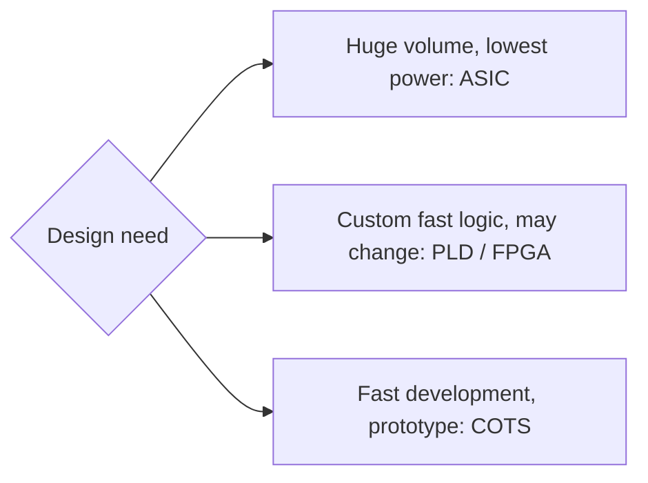

## Why should you care?

Three companies want to build a device.

- **Company A** will sell 50 lakh fitness bands. It wants the cheapest, smallest, lowest-power chip possible, even if designing it takes a year and crores of rupees.
- **Company B** builds a few hundred radar units a year and needs very fast custom logic that it can change after testing.
- **Company C** is a start-up that must show a working smart-farm sensor to investors in six weeks.

A microcontroller alone may not suit all three. Company A should consider an **ASIC**, Company B an **FPGA** (a programmable logic device), and Company C should build from **COTS** modules. Knowing these options is how engineers balance cost, speed, flexibility and time to market.

## In one line

An ASIC is a chip designed for one application, a PLD is a chip whose hardware logic can be programmed by the user, and COTS components are ready-made, commercially available parts used to build systems quickly.

## Explained

### Q1. What is an ASIC? ⭐

==An ASIC (Application-Specific Integrated Circuit) is a chip designed and manufactured for one particular application.==

- ==It contains exactly the circuits that application needs==, and nothing more.
- ==Benefits: **small size, low power, high speed, very low cost per chip**== when made in large numbers.
- ==Drawbacks: **high one-time design cost**== (called NRE, non-recurring engineering cost), long design time, and ==the design **cannot be changed**== after manufacture.
- Examples: the chip in a quartz watch, a TV's video decoder, Bitcoin mining chips, Google's TPU for AI.

==An **ASSP** (Application-Specific Standard Product)== is an ASIC-like chip designed for one application but sold to many companies, such as a standard Ethernet controller chip.

### Q2. When is an ASIC worth making?

==The design cost is paid once; the chip cost is paid per unit==. So:

| Volume | Better choice |
|---|---|
| Small (hundreds to a few thousand) | ==Microcontroller or FPGA: low design cost== |
| Very large (lakhs to crores) | ==ASIC: low cost per unit outweighs the design cost== |

Example: if an ASIC costs ₹5 crore to design but saves ₹50 per unit, it pays off only after 10 lakh units.

### Q3. What is a programmable logic device (PLD)? ⭐

==A PLD is a chip whose internal logic circuits can be configured by the user after manufacture to implement custom hardware.==

Unlike a microcontroller, which runs a **program** one instruction at a time, ==a PLD is **wired** into the circuit you need==, so many operations happen in parallel.

Types:
- ==**SPLD** (simple PLD): PAL, PLA, GAL==. Small logic, a few gates.
- ==**CPLD** (complex PLD)==: several SPLD blocks on one chip; keeps its configuration when power is off.
- ==**FPGA** (field-programmable gate array)==: thousands to millions of logic blocks; very flexible; usually reloads its configuration at power-on.

### Q4. Where are PLDs, especially FPGAs, used?

- ==**Prototyping ASICs:**== a design is tested on an FPGA before spending crores on an ASIC.
- ==**High-speed signal processing:**== radar, 5G base stations, medical imaging.
- ==**Low-volume products**== that need custom hardware: test equipment, defence systems.
- ==**Fixable hardware:**== a bug can be corrected by reprogramming, even in the field.

Trade-off: compared with an ASIC, an FPGA costs more per unit and uses more power, but has no large design cost and can be changed.

### Q5. What are COTS components? ⭐

==COTS (Commercial Off-The-Shelf) components are ready-made hardware or software parts that can be bought and used directly in a product.==

Examples:
- A GSM/4G module for sending SMS or data.
- A Wi-Fi module such as the ESP8266, or a Bluetooth module.
- A GPS module, an LCD display module, a TCP/IP chip.
- Software: an RTOS or a ready protocol stack.

| Advantages | Disadvantages |
|---|---|
| ==Fast development, low cost== | ==Depends on the vendor== |
| ==Already tested and reliable== | ==Part may be discontinued== |
| No need to design from scratch | May include unused features; less optimised |

### Q6. Compare ASIC and FPGA. When would a designer choose each? ⭐

| Point | ASIC | FPGA |
|---|---|---|
| ==Design cost (NRE)== | Very high | Low |
| ==Cost per unit== | Very low at high volume | Higher |
| ==Can it be changed later?== | No | Yes, reprogram it |
| ==Speed and power== | Fastest, lowest power | Slower, more power |
| ==Time to market== | Long (months) | Short (weeks) |

==Choose an **ASIC** for very high volumes with a fixed design== (fitness bands, phone chips). ==Choose an **FPGA** for low volumes, prototypes, or designs that may change== (radar, test equipment, ASIC prototyping).

## Analogy and real-life example

### Analogy

Building a house:
- **ASIC** = a house designed by an architect for one family: perfect fit, expensive to design, cannot be changed easily.
- **FPGA** = modular walls you can rearrange whenever you want: flexible, but each piece costs more.
- **COTS** = buying ready-made furniture from a shop: quick and cheap, but you take what is available.

### Real system: a smart-farm sensor start-up

- **Version 1 (prototype):** a microcontroller board with COTS modules (soil-moisture sensor, GSM module, solar charger). Working in weeks.
- **Version 2 (1,000 units):** same design on a custom board, still using COTS modules.
- **Version 3 (10 lakh units):** the company may move the main circuits into an ASIC to cut cost and power per device.

## Diagram

## Key points

> [!important] Key points
> - ASIC: Application-Specific Integrated Circuit, designed for one application.
> - ASIC: small, fast, low power, cheap per unit at high volume; high NRE cost; cannot be changed.
> - ASSP: an application-specific chip sold to many customers.
> - PLD: chip whose hardware logic is configured by the user after manufacture.
> - PLD types: SPLD (PAL, PLA, GAL), CPLD, FPGA.
> - FPGA: highly flexible, used for prototyping, signal processing, low-volume products.
> - COTS: Commercial Off-The-Shelf ready-made parts (GSM, Wi-Fi, GPS modules, RTOS).
> - COTS: fast and cheap to use, but vendor dependence and obsolescence risk.

## Common mistakes

> [!warning] Common mistake
> **"An FPGA runs a program like a microcontroller."** An FPGA is configured into hardware circuits. Its "program" (a bitstream) describes wiring, not a sequence of instructions, which is why it can do many things at the same time.

> [!warning] Common mistake
> **"ASICs are always expensive."** The design is expensive; each chip, once in mass production, is very cheap. Whether an ASIC is costly depends on how many units are made.

## Sources

- Shibu K V, *Introduction to Embedded Systems*, McGraw Hill, Ch. 2, sections on ASICs, PLDs and COTS (verify).
- Frank Vahid and Tony Givargis, *Embedded System Design*, Wiley India, Ch. 1, processor and IC technologies (verify).
