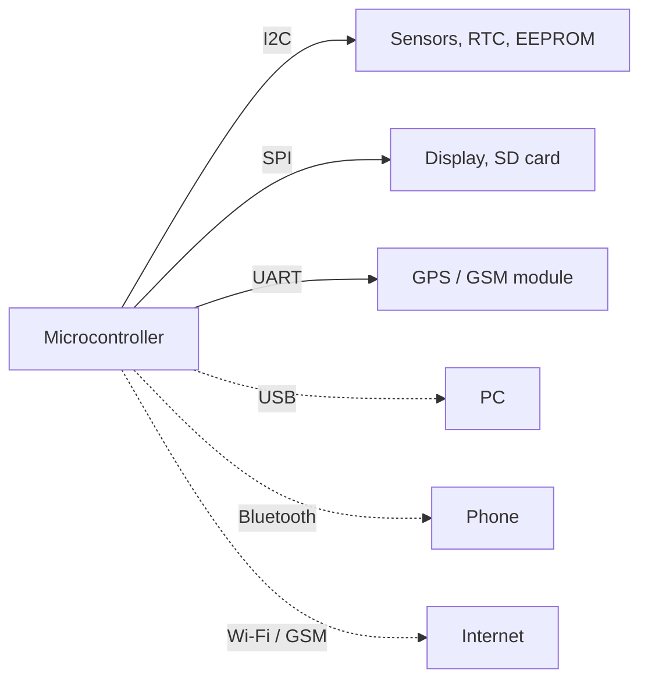

## Why should you care?

Open a smartwatch and you find a microcontroller, a heart-rate sensor, a motion sensor, a display, a flash memory chip and a Bluetooth radio. They all have to talk to each other, and the watch has to talk to your phone.

If every chip used its own private connection with dozens of wires, the watch would never fit on your wrist. Instead, engineers use a few standard **communication interfaces**: shared "languages" with two to four wires, such as I2C and SPI, inside the device, and Bluetooth or USB to the outside world.

Every sensor or module you buy will say which interface it uses. Choosing and connecting the right one is a daily task in embedded work.

## In one line

Communication interfaces are standard ways for an embedded system to exchange data, either between chips on the same board (onboard: UART, I2C, SPI, 1-Wire, parallel) or with external devices and networks (external: RS-232, RS-485, USB, Bluetooth, Wi-Fi, ZigBee, GSM).

## Explained

### Q1. What are serial and parallel communication?

==**Parallel:** sends several bits at the same time== on several wires (e.g. 8 wires for a byte).
- ==Fast over short distances==, but needs many pins and wires.
- Example: an 8051 port driving an LCD with 8 data lines.

==**Serial:** sends bits one after another== on one (or a few) wires.
- ==Fewer wires and pins, works over longer distances==, cheaper.
- Almost all modern interfaces are serial: UART, I2C, SPI, USB.

==Parallel sends many bits at once on many wires; serial sends one bit at a time on few wires.==

### Q2. What are the two groups of interfaces?

| Group | Purpose | Examples |
|---|---|---|
| **Onboard** | ==Chips on the same circuit board talk to each other== | UART, I2C, SPI, 1-Wire, parallel bus |
| **External** | ==The device talks to other devices, PCs or networks== | RS-232, RS-485, USB, IrDA (infrared), Bluetooth, Wi-Fi, ZigBee, GSM/4G |

The same device usually uses both: a smartwatch uses I2C to read its sensors (onboard) and Bluetooth to reach your phone (external).

### Q3. What is UART?

==**UART** (Universal Asynchronous Receiver Transmitter)== sends serial data using ==two lines: **TX** (transmit) and **RX** (receive)==.

- ==**Asynchronous:** no shared clock wire==. Both sides agree on the speed (**baud rate**, e.g. 9600 bits per second) in advance.
- ==Each byte is framed==: a **start bit**, 8 data bits, and a **stop bit**.
- ==Point-to-point==: connects two devices only.
- ==The 8051 has one built-in UART== (pins P3.0 RXD and P3.1 TXD). You will use it in practical 11.
- Examples: microcontroller to PC, GPS module, GSM module, Bluetooth module (HC-05).

### Q4. What are I2C and SPI?

| Feature | I2C | SPI |
|---|---|---|
| Full name | Inter-Integrated Circuit | Serial Peripheral Interface |
| Wires | ==2: SDA (data), SCL (clock)== | ==4: MOSI, MISO, SCLK, SS== |
| Clock | Synchronous (shared clock) | Synchronous |
| Selecting a device | ==Each device has an **address**== | A separate **SS** (slave select) line per device |
| Direction | ==Half duplex== | ==Full duplex== |
| Speed | Slower (typically 100–400 kbit/s) | Faster (several Mbit/s) |
| Typical use | Sensors, RTC, EEPROM | SD cards, displays, flash memory |

==I2C uses 2 wires and device addresses; SPI uses 4 wires, a select line per device, and is faster.==

==**1-Wire** uses a single data line== (plus ground) for slow devices, such as the DS18B20 temperature sensor.

### Q5. What are the common external interfaces?

**Wired**
- ==**RS-232:** old serial standard== for PC COM ports; short distance (about 15 m).
- ==**RS-485:** differential serial for long distances== (over 1 km) and many devices; used in industry and energy meters.
- ==**USB:** fast, plug-and-play==, also supplies power; used to program boards and connect to PCs.

**Wireless**
- **Infrared (IrDA):** short range, line of sight; TV remotes.
- ==**Bluetooth:** about 10 m, low power==; earphones, fitness bands.
- ==**Wi-Fi:** high speed, internet access==; smart plugs, CCTV.
- ==**ZigBee:** low power, low data rate==, mesh networks; home and industrial automation.
- **GSM/4G (GPRS):** cellular, long distance; vehicle trackers, UPI soundboxes.

## Analogy and real-life example

### Analogy

- **UART** is a phone call between two people who agreed in advance to speak at the same pace.
- **I2C** is a class register call: one teacher (master) calls a roll number (address), and only that student answers on the shared line.
- **SPI** is a teacher with a separate intercom line to each student: faster, but more wires.
- **Bluetooth** and **Wi-Fi** are talking across the room or across the city without any wire.

### Real system: a smartwatch

- **I2C:** heart-rate and motion sensors.
- **SPI:** the display and flash memory, which need higher speed.
- **UART:** a debug port used by the maker during testing.
- **Bluetooth:** syncing steps and notifications with the phone.
- **USB or pogo pins:** charging and firmware updates.

## Diagram

## Key points

> [!important] Key points
> - Parallel: many bits at once, many wires, short distance. Serial: one bit at a time, few wires.
> - Onboard interfaces: UART, I2C, SPI, 1-Wire, parallel bus.
> - External interfaces: RS-232, RS-485, USB, IrDA, Bluetooth, Wi-Fi, ZigBee, GSM/4G.
> - UART: TX and RX, asynchronous, agreed baud rate, start and stop bits; 8051 has one (P3.0, P3.1).
> - I2C: 2 wires (SDA, SCL), synchronous, devices selected by address, half duplex.
> - SPI: 4 wires (MOSI, MISO, SCLK, SS), synchronous, full duplex, faster than I2C.
> - RS-485: long distance, many devices, industrial use.
> - ZigBee: low power mesh; Bluetooth: short range; Wi-Fi: high speed internet.

## Common mistakes

> [!warning] Common mistake
> **Connecting TX to TX in UART.** The transmitter of one device must go to the receiver of the other: TX → RX and RX → TX, with a common ground.

> [!warning] Common mistake
> **"Serial is always slower than parallel."** Over long cables, parallel lines interfere with each other and drift out of step. That is why fast modern links (USB, SATA, PCIe) are all serial.

## Exam questions

**Short answer (2–3 marks)**
1. Differentiate between serial and parallel communication.
2. What is UART? Why is it called asynchronous?
3. List four external communication interfaces used in embedded systems.

**Long answer (5 marks)**
1. Explain onboard communication interfaces I2C and SPI and compare them.
2. Explain the external communication interfaces of embedded systems, wired and wireless, with one application each.

## Sources

- Shibu K V, *Introduction to Embedded Systems*, McGraw Hill, Ch. 2, onboard and external communication interfaces (verify).
- NXP Semiconductors, *UM10204: I2C-bus specification and user manual* (verify).
- Muhammad Ali Mazidi and Janice Mazidi, *The 8051 Microcontroller and Embedded Systems*, Pearson, Ch. 10 (serial communication) (verify).
