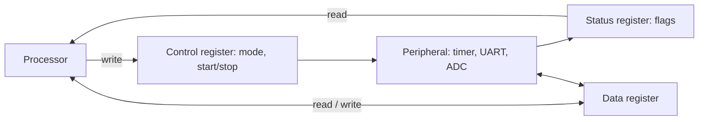

## Why should you care?

A microwave oven has a front panel: you **set** the power level and time with buttons, and you **read** the display to see how much time is left and whether it is done.

Every peripheral inside a microcontroller, such as a timer, a serial port or an ADC, has exactly this kind of panel, made of special registers. You write to **control registers** to tell the peripheral what to do, and you read **status registers** to find out what it has done.

Programming an embedded system is mostly about writing the right bits to these registers. In the timer and serial practicals you will set TMOD, TCON and SCON bit by bit, so understanding them now makes those practicals simple.

## In one line

Control and status registers (CSRs) are special registers through which the processor talks to a peripheral: it writes control registers to configure and start the peripheral, reads status registers (flags) to learn its state, and uses data registers to pass the actual data.

## Explained

### Q1. What are control and status registers?

==Control and status registers are special registers inside a peripheral that the processor uses to configure it, command it and check its state.==

Every peripheral usually has three kinds:

| Register | Direction | Purpose |
|---|---|---|
| ==**Control register**== | Processor writes | Selects the mode and starts or stops the peripheral |
| ==**Status register**== | Processor reads | Shows the peripheral's state through **flag** bits |
| ==**Data register**== | Read and/or write | Holds the data being sent or received |

On the 8051 these are **special function registers (SFRs)** at addresses 80H–FFH.

### Q2. What is a control register? Give an 8051 example.

==A control register holds bits that configure how a peripheral works.==

**TMOD (Timer Mode register, address 89H)** sets how Timer 0 and Timer 1 work:
- ==The lower 4 bits configure Timer 0==, the upper 4 bits Timer 1.
- ==The **M1, M0** bits choose the mode==: 00 = 13-bit, 01 = 16-bit, 10 = 8-bit auto-reload, 11 = split mode.
- ==The **C/T** bit chooses timer (count clock pulses) or counter== (count pulses on a pin).
- ==The **GATE** bit== decides whether an external pin also controls the timer.

Example: `TMOD = 0x01;` puts Timer 0 in mode 1 (16-bit timer).

### Q3. What is a status register? Give an 8051 example.

==A status register holds flag bits that the peripheral sets to report an event or condition.==

- ==**TF0 / TF1** (in TCON):== set to 1 when Timer 0 / Timer 1 **overflows**.
- ==**TI / RI** (in SCON):== set when the serial port has finished **transmitting** or has **received** a byte.
- ==**PSW** (Program Status Word):== holds the CPU's own flags: carry (CY), auxiliary carry (AC), overflow (OV), parity (P).

The program **reads** a flag to know an event happened, and usually **clears** it afterwards so the next event can be detected.

### Q4. Can one register hold both control and status bits?

Yes. **TCON (Timer Control, address 88H)** mixes both:

| Bit | Name | Kind | Meaning |
|---|---|---|---|
| 7 | ==TF1== | Status | Timer 1 overflowed |
| 6 | ==TR1== | Control | Run (1) or stop (0) Timer 1 |
| 5 | TF0 | Status | Timer 0 overflowed |
| 4 | TR0 | Control | Run or stop Timer 0 |
| 3–0 | ==IE1, IT1, IE0, IT0== | Status / control | External interrupt flags and trigger type |

TCON and SCON are **bit-addressable**, so in Keil C you can write single bits by name: `TR0 = 1;` starts Timer 0.

### Q5. How does a program use them together?

The usual pattern, shown for a Timer 0 delay:

```c
TMOD = 0x01;          // control: Timer 0, mode 1 (16-bit)
TH0 = 0x4B;           // data: starting count, high byte
TL0 = 0xFD;           //       starting count, low byte
TR0 = 1;              // control: start Timer 0
while (TF0 == 0);     // status: wait until the overflow flag is set
TR0 = 0;              // control: stop the timer
TF0 = 0;              // clear the status flag for next time
```

==Configure (control) → load data → start (control) → wait for flag (status) → clear flag.==

Waiting in a loop for a flag is called **polling**. The alternative is to let the flag raise an **interrupt**, which you will meet with the interrupt map and the timer practicals.

## Analogy and real-life example

### Analogy

A washing machine's front panel: the program knob and Start button are **control** (you set them); the "Door locked" and "Finished" lights are **status** (the machine sets them, you read them); the clothes inside are the **data**. You never reach inside the machine; you work only through the panel.

### Real system: sending a byte over the serial port

1. Write **SCON** (control) to choose 8-bit UART mode.
2. Write the byte into **SBUF** (data register).
3. Wait until **TI** in SCON (status flag) becomes 1: the byte has gone.
4. Clear TI, then send the next byte.

You will do exactly this in the serial communication practical.

## Diagram



## Key points

> [!important] Key points
> - CSRs: registers through which the processor configures and checks a peripheral.
> - Control register: written by the processor; sets mode, starts/stops (e.g. TMOD, TR0 in TCON).
> - Status register: read by the processor; flag bits report events (e.g. TF0, TI, RI, PSW flags).
> - Data register: holds data being sent or received (e.g. SBUF, TH0/TL0).
> - TMOD (89H): GATE, C/T, M1, M0 for each timer; lower nibble Timer 0, upper nibble Timer 1.
> - TCON (88H): TF1, TR1, TF0, TR0 + external interrupt bits; bit-addressable.
> - Pattern: configure → load → start → poll flag (or interrupt) → clear flag.

## Common mistakes

> [!warning] Common mistake
> **Forgetting to clear a flag.** On the 8051, TF0 stays 1 after an overflow until the program clears it (when polling). If you don't clear it, the next wait loop ends immediately and the delay becomes far too short.

> [!warning] Common mistake
> **Overwriting the other timer's settings.** `TMOD = 0x01;` also sets Timer 1's bits to 0000. If Timer 1 is already in use (for example for the serial port), change only Timer 0's bits: `TMOD = (TMOD & 0xF0) | 0x01;`.

## Exam questions

**Short answer (2–3 marks)**
1. What are control and status registers?
2. Explain the bits of the 8051 TMOD register.
3. What is a flag? Give two examples from the 8051.

**Long answer (5 marks)**
1. Explain control, status and data registers with 8051 examples (TMOD, TCON, SCON).
2. Explain how a program uses control and status registers to generate a time delay with Timer 0.

## Sources

- Muhammad Ali Mazidi and Janice Mazidi, *The 8051 Microcontroller and Embedded Systems*, Pearson, Ch. 9 (timers: TMOD, TCON) and Ch. 10 (serial: SCON, SBUF) (verify).
- Intel, *MCS-51 Microcontroller Family User's Manual*, special function registers (verify).
