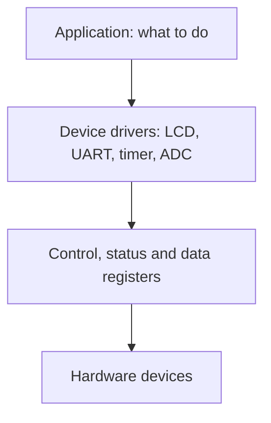

## Why should you care?

When you plug a new printer into a laptop, you don't learn which register inside the printer starts the paper feed. You install a **driver**, and from then on every program just says "print".

Embedded firmware works the same way. Suppose your temperature logger reads an LCD, a keypad, a timer and a serial port. If every part of the code poked those registers directly, one change of LCD model would mean hunting through the whole program. Instead, each device gets a small **driver**: a set of functions like `lcd_print()` or `timer_delay_ms()` that hide the register details.

Writing your practical code as small drivers makes it shorter, easier to debug and reusable in the next practical.

## In one line

A device driver is a piece of software that hides a hardware device's registers and details behind simple functions (initialise, read, write, handle interrupt), so that the application can use the device without knowing how it works inside; a timer driver does this for a hardware timer.

## Explained

### Q1. What is a device driver?

==A device driver is software that controls a hardware device and gives the rest of the program simple functions to use it.==

- ==It hides hardware details==: register addresses, bit settings, timing.
- ==It gives a clean interface (API)==, such as `uart_send(byte)` or `lcd_clear()`.
- ==It sits between the application and the hardware==, so one can change without rewriting the other.

In an embedded system with an OS, drivers are part of the OS; in a super-loop 8051 program, drivers are simply C functions in their own source files.

### Q2. Why are device drivers needed?

- ==**Abstraction:**== the application says *what* to do, the driver knows *how*.
- ==**Reuse:**== the same LCD driver works in every project that uses that LCD.
- ==**Portability:**== move to a new microcontroller and only the drivers change, not the application.
- ==**Easier debugging:**== a fault in the serial port is looked for in one place: the UART driver.
- ==**Safe sharing:**== the driver controls access, so two parts of the program don't fight over one device.

### Q3. What functions does a typical driver provide?

| Function | Job | UART example |
|---|---|---|
| ==**Initialise**== | Set up registers and mode at power-on | `uart_init(9600)` |
| ==**Write / send**== | Output data to the device | `uart_send('A')` |
| ==**Read / receive**== | Get data from the device | `c = uart_receive()` |
| ==**Control**== | Change a setting while running | `uart_set_baud(4800)` |
| ==**Interrupt service routine**== | Respond when the device raises an interrupt | Store each received byte in a buffer |

### Q4. What types of drivers are there?

- ==**On-chip peripheral drivers:**== for parts inside the microcontroller: timers, UART, ADC, GPIO. Often supplied by the chip maker or the compiler vendor.
- ==**External device drivers:**== for chips and modules outside: LCD, RTC, EEPROM, sensors, GSM module.
- ==**Architecture-specific vs generic:**== the low layer that touches registers is specific to one chip; the upper layer (e.g. "print a string on the LCD") can be generic and reused.

### Q5. What is a timer driver?

==A timer driver is a device driver that manages the microcontroller's hardware timers and gives functions for delays, periodic events and time measurement.==

Typical functions for the 8051:
- `timer0_init()`: ==sets TMOD for the required mode==.
- `delay_ms(n)`: ==waits n milliseconds==, by loading TH0/TL0, starting the timer and waiting for TF0, `n` times.
- `timer0_start()` / `timer0_stop()`: ==set or clear TR0== to run or stop the timer.
- ==A **tick ISR**== (Timer 0 interrupt) increments a counter every 1 ms or 50 ms, so the application can ask "how much time has passed?" without waiting.

The application then writes `delay_ms(500);` and never touches TMOD or TF0 itself.

## Analogy and real-life example

### Analogy

A device driver is like a hotel receptionist. Guests (the application) ask simple things: "a room", "a taxi", "a wake-up call at 6". The receptionist knows which form to fill, which phone number to call and whom to tell. Change the taxi company and the guests never notice; only the receptionist's method changes.

### Real system: an 8051 temperature logger

The application loop is short and readable:

```text
lcd_init(); uart_init(9600); timer0_init();
while (1) {
    t = adc_read(0);          // ADC driver
    lcd_print_temp(t);        // LCD driver
    uart_send_temp(t);        // UART driver
    delay_ms(1000);           // timer driver
}
```

All register work lives inside the four drivers.

## Diagram



## Key points

> [!important] Key points
> - Device driver: software that controls a device and offers simple functions to the application.
> - Hides register-level details; sits between application and hardware.
> - Benefits: abstraction, reuse, portability, easier debugging, safe sharing.
> - Typical functions: initialise, write, read, control, interrupt service routine.
> - Types: on-chip peripheral drivers, external device drivers; architecture-specific and generic layers.
> - Timer driver: init, delay, start/stop, periodic tick ISR.

## Common mistakes

> [!warning] Common mistake
> **"Drivers exist only in operating systems."** An 8051 program with no OS still benefits from drivers: they are just well-organised C functions such as `lcd_init()` and `delay_ms()`.

> [!warning] Common mistake
> **Using registers directly in the application "just this once".** It works until the hardware or pin changes, and then every scattered register write must be found and fixed. Keep all register access inside the driver.

## Exam questions

**Short answer (2–3 marks)**
1. What is a device driver? Why is it needed?
2. List the typical functions provided by a device driver.
3. What is a timer driver?

**Long answer (5 marks)**
1. Explain the role of device drivers in an embedded system, with their types and functions.
2. Explain a timer driver for the 8051 with its functions and an example of its use.

## Sources

- Shibu K V, *Introduction to Embedded Systems*, McGraw Hill, Ch. 10, device drivers (verify).
- Michael Barr, *Programming Embedded Systems in C and C++*, O'Reilly, Ch. 7, peripherals and device drivers (verify).
