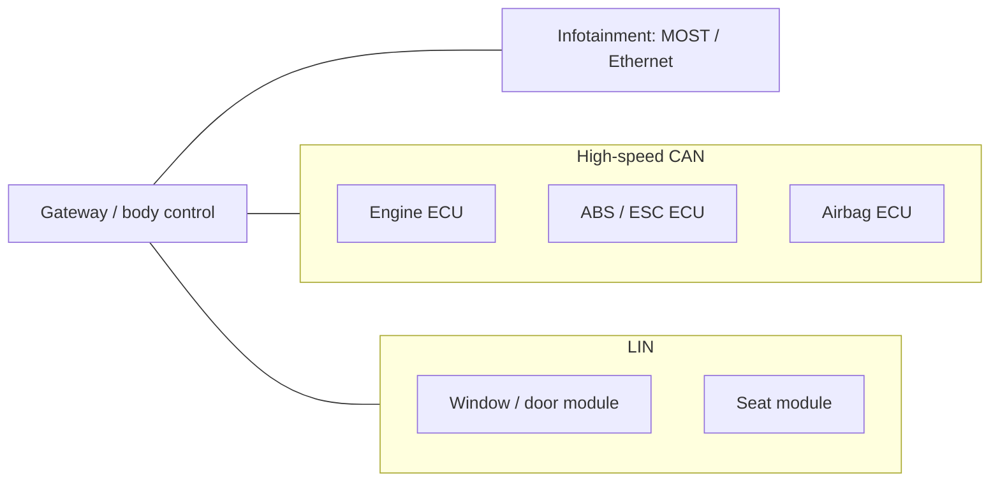

## Why should you care?

A new car sold in India today can contain dozens of small computers. One controls fuel injection, one the ABS brakes, one each airbag system, door module, seat, instrument cluster and infotainment screen. When you press the brake, several of them talk to each other within milliseconds: the brake controller, the engine controller, the stability controller, and the brake-light module.

None of these is a general computer, and no single one of them is "the car's computer". Together they form an embedded system designed for one whole **domain**: automotive.

Pune and Bengaluru employ thousands of engineers who write software for exactly these controllers. This lecture shows how such a domain-specific system is organised.

## In one line

A domain-specific embedded system is designed for a whole field of use, such as automotive, where many electronic control units (ECUs) for engine, brakes, safety, body and infotainment work together over in-vehicle networks such as CAN, LIN and MOST.

## Explained

### Q1. What is a domain-specific embedded system? ⭐

==A domain-specific embedded system is designed for a particular domain (field), and contains many embedded systems that follow that domain's rules and standards.==

- ==It serves a whole field==, not one product: automotive, telecom, aerospace, medical, industrial.
- ==Its parts share domain standards==: temperature ranges, safety rules, communication buses.
- ==Its parts are reused== across many products in that domain (the same ABS controller in several car models).

Example: the electronics of an automobile. Compare: a washing machine is **application** specific (one application); a car is **domain** specific (one field, many applications).

### Q2. What is an ECU? ⭐

==An ECU (Electronic Control Unit) is an embedded controller in a vehicle that manages one function or subsystem.==

Each ECU has a microcontroller, sensors, actuators and firmware, like any embedded system. A modern car has from a few dozen to over a hundred ECUs.

| ECU | Job |
|---|---|
| Engine control unit | Fuel injection, ignition timing, emissions |
| ABS / ESC controller | Prevents wheel lock and skidding |
| Airbag control unit | Detects a crash and fires the airbags |
| Body control module | Lights, wipers, central locking, power windows |
| Instrument cluster | Speedometer, warnings, fuel gauge |
| Infotainment unit | Music, navigation, phone connection |

### Q3. How are automotive ECUs grouped? ⭐

==Automotive embedded systems are grouped into high-speed and low-speed systems.==

- ==**High-speed (real-time, safety-critical):**== engine control, ABS, airbags, electronic stability control. Must respond within milliseconds; a missed deadline can cause an accident.
- ==**Low-speed (comfort and body):**== power windows, seats, mirrors, central locking, climate control. A short delay only annoys the driver.
- ==**Infotainment and telematics:**== music, navigation, connected-car services. Needs high data rates but is not safety-critical.

### Q4. How do ECUs talk to each other? ⭐

They share data over **in-vehicle networks** (buses):

| Bus | Speed | Typical use |
|---|---|---|
| ==**CAN** (Controller Area Network)== | Up to about 1 Mbit/s | Engine, brakes, transmission: robust, real-time |
| ==**LIN** (Local Interconnect Network)== | About 20 kbit/s | Windows, mirrors, seats: cheap, simple |
| ==**MOST** (Media Oriented Systems Transport)== | Tens of Mbit/s | Audio and video in infotainment |
| ==**FlexRay**== | Up to 10 Mbit/s | Advanced safety, drive-by-wire (some cars) |
| ==**Automotive Ethernet**== | 100 Mbit/s and above | Cameras, driver assistance, newer cars |

==CAN is the main automotive bus; it lets many ECUs share two wires.==

### Q5. Who builds automotive embedded systems?

The automotive embedded industry has three kinds of players:

- ==**Silicon providers:**== make the microcontrollers and chips (e.g. NXP, Infineon, Renesas, Texas Instruments).
- ==**Tools and platform providers:**== supply development tools, RTOSs and software platforms (e.g. Vector, MathWorks; AUTOSAR-based software stacks).
- ==**Solution providers:**== design and build ECUs and software for car makers (e.g. Bosch, Continental, KPIT Technologies, Tata Elxsi).

> [!beyond] Beyond the syllabus
> Car makers are moving from many small ECUs to a few powerful **zonal and central computers**, often called the **software-defined vehicle**. New features then arrive as over-the-air software updates, as in phones.

## Analogy and real-life example

### Analogy

A car is like a hospital. Each department (ECU) has its own specialists and equipment: emergency (airbags), cardiology (engine), physiotherapy (seats and windows). They work independently but share patient records over the hospital network (CAN bus). An emergency message always gets priority over a routine one, just as a brake message gets priority over a window message on CAN.

### Real system: pressing the brake pedal

1. The **brake pedal sensor** reports pressure to the **ABS/ESC controller**.
2. If a wheel starts to lock, the ABS controller pulses the brake pressure many times a second.
3. It sends a CAN message; the **engine controller** reduces engine torque.
4. The **body control module** switches on the brake lights.
5. The **instrument cluster** shows an ABS warning if something fails.

## Diagram

## Key points

> [!important] Key points
> - Domain-specific embedded system: designed for a whole domain (automotive, telecom, aerospace), with many applications inside.
> - ECU: Electronic Control Unit, an embedded controller for one vehicle function.
> - Examples of ECUs: engine, ABS/ESC, airbag, body control, instrument cluster, infotainment.
> - Groups: high-speed safety-critical (engine, ABS, airbags), low-speed comfort (windows, seats), infotainment.
> - In-vehicle buses: CAN (main, about 1 Mbit/s), LIN (cheap, slow), MOST (media), FlexRay, automotive Ethernet.
> - Industry players: silicon providers, tools and platform providers, solution providers.

## Common mistakes

> [!warning] Common mistake
> **"The car has one computer."** A car has many independent ECUs. If the infotainment screen crashes, the engine and brakes keep working, because they are separate embedded systems.

> [!warning] Common mistake
> **Mixing up CAN and LIN.** CAN is fast and robust, for critical systems. LIN is slow and cheap, for simple body functions like windows and mirrors.

## Sources

- Shibu K V, *Introduction to Embedded Systems*, McGraw Hill, Ch. 4, "Automotive: domain-specific examples of embedded system" (verify).
- Bosch, *Automotive Handbook*, sections on vehicle electronics and networking (verify).
