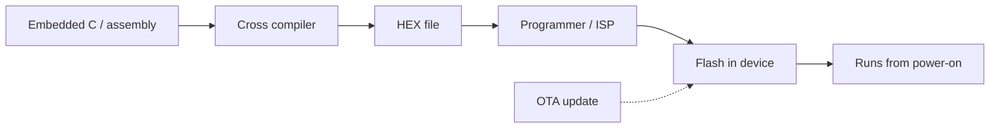

## Why should you care?

Two washing machines from the same factory have identical motors, sensors and circuit boards. One is sold as a basic model with 6 wash programs; the other as a premium model with 12 programs and a "quick wash". The only difference is the program stored inside the chip.

Companies also fix problems this way. When a car maker finds a fault in how the engine responds, it often does not replace any part; it updates the code in the engine controller.

That code is called **firmware**. Hardware decides what a device **can** do; firmware decides what it **does**. In this course you will write firmware for the 8051.

## In one line

Embedded firmware is the control program stored permanently in an embedded system's non-volatile memory (ROM or flash), written in assembly or Embedded C, that runs from power-on and makes the hardware perform its specific function.

## Explained

### Q1. What is embedded firmware? ⭐

==Firmware is the program stored in an embedded system's non-volatile memory that controls its hardware to perform its specific task.==

- ==**Non-volatile:** it stays in ROM or flash== when power is off, and runs as soon as the device is switched on.
- It is ==written by the **manufacturer**, not the user==.
- ==It talks directly to the hardware==: reading port pins, setting timers, driving displays.
- The name means it sits between hardware (fixed) and software (easily changed): "firm".

Examples: the program in a TV remote, a microwave oven, a router, a car's engine controller.

### Q2. How is firmware different from application software on a PC? ⭐

| Point | Firmware | PC application software |
|---|---|---|
| Stored in | ==ROM or flash, inside the device== | Hard disk or SSD |
| Installed by | ==Manufacturer== | User |
| Purpose | ==One fixed function== | Any task the user wants |
| Hardware access | ==Direct, controls pins and registers== | Through the operating system |
| Size | ==Small (KB to a few MB)== | Large (MB to GB) |
| Updates | Rare, by the maker | Frequent, by the user |
| Ends? | ==Never: runs in an infinite loop== | Closes when the user exits |

### Q3. In which languages is firmware written? ⭐

| Approach | Language | Strength | Weakness |
|---|---|---|---|
| Assembly language | Processor's own mnemonics (MOV, ADD, SJMP) | ==Smallest, fastest code; full control== | Hard to write, read and port to another chip |
| High-level language | **Embedded C** (most common), C++ | ==Faster development, readable, portable== | Slightly larger, slower code |
| Mixed | C with a few assembly parts | ==Speed where it matters, C elsewhere== | Needs knowledge of both |

==Embedded C is the most widely used firmware language: it is C plus extensions to access the microcontroller's registers and pins.==

### Q4. What are the two ways of designing firmware? ⭐

**1. Super loop (no operating system)**
- After setting up the hardware, ==the program runs one infinite loop that repeats a list of tasks==.
- ==Simple, small and predictable==; suits small systems (8051, calculators, toys).
- Weakness: ==if one task takes long, the others wait==.

**2. Operating system based**
- ==An **RTOS** or embedded OS== (e.g. FreeRTOS, embedded Linux) schedules several tasks.
- ==Suits complex systems== that must handle many things on time (phones, routers, cars).

You will study the RTOS approach in Unit 4.

### Q5. What does a super-loop program look like?

```text
main()
{
    configure ports, timers and serial port     // runs once at power-on

    while (1)                                  // super loop: repeats forever
    {
        read keypad and sensors                // task 1
        decide what to do                      // task 2
        update display and actuators           // task 3
    }
}
```

This is the shape of every 8051 program you wrote in the practicals: set-up code, then `while(1)`. A microcontroller has ==no operating system to return to==, so `main()` never ends.

### Q6. How does firmware get into the device, and how is it updated?

1. ==The programmer writes firmware in Embedded C or assembly== on a PC.
2. ==A **cross compiler** (e.g. Keil C51) converts it into machine code==, ==producing a **HEX file**==.
3. ==A **device programmer** or **ISP**== (in-system programming) cable writes the HEX file into the chip's flash.
4. **Updates:** the same flash can be rewritten later. Modern devices receive updates ==**over the air (OTA)**==, through Wi-Fi or mobile data, like your phone's system update.

## Analogy and real-life example

### Analogy

A harmonium is hardware: keys, reeds and bellows. The same harmonium can play a bhajan or a film song; the **music sheet** decides which. Firmware is that music sheet for the hardware. Changing the sheet changes the music without changing the instrument.

### Real system: a TV remote

- **Hardware:** a small microcontroller, a keypad matrix, an infrared LED, a battery.
- **Firmware (super loop):** sleep to save battery; wake when a key is pressed; find which key; send that key's code by blinking the IR LED; go back to sleep.
- The same hardware becomes a remote for a different TV brand just by changing the code table in the firmware.

## Diagram



## Key points

> [!important] Key points
> - Firmware: program stored in non-volatile memory (ROM/flash) that controls an embedded system's hardware.
> - Written by the manufacturer; runs from power-on; never ends (infinite loop).
> - Languages: assembly (fast, small, hard), Embedded C (most common, portable), or mixed.
> - Design approaches: super loop (no OS, simple systems) and OS based (RTOS, complex systems).
> - Super loop: initialise once, then repeat tasks forever in `while(1)`.
> - Flow: source → cross compiler → HEX file → programmer/ISP → flash.
> - Updates: reprogramming flash, or over-the-air (OTA) updates.

## Common mistakes

> [!warning] Common mistake
> **"Firmware and software are the same."** Firmware is a kind of software, but it is stored permanently in the device, tied to specific hardware and written by the maker. PC software is installed and removed by the user and runs through an operating system.

> [!warning] Common mistake
> **"Firmware is always written in assembly."** That was true decades ago. Today most firmware is written in Embedded C, with assembly used only for small time-critical parts.


## Sources

- Shibu K V, *Introduction to Embedded Systems*, McGraw Hill, Ch. 2 (embedded firmware) and Ch. 9 (firmware design approaches and languages) (verify).
- Muhammad Ali Mazidi and Janice Mazidi, *The 8051 Microcontroller and Embedded Systems*, Pearson, Ch. 7 (8051 programming in C) (verify).
