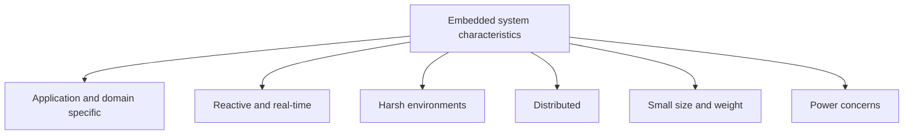

## Why should you care?

The controller on a modern combine harvester works in a field at 45 °C, covered in dust, shaken for hours, with mud splashing on it. A laptop in the same place would fail within a day.

A pacemaker must run for about ten years inside a human body on one small battery, and can never "hang".

A railway level-crossing controller must lower the gate **before** the train arrives, every single time.

None of these is just "a small computer". Each is shaped by a set of **characteristics** that are common to embedded systems and rare in PCs. Knowing them tells you what to check first when you design, choose or test any embedded device.

## In one line

Embedded systems are application- and domain-specific, reactive and real-time, able to work in harsh environments, often distributed, small and light, and designed for low power consumption.

## Explained

### Q1. What are the characteristics of an embedded system?

==Characteristics of embedded systems: application and domain specific, reactive and real-time, operates in harsh environments, distributed, small size and weight, and power concerns.==

Each is explained below with an example. In exams, write the characteristic, a one-line meaning and one example.

### Q2. What does "application and domain specific" mean?

- **Application specific:** each embedded system is designed for one task and cannot be used for another. The controller of a washing machine cannot run an air conditioner.
- **Domain specific:** systems are designed with the knowledge of their field. An automotive controller follows automotive rules for temperature range and safety; a medical device follows medical safety standards.

This is the most basic difference from a PC, which can be used for anything.

### Q3. What does "reactive and real-time" mean?

- **Reactive:** the system continuously responds to events in its environment, such as a key press, a sensor reading or a message.
- **Real-time:** it must respond **within a fixed time limit**. A late answer is a wrong answer.

Example: an ABS (anti-lock braking) controller reads wheel-speed sensors many times a second and must release and re-apply the brakes in milliseconds. If it reacts late, the wheel locks and the car skids.

### Q4. What do "harsh environments" and "distributed" mean?

**Operates in harsh environments**
- Must work in heat, cold, dust, moisture, vibration and electrical noise.
- Example: an engine controller near a hot engine; a weather station on a mountain.
- Design response: rugged casing, wide temperature-rated parts, protective coating, careful power supply design.

**Distributed**
- Many small embedded systems work together, each doing part of a bigger job, connected by a network.
- Example: a car has dozens of controllers (engine, brakes, airbags, doors) talking over a CAN bus. An ATM has separate controllers for the card reader, cash dispenser and printer.

### Q5. What do "small size and weight" and "power concerns" mean?

**Small size and weight**
- Many embedded systems must fit in a small space or be carried: phones, fitness bands, hearing aids, drones.
- Design response: microcontrollers with on-chip memory and I/O, surface-mount parts, fewer chips.

**Power concerns**
- Battery devices must last long; all devices should waste little heat.
- Design response: low-power microcontrollers, **sleep modes** (the chip sleeps and wakes only on an event), efficient firmware.
- Example: a TV remote's chip sleeps until a key is pressed, so two AA cells last a year or more.

==Embedded systems must deliver their function within tight limits of time, power, size and cost.==

## Analogy and real-life example

### Analogy

Compare a Swiss army knife (PC) with a surgeon's scalpel (embedded system). The scalpel does one job only (application specific), must perform perfectly at the right moment (real-time), works in a demanding setting (harsh environment), is small and light, and needs no extra power. Its limits are exactly what make it good at its job.

### Real system: an ATM

| Characteristic | In an ATM |
|---|---|
| Application specific | Only dispenses cash and handles accounts |
| Reactive, real-time | Responds to card, PIN and keys within seconds |
| Harsh environment | Runs 24×7, often outdoors, in heat and dust |
| Distributed | Separate controllers for card reader, cash dispenser, printer, network |
| Power concern | UPS keeps it running during power cuts |

## Diagram

## Key points

> [!important] Key points
> - Application specific: designed for one task. Domain specific: follows its field's rules (automotive, medical).
> - Reactive: responds continuously to events. Real-time: responds within a fixed time.
> - Harsh environments: heat, dust, moisture, vibration, electrical noise.
> - Distributed: many small controllers work together over a network (e.g. CAN bus in cars).
> - Small size and weight: portable, compact devices; single-chip microcontrollers.
> - Power concerns: low-power chips, sleep modes, long battery life.
> - Overall: tight limits of time, power, size and cost.

## Common mistakes

> [!warning] Common mistake
> **Listing characteristics without examples.** "Real-time" alone gets few marks. "Real-time: an airbag must inflate within milliseconds of a crash" shows understanding.

> [!warning] Common mistake
> **Confusing characteristics with quality attributes.** Characteristics describe what embedded systems **are** (reactive, distributed, small). Quality attributes describe how **well** a system does its job (reliability, maintainability). Quality attributes are the next lecture.

## Exam questions

**Short answer (2–3 marks)**
1. What is meant by reactive and real-time behaviour of an embedded system?
2. What is a distributed embedded system? Give an example.
3. How do embedded systems address power concerns?

**Long answer (5 marks)**
1. Explain the characteristics of embedded systems with suitable examples.
2. Taking an ATM or a car as an example, show how it reflects the characteristics of an embedded system.

## Sources

- Shibu K V, *Introduction to Embedded Systems*, McGraw Hill, Ch. 3, characteristics of an embedded system (verify).
- Frank Vahid and Tony Givargis, *Embedded System Design*, Wiley India, Ch. 1, common characteristics of embedded systems (verify).
