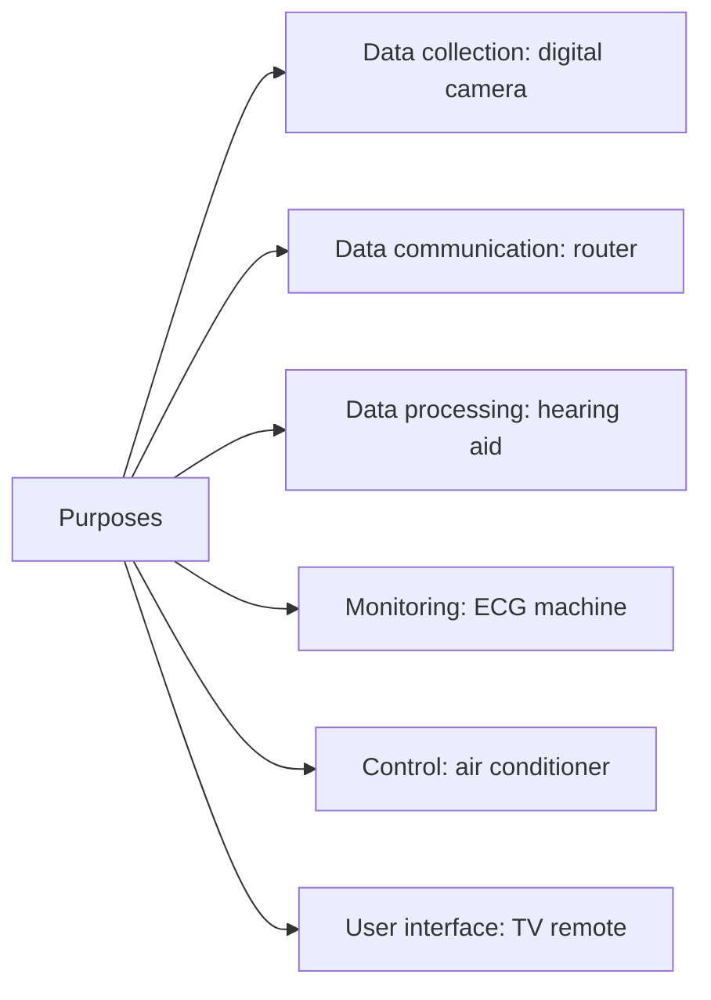

## Why should you care?

Count the embedded systems you used before reaching college today. The alarm on your phone. The geyser thermostat. The digital meter on the auto. The metro gate that read your card. The traffic signal. The UPI soundbox at the tea stall.

Most people would guess "two or three". The real number is often over twenty, because embedded systems are built to be invisible.

Knowing **where** they are used, and **what job** each one does, lets you look at any device and describe it the way an engineer does. It is also a guaranteed exam question.

## In one line

Embedded systems are used in almost every field, from consumer electronics to space, and each one serves one or more of six purposes: data collection, data communication, data processing, monitoring, control, and application-specific user interface.

## Explained

### Q1. Where are embedded systems used?

| Area | Examples |
|---|---|
| Consumer electronics | Digital camera, smart TV, washing machine, microwave oven |
| Household and building | Air conditioner, security alarm, smart lock, lift controller |
| Automotive | Engine control, ABS, airbags, infotainment, FASTag reader |
| Telecom and networking | Mobile phone, router, Wi-Fi access point, network switch |
| Healthcare | ECG machine, pulse oximeter, glucose meter, pacemaker |
| Banking and retail | ATM, card-swipe (POS) machine, UPI soundbox, billing scale |
| Industry | PLC-controlled assembly lines, robots, SCADA |
| Defence and space | Missile guidance, satellites, launch vehicles |
| Agriculture | Soil-moisture sensors, automatic drip irrigation |

### Q2. What are the purposes of embedded systems?

==The six purposes of embedded systems: data collection, data communication, data processing, monitoring, control, and application-specific user interface.==

Each embedded system is built for one or more of these. A digital thermometer collects and displays data; an air conditioner monitors temperature and controls the compressor. In exams, explain each purpose with one example.

### Q3. What are data collection and data communication?

**Data collection (storage and representation)**
- The system senses real-world data, converts it to digital form, and stores or displays it.
- A **sensor** measures a physical quantity; an **ADC** (analog-to-digital converter) turns it into numbers.
- Examples: digital camera (light → image file), digital thermometer, data logger in a cold-storage truck.

**Data communication**
- The system sends data from one place to another, over wires or wirelessly.
- Some systems only carry data (a router); others collect and then send it (a smart meter sending readings to the electricity board).
- Examples: Wi-Fi router, network switch, GPS tracker in a delivery bike.

### Q4. What are data processing, monitoring and control?

**Data processing:** the system changes data to make it useful. A hearing aid filters noise and amplifies speech; a voice assistant processes sound to detect a wake word.

**Monitoring:** the system watches a quantity and reports it, but does not change it. An ECG machine shows the heart's activity; a smoke detector watches for smoke and sounds an alarm.

**Control:** the system watches a quantity **and acts** to keep it at a target. An air conditioner reads room temperature (sensor) and switches the compressor (actuator) to hold 24 °C.

==Monitoring only observes; control observes and then acts to change the output.==

### Q5. What is an application-specific user interface?

Some embedded systems exist mainly to give the user a simple, dedicated way to interact with something.

- Buttons, a small keypad, LEDs, a small display or a touch panel, designed only for that one job.
- Examples: TV remote, mobile phone keypad, lift buttons, ATM screen, card-swipe machine.

The interface is "application-specific" because it shows only what that one task needs, unlike a PC's general keyboard and screen.

> [!beyond] Beyond the syllabus
> Many modern systems combine several purposes with a cloud link. A smart electricity meter collects usage (data collection), sends it to the board's servers (communication), and lets the board cut supply remotely (control). This combination is what the Internet of Things means in practice, and you will meet it in the Sem 5 IoT course.

## Analogy and real-life example

### Analogy

Think of a hospital. Different staff have different jobs: one takes your blood pressure (collects data), one carries reports to the doctor (communicates), the doctor reads them (processes), a nurse watches the monitor at night (monitors), and the drip is adjusted to keep levels steady (controls). The front desk is the interface. Embedded systems divide jobs the same way, and one device can do several of them.

### Real system: a cold-storage truck carrying vaccines

- **Data collection:** temperature sensors inside the container.
- **Monitoring:** alarm if the temperature rises above 8 °C.
- **Control:** the cooling unit switches on and off to hold 2–8 °C.
- **Communication:** a GPS-GSM unit sends temperature and location to the depot.
- **User interface:** a small display and buzzer for the driver.

## Diagram

## Key points

> [!important] Key points
> - Application areas: consumer, household, automotive, telecom, healthcare, banking, industry, defence and space, agriculture.
> - Six purposes: data collection, data communication, data processing, monitoring, control, application-specific user interface.
> - Data collection: sense, convert (ADC), store or display. Example: digital camera.
> - Data communication: carry data by wire or wireless. Example: router.
> - Data processing: change data to make it useful. Example: hearing aid.
> - Monitoring: observe and report only. Example: ECG machine.
> - Control: observe and act through actuators. Example: air conditioner.
> - Application-specific user interface: dedicated buttons and displays. Example: TV remote.

## Common mistakes

> [!warning] Common mistake
> **Mixing up monitoring and control.** A smoke detector that only sounds an alarm is monitoring. A sprinkler system that detects smoke and opens the water valve is control, because it acts on the world.

> [!warning] Common mistake
> **Giving one purpose per device.** Most real devices serve several purposes. In a long answer, show this: it earns marks.

## Exam questions

**Short answer (2–3 marks)**
1. List any six application areas of embedded systems with one example each.
2. Differentiate between monitoring and control purposes of embedded systems.
3. What is meant by an application-specific user interface? Give two examples.

**Long answer (5 marks)**
1. Explain the purposes of embedded systems with suitable examples.
2. Taking any one real device, show how it serves more than one purpose of embedded systems.

## Sources

- Shibu K V, *Introduction to Embedded Systems*, McGraw Hill, Ch. 1, sections on application areas and purpose of embedded systems (verify).
- Raj Kamal, *Embedded Systems: Architecture, Programming and Design*, Tata McGraw Hill, Ch. 1 (verify).
