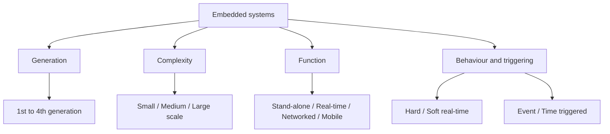

## Why should you care?

In 1969, a Japanese calculator company, Busicom, asked Intel to design about a dozen custom chips for a new desktop calculator. Each chip would do one fixed job.

Intel's engineers suggested something different: **one** general chip that does whatever its program tells it. Change the program and the same chip could run a calculator, a cash register or a traffic light. That chip became the **Intel 4004** (1971), the first commercial microprocessor.

That idea, cheap programmable chips instead of custom circuits, is why a ₹300 watch and a ₹30-lakh car both contain computers today. Knowing this history, and how we group the designs it produced, helps you pick the right hardware for a job.

## In one line

Embedded systems grew from 1960s guidance computers through 4-bit and 8-bit chips to today's 32/64-bit systems-on-chip, and are classified by generation, by complexity (small, medium, large scale), by function (stand-alone, real-time, networked, mobile) and by how they are triggered.

## Explained

### Q1. How did embedded systems develop over time?

| Period | Milestone |
|---|---|
| 1960s | ==Guidance computers for missiles and the **Apollo** spacecraft==: the first computers built into a larger machine for one job |
| 1971 | ==**Intel 4004**, a 4-bit microprocessor==, made for a calculator |
| 1976–1980 | ==**Microcontrollers**: CPU, memory and I/O on one chip== (Intel 8048, then the **8051** in 1980) |
| 1990s | ==16- and 32-bit processors (such as ARM)== spread into mobile phones, cars and networking |
| 2000s–2010s | ==Systems-on-chip, Arduino and Raspberry Pi==, the Internet of Things |
| Today | ==Multicore chips and edge AI== running inside devices |

The 8051 from 1980 is still made by many companies, and is the chip you will program in this course.

### Q2. Why do we classify embedded systems?

There are millions of embedded designs, from a TV remote to a satellite. Classifying them helps an engineer answer practical questions quickly:

- How powerful a processor is needed: 8-bit or 32-bit?
- Is an operating system needed? A real-time one?
- What happens if a deadline is missed: a small annoyance or a disaster?
- Does the device work alone, on a network, or on the move?

==Embedded systems are classified by generation, by complexity and performance, by functional requirement, and by deterministic behaviour and triggering.==

### Q3. What is classification by generation? ⭐

==Based on the processor technology used==:

| Generation | Processor used | Example |
|---|---|---|
| First | ==8-bit microprocessors (8085), 4-bit microcontrollers== | Digital telephone keypad, stepper motor control |
| Second | ==16-bit microprocessors, 8/16-bit microcontrollers== | Data-acquisition systems, SCADA |
| Third | ==32-bit processors, DSPs, ASICs== | Robotics, industrial process control, network routers |
| Fourth | ==Systems-on-chip, multicore processors== | Smartphones, smart TVs, tablets |

Each generation brought more power, more memory and, from the third generation on, an operating system in many devices.

### Q4. What is classification by complexity and performance? ⭐

| Type | Processor | Operating system | Example |
|---|---|---|---|
| Small-scale | ==8/16-bit microcontroller (e.g. 8051)== | ==Usually none== | Electronic toy, TV remote, washing machine |
| Medium-scale | ==16/32-bit microcontroller, DSP or RISC processor== | ==Sometimes an RTOS== | ATM, router, car engine controller |
| Large-scale (complex) | ==32/64-bit multicore, SoC, FPGA== | ==RTOS or embedded Linux== | Aircraft flight control, satellite, smartphone |

Small-scale: 8/16-bit, usually no OS. Medium-scale: 16/32-bit, may use an RTOS. Large-scale: 32/64-bit or multicore, needs an RTOS.

### Q5. What is classification by functional requirement? ⭐

==Based on what the system must do==:

| Type | Meaning | Example |
|---|---|---|
| Stand-alone | ==Works alone==: takes input, processes, gives output; no host computer needed | Digital camera, microwave oven, calculator |
| Real-time | ==Must produce the correct output **within a fixed time**== | Airbag controller, ABS brakes, pacemaker |
| Networked | ==Connected to a network== (LAN, internet) to share data or be controlled remotely | Smart electricity meter, CCTV camera, UPI soundbox |
| Mobile | ==Portable and battery-powered==, small size and low power | Mobile phone, fitness band, handheld POS machine |

One device can fit several types: a fitness band is mobile **and** networked.

### Q6. What are hard and soft real-time systems? ⭐

This classification is by **deterministic behaviour**: how strict the deadline is.

| Type | Missed deadline means | Example |
|---|---|---|
| Hard real-time | ==System failure, possibly loss of life== | Airbag, flight control, pacemaker |
| Soft real-time | ==Lower quality, but the system still works== | Video streaming, online game, ATM response |

==A hard real-time system must never miss a deadline; a soft real-time system can tolerate an occasional delay.==

### Q7. What are event-triggered and time-triggered systems?

This classification is by **triggering**: ==what makes the system act==.

- ==**Event-triggered:** acts when something happens==, such as a key press or a sensor crossing a limit (fire alarm).
- ==**Time-triggered:** acts at fixed time intervals==, such as reading a temperature every second (data logger).

## Analogy and real-life example

### Analogy

Think of vehicles. A bicycle, an autorickshaw and a goods train are all "transport", but you would never use a goods train to deliver one pizza. Classifying them by size, speed and purpose tells you which to use. Embedded systems are classified for the same reason: so that a TV remote gets a tiny 8-bit chip, and a satellite gets a powerful, fault-tolerant one.

### Real system: a modern car

A single car shows almost every class:
- **Airbag controller:** hard real-time, event-triggered.
- **Engine controller:** medium-scale, time-triggered (reads sensors many times a second).
- **Power-window controller:** small-scale, stand-alone.
- **Infotainment with maps:** large-scale, networked, soft real-time.

## Diagram

## Key points

> [!important] Key points
> - 1960s: Apollo and missile guidance computers were the first embedded systems.
> - 1971: Intel 4004, first commercial microprocessor, made for a calculator.
> - 1980: Intel 8051 microcontroller, still in wide use.
> - By generation: 1st (8-bit µP, 4-bit µC), 2nd (16-bit), 3rd (32-bit, DSP, ASIC), 4th (SoC, multicore).
> - By complexity: small-scale (8/16-bit, no OS), medium-scale (16/32-bit, may use RTOS), large-scale (32/64-bit, RTOS needed).
> - By function: stand-alone, real-time, networked, mobile.
> - Hard real-time: missing a deadline is a failure. Soft real-time: occasional delay is tolerated.
> - Event-triggered systems react to events; time-triggered systems act at fixed intervals.

## Common mistakes

> [!warning] Common mistake
> **"Real-time means fast."** Real-time means **on time**, every time. A system that answers in 50 ms but sometimes takes 2 seconds is fast but not real-time. A slower system that always answers within its fixed limit is real-time.

> [!warning] Common mistake
> **"Each device belongs to exactly one class."** The classes are different viewpoints, not boxes. A smart meter can be small-scale, networked and time-triggered all at once. In exams, name the classification scheme before naming the class.

## Exam questions

**Short answer (2–3 marks)**
1. Write a short note on the history of embedded systems.
2. Differentiate between hard real-time and soft real-time systems with one example each. ⭐
3. What are event-triggered and time-triggered embedded systems?
4. Classify the following: (a) TV remote, (b) airbag controller, (c) smart electricity meter.

**Long answer (5 marks)**
1. Explain the classification of embedded systems based on generation, with examples. ⭐
2. Classify embedded systems based on complexity and on functional requirements. Give two examples of each type. ⭐

## Sources

- Shibu K V, *Introduction to Embedded Systems*, McGraw Hill, Ch. 1, sections on history and classification (verify).
- Raj Kamal, *Embedded Systems: Architecture, Programming and Design*, Tata McGraw Hill, Ch. 1 (verify).
- Intel Corporation, "The Story of the Intel 4004", intel.com (verify).
