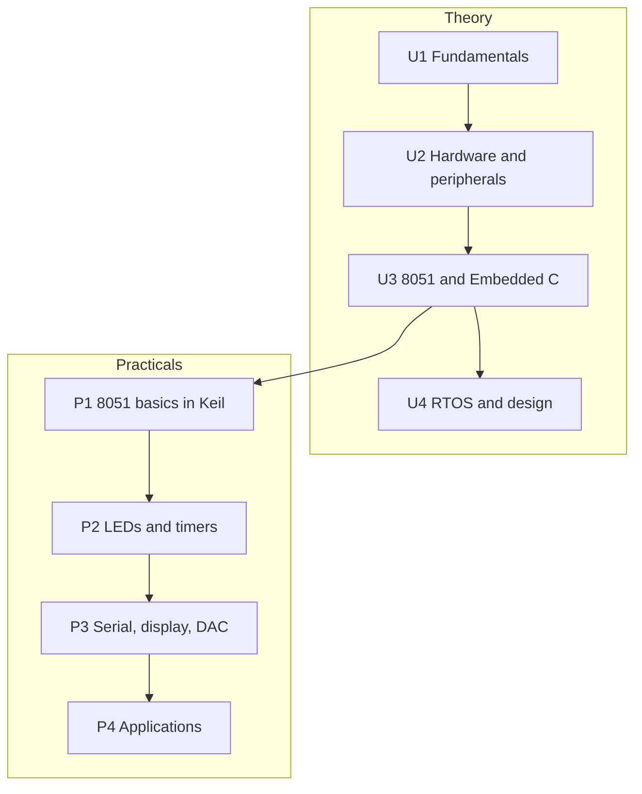

## Why this subject matters

A shopkeeper in Pune gets a UPI payment. Within a second, a small speaker box on the counter announces "₹250 received". Nobody opened an app or clicked anything.

That box is a computer, but not the kind on your desk. It has one job, it runs all day for years, it costs very little, and it must never freeze while a customer is waiting.

Computers like this are called **embedded systems**. They are hidden inside washing machines, cars, ATMs, FASTag readers, pacemakers, metro trains and satellites. Most processors made in the world today go into such devices, not into laptops. This subject teaches how they are built and programmed.

## A short story

In July 1969, minutes before Apollo 11 touched the Moon, the guidance computer flashed alarms "1201" and "1202". It was overloaded with extra work it had not expected.

The computer did not crash. Its software had been designed to drop low-priority jobs and keep the important ones running, such as steering and engine control. Mission control checked quickly and said "Go". The landing continued.

That computer had only about 4 KB of working memory. Yet it was built for one job, under strict timing, where failure was not an option. One job, real time, reliability: these three ideas are the heart of this course.

## Where it is used today

- **Home:** washing machines, microwave ovens, smart TVs, air conditioners, set-top boxes.
- **Payments and shops:** UPI soundboxes, card-swipe machines, ATMs, billing scales.
- **Transport:** a modern car has dozens of small controllers for the engine, airbags, ABS brakes and infotainment. FASTag readers and metro signalling are embedded too.
- **Health:** pulse oximeters, glucose meters, ECG machines, pacemakers.
- **Agriculture and cities:** soil-moisture sensors, smart electricity meters, traffic signals.
- **Space and defence:** satellites and launch vehicles from ISRO run embedded controllers.
- **AI at the edge:** small machine learning models now run directly on microcontrollers, for example wake-word detection ("Hey Google") and smart cameras.

## What you will be able to do

By the end of this course you will be able to:

- Tell an embedded system apart from a general-purpose computer and describe its parts.
- Explain the hardware inside: microcontroller, memory, sensors, actuators, timers and interfaces.
- Read the 8051 microcontroller's architecture and write Embedded C programs for it.
- Build and test programs in **Keil µVision** and simulate circuits in **Proteus**.
- Interface LEDs, seven-segment displays, a DAC, a stepper motor and a temperature sensor.
- Explain what a real-time operating system (RTOS) does and how an embedded product is developed from idea to market.

## Careers that use it

- **Embedded software / firmware engineer:** writes the code inside devices.
- **IoT developer:** connects devices to the cloud and mobile apps.
- **Automotive software engineer:** works on car controllers. Pune is a major hub, with firms such as KPIT Technologies, Tata Elxsi and Bosch working on vehicle software.
- **Test and validation engineer:** checks that devices behave correctly and safely.
- **Edge AI / TinyML engineer:** fits trained machine learning models into small devices. This is a natural bridge for Data Science students.
- **Hardware design engineer:** designs the circuit boards (needs electronics depth too).

## Map of the subject

## Sources

- Shibu K V, *Introduction to Embedded Systems*, McGraw Hill, Ch. 1 (verify).
- Raj Kamal, *Embedded Systems: Architecture, Programming and Design*, Tata McGraw Hill, Ch. 1 (verify).
- NASA, *Apollo 11 Lunar Surface Journal*, notes on the 1201 and 1202 program alarms (verify).
- University syllabus, BSc IT and BSc DS Sem 4, courses UITIV-005/006 and UDSIV-005/006 (BOS 05/06/2026).
