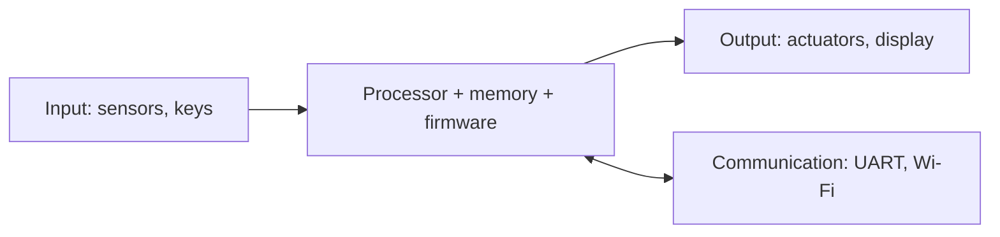

## Why should you care?

Your laptop hangs. You sigh, press restart, and two minutes later you are back. Annoying, but nobody is hurt.

Now imagine the airbag controller in a car "hangs" for two seconds during a crash. Or the UPI soundbox at a shop freezes during the evening rush, and the shopkeeper can no longer trust that payments have arrived.

Both the laptop and the airbag controller contain a processor, memory and software. So why do we expect one to be forgiving and the other to be perfect? The answer is the difference between a **general-purpose computer** and an **embedded system**, and it decides how each one is designed, programmed and tested.

## In one line

An embedded system is a combination of hardware and firmware built into a larger product to do one specific job, usually under limits of time, power, size and cost; a general-purpose computer runs many different programs chosen by its user.

## Explained

### Q1. What is an embedded system?

==An embedded system is an electronic system of hardware and firmware, designed to perform a specific function, usually as part of a larger device.==

Break the name down:
- **Embedded** means "fixed inside". The computer is hidden inside a washing machine, car or meter. The user sees the product, not the computer.
- **System** means several parts working together: processor, memory, input, output and the program.
- **Firmware** is the program stored permanently in the device's memory. It is written once by the maker and runs every time the device is switched on.

Examples: digital watch, microwave oven, pulse oximeter, FASTag reader, traffic signal controller.

### Q2. What is a general-purpose computer system?

==A general-purpose computer is designed to run many different programs, chosen and installed by its user.==

- Your laptop runs a browser now, a spreadsheet later, a game at night.
- It has a full operating system (Windows, Linux, macOS) that manages these programs.
- It has a general user interface: keyboard, mouse, large screen.
- Nobody knows in advance exactly what it will be used for, so it is designed to be flexible rather than to meet one fixed deadline.

Examples: desktop PC, laptop, server.

### Q3. How do the two differ?

| Point | General-purpose computer | Embedded system |
|---|---|---|
| Purpose | Many tasks | One specific task |
| Software | User installs and changes apps | Fixed firmware from the maker |
| Operating system | Full OS (Windows, Linux) | None, an RTOS or a small OS |
| Timing | Speed matters, deadlines rarely strict | Often must respond within a fixed time |
| Power | Mains or large battery | Often very low power |
| Size and cost | Larger, costlier | Small, cheap, made in lakhs |
| User interface | Keyboard, mouse, screen | Few buttons, LEDs, or none |
| Failure | Restart and continue | May be costly or dangerous |

Exams usually ask for five or six of these differences, with an example for each side.

### Q4. Is a smartphone embedded or general-purpose?

It sits on the boundary.

- **Like a general-purpose computer:** you install any app, it runs a full OS (Android, iOS), and its use is not fixed.
- **Like an embedded system:** it is battery-powered, compact and full of embedded parts. The camera module, the modem and the fingerprint sensor each have their own small processor and firmware.

So a smartphone is usually called a general-purpose device **built from many embedded subsystems**. An ATM is the opposite case: it runs a PC-like computer, but the whole machine does one job, so it is treated as embedded.

### Q5. What are the building blocks of an embedded system?

==Every embedded system has four blocks: input (sensors), processing (processor, memory and firmware), output (actuators) and communication.==

| Block | Job | Washing machine example |
|---|---|---|
| Input | Sense the world | Water-level sensor, door switch, buttons |
| Processing | Decide what to do | Microcontroller running the wash program |
| Output | Act on the world | Motor, water valve, display, buzzer |
| Communication | Talk to other devices | Wi-Fi module in smart models |

You will study each block in later lectures of this unit.

> [!beyond] Beyond the syllabus
> The line between the two kinds of system is moving. Small microcontrollers can now run trained machine learning models, an area called **TinyML** or **edge AI**. Wake-word detection ("Hey Google") and smart doorbells that recognise a person run a tiny neural network inside an embedded chip, without sending every frame to the cloud. For Data Science students, this is where your models and this subject meet.

## Analogy and real-life example

### Analogy

A general-purpose computer is like a hotel chef: you can order any dish, and the chef reads a new recipe for each order. An embedded system is like a pressure cooker's whistle valve or an electric rice cooker: it does one thing, does it the same way every time, and nobody has to instruct it.

### Real system: the UPI soundbox

- **Input:** a payment message arrives over its mobile network connection.
- **Processing:** a small processor checks the message and picks the amount.
- **Output:** the speaker announces "₹250 received".
- **Constraints:** it runs all day on a small battery, must work in noisy, dusty shops, and must never miss a payment. The shopkeeper cannot install apps on it.

That is a textbook embedded system.

## Diagram

## Key points

> [!important] Key points
> - Embedded system: hardware + firmware designed for one specific function, usually inside a larger product.
> - General-purpose computer: runs many programs chosen and installed by the user.
> - Firmware is fixed program code stored in the device's non-volatile memory.
> - Embedded systems work under constraints: real-time response, low power, small size, low cost, high reliability.
> - Main differences: purpose, software change, operating system, timing, power, cost, user interface.
> - Four blocks: input (sensors), processing (processor, memory, firmware), output (actuators), communication.
> - Smartphones are general-purpose devices built from many embedded subsystems.
> - Examples: washing machine, UPI soundbox, ATM, FASTag reader, pacemaker, car airbag controller.

## Common mistakes

> [!warning] Common mistake
> **"Embedded means small."** Not always. Metro train control, aircraft flight control and industrial plant controllers are large embedded systems. What makes a system embedded is its dedicated job, not its size.

> [!warning] Common mistake
> **"Embedded systems never have an operating system."** Many simple ones do not, but many others run a real-time operating system (RTOS) or embedded Linux. You will study RTOS in Unit 4.

> [!warning] Common mistake
> **"Firmware can never be changed."** Makers can update firmware, for example over-the-air updates in cars and phones. What the user cannot do is install their own programs to change the device's purpose.

## Exam questions

**Short answer (2–3 marks)**
1. Define an embedded system. Give two examples.
2. What is firmware? How is it different from application software on a PC?
3. State any four differences between an embedded system and a general-purpose computer.
4. Is a smartphone an embedded system? Justify your answer briefly.

**Long answer (5 marks)**
1. Compare embedded systems and general-purpose computer systems on at least six points, with an example of each.
2. With a neat block diagram, explain the building blocks of an embedded system, using a washing machine or a UPI soundbox as an example.

## Sources

- Shibu K V, *Introduction to Embedded Systems*, McGraw Hill, Ch. 1, "Embedded System vs General Computing System" (verify).
- Raj Kamal, *Embedded Systems: Architecture, Programming and Design*, Tata McGraw Hill, Ch. 1 (verify).
- Frank Vahid and Tony Givargis, *Embedded System Design*, Wiley India, Ch. 1 (verify).
