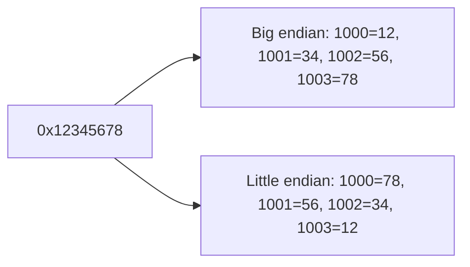

## Why should you care?

A temperature sensor in a cold-storage truck sends the reading 0x01F4 (500, meaning 50.0 °C) to a server. The server reads it as 0xF401 (62465) and raises a false alarm: "Temperature 6246 °C!"

Nothing was broken. Both machines were working correctly. They simply disagreed on **which byte comes first** when a number larger than one byte is stored or sent.

This disagreement, called **endianness**, causes real bugs whenever an embedded device talks to a PC, a server or another chip. Every embedded engineer has to check it.

## In one line

Endianness is the order in which a processor stores the bytes of a multi-byte number in memory: big endian stores the most significant byte at the lowest address, and little endian stores the least significant byte at the lowest address.

## Explained

### Q1. Why does byte order matter at all?

Memory is organised in **bytes**: each address holds 8 bits. But many numbers are larger: a 16-bit `int` needs 2 bytes, a 32-bit number needs 4.

So the processor must split the number across several addresses, and it must decide **which byte goes to the lowest address**. There are two choices, and different processor families chose differently.

The terms come from *Gulliver's Travels*, where two kingdoms fought over which end of a boiled egg to break first: the big end or the little end.

### Q2. What is big endian?

==Big endian: the most significant byte (MSB) is stored at the lowest memory address.==

Storing 0x12345678 at address 1000:

| Address | 1000 | 1001 | 1002 | 1003 |
|---|---|---|---|---|
| Byte | 12 | 34 | 56 | 78 |

The number reads left to right in memory exactly as we write it.

Used by: older Motorola 68000, IBM mainframes, and **network protocols** (TCP/IP sends data in big-endian order, called **network byte order**).

### Q3. What is little endian?

==Little endian: the least significant byte (LSB) is stored at the lowest memory address.==

Storing 0x12345678 at address 1000:

| Address | 1000 | 1001 | 1002 | 1003 |
|---|---|---|---|---|
| Byte | 78 | 56 | 34 | 12 |

The number appears "backwards" in memory.

Used by: Intel and AMD x86 (all PCs), and most ARM systems (ARM can run either way, but phones and microcontrollers usually use little endian).

### Q4. How can a program find out which one it is running on?

Store a known number and look at its first byte:

```c
#include <stdio.h>

int main(void)
{
    unsigned int x = 0x12345678;
    unsigned char *p = (unsigned char *)&x;   // look at x one byte at a time

    printf("Byte at lowest address: 0x%02X\n", p[0]);
    if (p[0] == 0x78)
        printf("Little endian\n");
    else
        printf("Big endian\n");
    return 0;
}
```

Output on an ordinary PC (x86):

```output
Byte at lowest address: 0x78
Little endian
```

### Q5. Where does endianness cause problems in embedded systems?

- **Device to PC or server:** a sensor node sends a 16-bit reading; if the two sides use different orders, the value is garbled (as in the truck example).
- **Networking:** data must be converted to network byte order (big endian) before sending, using functions like `htons()` and `htonl()`.
- **Files and memory dumps:** reading a binary file or EEPROM written by another processor.
- **Chip-to-chip links:** some sensors send the high byte first, some the low byte first; the datasheet says which.

==Whenever multi-byte data crosses between two systems, both must agree on the byte order.==

> [!beyond] Beyond the syllabus
> The 8051 has almost no instructions that read 16-bit values from memory, so for C variables the **compiler** decides the byte order. Keil C51 stores multi-byte variables in big-endian order (verify in the C51 manual), while the free SDCC compiler stores them in little-endian order. The same C code can therefore lay out memory differently on the same chip.

## Analogy and real-life example

### Analogy

Write the date 25 November 2026. In India we write 25-11-2026 (smallest unit, the day, first: like little endian). In an ISO format it is 2026-11-25 (largest unit, the year, first: like big endian). Both are correct, but if you read one as the other, "03-04" becomes 4 March instead of 3 April. Endianness is the same problem for bytes.

### Real system: a smart energy meter

A meter's microcontroller stores the reading 1500 units as the 16-bit value 0x05DC. It sends it over the network to the electricity board's server in **network byte order** (05 then DC). The server converts it back to its own little-endian order before saving it. If either conversion is skipped, the bill shows 0xDC05 = 56,325 units.

## Diagram



## Key points

> [!important] Key points
> - Endianness: the order in which bytes of a multi-byte number are stored in memory.
> - Big endian: MSB at the lowest address (0x12345678 → 12 34 56 78).
> - Little endian: LSB at the lowest address (0x12345678 → 78 56 34 12).
> - Big endian: Motorola 68000, IBM mainframes, network byte order (TCP/IP).
> - Little endian: Intel/AMD x86; most ARM systems (ARM is bi-endian).
> - Problems arise when data moves between systems: networks, files, sensor data.
> - Fix: agree on one order and convert (e.g. `htons()`, `htonl()` for networks).

## Common mistakes

> [!warning] Common mistake
> **Reversing bits instead of bytes.** Endianness changes the order of **bytes**, not the bits inside each byte. 0x1234 in little endian is stored as 34 12, not as 0x2C48.

> [!warning] Common mistake
> **Thinking single bytes are affected.** An 8-bit `char` or a text string stored one character per byte looks the same in both systems. Endianness matters only for values of 2 or more bytes.

## Exam questions

**Short answer (2–3 marks)**
1. What is endianness? Define big endian and little endian.
2. Show how 0xA1B2C3D4 is stored from address 2000 in big-endian and little-endian processors.
3. What is network byte order?

**Long answer (5 marks)**
1. Explain big-endian and little-endian processors with a memory diagram and examples of each.
2. Why is endianness important when an embedded device communicates with a PC or a network? Explain with an example.

## Sources

- Shibu K V, *Introduction to Embedded Systems*, McGraw Hill, Ch. 2, section on big-endian and little-endian processors (verify).
- Arm Keil, *C51 Compiler User's Guide*, data storage formats (verify).
- IETF, Internet protocol standards (RFC 791, RFC 1700) on network byte order (verify).
