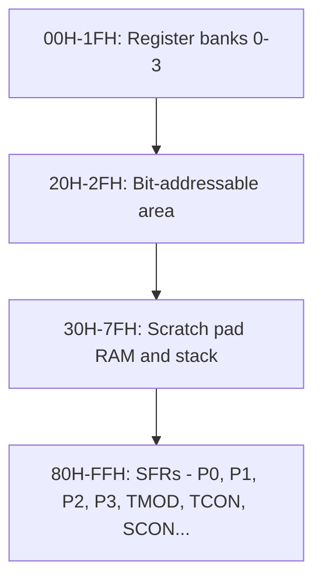

## Why should you care?

A new flat in a housing society has a **floor plan**: which room is the kitchen, which the bedroom, where the electricity meter and water tank are. Without it, a plumber or electrician would be guessing.

A microcontroller's addresses need the same kind of plan. Which addresses hold the program? Which hold variables? Which address do you write to so that an LED turns on? When a timer finishes, which address does the processor jump to?

These plans are the **memory map**, the **I/O map** and the **interrupt map**. Every datasheet starts with them, and every program you write for the 8051 depends on them, even when the C compiler hides the details.

## In one line

A memory map shows how a processor's address space is divided among program memory, data memory and registers; an I/O map shows the addresses of the I/O ports and peripherals; and an interrupt map lists each interrupt source with its vector address and priority.

## Explained

### Q1. What is a memory map? ⭐

==A memory map is a diagram or table showing which range of addresses is used for which memory or device.==

- ==It is drawn from the lowest to the highest address==, with each block labelled (ROM, RAM, registers, peripherals).
- ==It tells the programmer where code and data are placed==, and the hardware designer which chip to connect at which address.
- ==Unused address ranges are shown too==, so they can be used for expansion later.

Example: a processor with a 16-bit address bus can address 2¹⁶ = 65,536 locations (64 KB), numbered 0000H to FFFFH.

### Q2. What does the 8051's memory map look like? ⭐

The 8051 keeps program and data in **separate** address spaces:

| Space | Addresses | Holds |
|---|---|---|
| ==Program memory (code)== | 0000H–0FFFH on-chip (4 KB); up to FFFFH with external ROM | The program |
| ==Internal RAM: register banks== | 00H–1FH | Four banks of R0–R7 |
| ==Internal RAM: bit-addressable area== | 20H–2FH | 128 single bits, set or cleared one at a time |
| ==Internal RAM: scratch pad== | 30H–7FH | General variables and the stack |
| ==Special function registers (SFRs)== | 80H–FFH | Port, timer, serial and control registers |
| ==External data memory== | 0000H–FFFFH | Optional extra RAM (64 KB) |

### Q3. What is an I/O map, and how are I/O devices addressed? ⭐

==An I/O map lists the addresses assigned to each input/output port and peripheral.==

Two ways to give I/O devices addresses:
- ==**Memory-mapped I/O:**== devices share the memory address space; normal memory instructions read and write them. Simple, but uses up memory addresses.
- ==**I/O-mapped (port-mapped) I/O:**== devices have a separate I/O address space and special instructions (IN, OUT on the 8085 and x86).

On the 8051, the ports are **special function registers** inside the memory map: P0 at 80H, P1 at 90H, P2 at A0H, P3 at B0H. Writing to address 90H changes the pins of Port 1. External peripherals added to an 8051 are memory-mapped in the external data space.

### Q4. What is an interrupt map?

==An interrupt map lists every interrupt source with its vector address and its priority.==

- ==An **interrupt** is a signal that makes the processor pause its current work== and run a special function (the **interrupt service routine**, ISR).
- ==The **vector address** is where the processor jumps== for that interrupt.
- ==The **priority** decides which is served first== when two interrupts arrive together.

### Q5. What is the 8051's interrupt map? ⭐

| Source | Vector address | Default priority |
|---|---|---|
| ==Reset== | 0000H | Highest (not maskable) |
| ==External interrupt 0 (INT0, pin P3.2)== | 0003H | 1 (highest of the five) |
| ==Timer 0 overflow (TF0)== | 000BH | 2 |
| ==External interrupt 1 (INT1, pin P3.3)== | 0013H | 3 |
| ==Timer 1 overflow (TF1)== | 001BH | 4 |
| ==Serial port (RI or TI)== | 0023H | 5 (lowest) |

The vectors are only 8 bytes apart, so an ISR usually starts with a jump to the real code elsewhere. In Keil C, you simply write `void timer0_isr(void) interrupt 1` and the compiler places the jump.

## Analogy and real-life example

### Analogy

- **Memory map:** the floor plan of a building, showing which floor holds offices, which the store room.
- **I/O map:** the list of meter and switch-board locations in that building.
- **Interrupt map:** the emergency contact list on the wall. Fire alarm: call the fire station first; lift stuck: call the lift company. Each emergency (interrupt) has a fixed number (vector) and an order of importance (priority).

### Real system: a digital clock on an 8051

- **Memory map:** the program sits in on-chip ROM from 0000H; the hours, minutes and seconds are variables in internal RAM.
- **I/O map:** Port 1 drives the display segments; Port 2 selects which digit is lit.
- **Interrupt map:** Timer 0's interrupt (vector 000BH) fires every 50 ms to keep time; External interrupt 0 (vector 0003H) handles the "set time" button.

## Diagram

## Key points

> [!important] Key points
> - Memory map: which address range is used by which memory or device.
> - 16-bit address bus: 64 KB, addresses 0000H–FFFFH.
> - 8051 program memory: 4 KB on-chip (0000H–0FFFH), up to 64 KB external.
> - 8051 internal RAM: register banks 00H–1FH, bit-addressable 20H–2FH, scratch pad 30H–7FH; SFRs 80H–FFH.
> - I/O map: addresses of ports and peripherals. Memory-mapped I/O vs I/O-mapped (port-mapped) I/O.
> - 8051 ports are SFRs: P0 80H, P1 90H, P2 A0H, P3 B0H.
> - Interrupt map: source, vector address, priority.
> - 8051 vectors: Reset 0000H, INT0 0003H, T0 000BH, INT1 0013H, T1 001BH, Serial 0023H.

## Common mistakes

> [!warning] Common mistake
> **Thinking the 8051 has one 64 KB memory.** It has separate spaces: up to 64 KB of program memory **and** up to 64 KB of external data memory, plus 128 bytes of internal RAM and the SFR area. The same address (say 0010H) can mean different places in each space.

> [!warning] Common mistake
> **Mixing up the vector address and the ISR.** The vector address is only where the processor jumps; the ISR is the code that runs. On the 8051 the vector usually holds just a jump to the ISR.

## Exam questions

**Short answer (2–3 marks)**
1. What is a memory map? Why is it needed?
2. Differentiate between memory-mapped I/O and I/O-mapped I/O.
3. Write the vector addresses of the 8051 interrupts. ⭐

**Long answer (5 marks)**
1. Explain the memory map of the 8051 microcontroller with a neat diagram. ⭐
2. Explain the memory map, I/O map and interrupt map of an embedded system, with 8051 examples. ⭐

## Sources

- Muhammad Ali Mazidi and Janice Mazidi, *The 8051 Microcontroller and Embedded Systems*, Pearson, Ch. 2 (RAM and SFRs) and Ch. 11 (interrupts) (verify).
- Intel, *MCS-51 Microcontroller Family User's Manual*, memory organisation and interrupt vectors (verify).
- Shibu K V, *Introduction to Embedded Systems*, McGraw Hill (verify).
