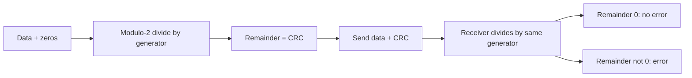

## Why should you care?

An ATM in a small town powers up every morning. Before it gives anyone cash, its controller checks itself: is the RAM working? Is the program in flash exactly what was installed, with not a single bit changed by heat, age or a voltage spike?

If one bit in the program changed, the machine could dispense the wrong amount. If one RAM chip had a broken address line, two variables could silently overwrite each other.

Embedded systems therefore test their own memory, usually at power-on, and protect important data with a **checksum** or **CRC**. These checks are cheap to run and catch faults before they cause damage.

## In one line

Memory testing checks that RAM can store and return data correctly (data bus, address bus and device tests), while a checksum or CRC (Cyclic Redundancy Check), computed by modulo-2 division with a generator polynomial, detects whether the contents of ROM, flash or transmitted data have changed.

## Explained

### Q1. Why is memory tested in embedded systems?

- ==Memory chips and connections can fail==: a broken track on the board, a short between two pins, a faulty chip, or wear in flash.
- ==Faults may be silent==: the program keeps running with wrong data.
- ==Many systems run a **power-on self-test (POST)**== before starting, and refuse to run (or show an error) if memory fails.

Two different checks are needed:
- ==**RAM test:**== can every location be written and read back correctly?
- ==**ROM/flash test:**== are the stored contents still exactly what was programmed?

### Q2. How is RAM tested?

A RAM test checks three things, in this order:

1. ==**Data bus test:**== write and read back a **walking 1** pattern (00000001, 00000010, 00000100 …) at one address. If any data line is stuck or shorted, a pattern comes back wrong.
2. ==**Address bus test:**== write different values at addresses that are powers of two (0001H, 0002H, 0004H …) and check that writing one does not change another. This finds stuck or shorted address lines.
3. ==**Device test:**== write a pattern (for example an incrementing count) into every location, read it all back, then repeat with the inverted pattern. This finds bad cells.

==A RAM test checks the data bus, the address bus and every memory cell.==

### Q3. How are ROM and flash contents checked?

ROM cannot be written during a test, so we check its **contents** instead:

- ==**Checksum:**== add up all the bytes of the program and store the total. At power-on, add them again and compare. Simple, but some errors cancel out (one byte +1, another −1).
- ==**CRC (Cyclic Redundancy Check):**== a stronger check value computed by **modulo-2 polynomial division**. It catches all single-bit errors, all burst errors shorter than the CRC length, and almost all other errors.

The same idea protects **data in transit**: UART frames, CAN messages, Ethernet frames, and files all carry a CRC.

### Q4. How is a CRC calculated?

1. ==Choose a **generator** polynomial== agreed by sender and receiver, e.g. x³ + x + 1 = **1011**.
2. ==Append zeros to the data==: as many as the generator's degree (here 3).
3. ==Divide by the generator using **modulo-2 division**==: subtract with XOR, no carries or borrows.
4. ==The **remainder** is the CRC==. Send (or store) the data followed by the CRC.
5. ==The receiver divides the whole block by the same generator==. Remainder 0 means no error detected; any other remainder means an error.

### Q5. Can you show a CRC worked example?

Data **110101**, generator **1011** (degree 3), so append three zeros: 110101**000**.

```text
110101000
1011                 XOR  -> 011001000
 1011                XOR  -> 001111000
  1011               XOR  -> 000100000
   1011              XOR  -> 000001100
     1011            XOR  -> 000000111
Remainder (last 3 bits) = 111
```

- ==**CRC is 111**==; transmitted block = 110101**111**.
- ==**Check:**== 110101111 ÷ 1011 gives remainder **000**: no error.
- ==**With an error**== (fifth bit flipped: 110111111), the remainder is **110**, not zero: error detected.

## Analogy and real-life example

### Analogy

A RAM test is like a teacher checking every desk in a classroom: put a book on each desk, then walk round to see that every book is still where it was put. A CRC is like the check digit on a bank account number or an ISBN: a small number calculated from all the other digits. If one digit is copied wrongly, the check digit no longer matches and the mistake is caught.

### Real system: a card-swipe (POS) machine at power-on

1. Tests its RAM with data-bus, address-bus and pattern tests.
2. Computes the CRC of its firmware in flash and compares it with the CRC stored at the factory.
3. If either fails, it shows an error and refuses transactions.
4. Every message it then sends to the bank carries a CRC, so a corrupted message is rejected and sent again.

## Diagram



## Key points

> [!important] Key points
> - Memory faults can be silent; systems run a power-on self-test (POST).
> - RAM test: data bus test (walking 1s), address bus test (power-of-two addresses), device test (patterns in every cell).
> - ROM/flash test: check contents with a checksum or CRC.
> - Checksum: sum of all bytes; simple but weak.
> - CRC: remainder of modulo-2 division of data by a generator polynomial; strong error detection.
> - Steps: append zeros (degree of generator), XOR-divide, remainder is CRC; receiver remainder 0 means no error.
> - Example: data 110101, generator 1011 → CRC 111, sent 110101111.
> - CRCs also protect data in UART, CAN, Ethernet and files.

## Common mistakes

> [!warning] Common mistake
> **Using normal subtraction in CRC division.** CRC uses modulo-2 arithmetic: each "subtraction" is an XOR, with no borrows. 1 − 1 = 0, 0 − 1 = 1, and nothing is carried.

> [!warning] Common mistake
> **Appending the wrong number of zeros.** Append as many zeros as the **degree** of the generator, which is one less than its number of bits. Generator 1011 (4 bits) means 3 zeros and a 3-bit CRC.

## Exam questions

**Short answer (2–3 marks)**
1. Why is memory testing needed in embedded systems?
2. What is a checksum? State one limitation.
3. Find the CRC for data 1101 with generator 1011.

**Long answer (5 marks)**
1. Explain the data bus, address bus and device tests used for RAM testing.
2. What is CRC? Explain its calculation and checking with an example.

## Sources

- Michael Barr, *Programming Embedded Systems in C and C++*, O'Reilly, Ch. 6, memory testing, checksums and CRCs (verify).
- Andrew S. Tanenbaum, *Computer Networks*, Ch. 3, cyclic redundancy check (verify).
- Shibu K V, *Introduction to Embedded Systems*, McGraw Hill (verify).
