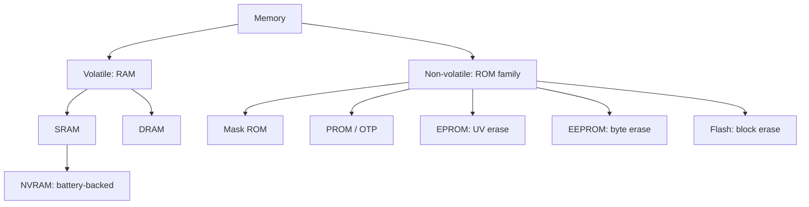

## Why should you care?

Unplug a TV remote's batteries for a minute and put them back: it still works, because its program is stored in memory that does not forget. But a calculator forgets the number you were typing the moment it turns off.

A smart electricity meter must remember the units consumed even through a week-long power cut. A car's controller must store its program for 15 years, yet accept a software update at the service centre.

Each of these needs a different kind of memory. Choosing wrongly means a product that loses data, wears out, or costs too much. This lecture sorts out the memory types used in embedded systems.

## In one line

Embedded systems use volatile RAM (SRAM, DRAM) for working data that is lost at power-off, and non-volatile memory (mask ROM, PROM/OTP, EPROM, EEPROM, flash) to hold the program and settings permanently; flash is the most common program memory today.

## Explained

### Q1. How is memory classified?

==Memory is classified as volatile (loses data when power is off) or non-volatile (keeps data without power).==

- ==**RAM** (Random Access Memory) is volatile==: fast to read and write; holds variables, stack and buffers while running.
- ==**ROM** (Read Only Memory) family is non-volatile==: holds the program (firmware) and fixed data.
- ==Embedded systems need both==: ROM-type memory for the program, RAM for the data it works on.

On the AT89C51: 4 KB flash (program) and 128 bytes RAM (data).

### Q2. What are SRAM and DRAM?

| Point | SRAM (Static RAM) | DRAM (Dynamic RAM) |
|---|---|---|
| Stores a bit in | ==A flip-flop (about 6 transistors)== | ==A tiny capacitor (1 transistor + 1 capacitor)== |
| Refresh needed? | ==No== | ==Yes, thousands of times per second== |
| Speed | Faster | Slower |
| Density and cost | Lower density, costlier per bit | Higher density, cheaper per bit |
| Used for | Microcontroller on-chip RAM, cache | Main memory in PCs and phones |

==Microcontrollers use SRAM on-chip, because it is fast and needs no refresh circuit.==

**NVRAM** (non-volatile RAM) is SRAM with a small backup battery, so it keeps data when main power fails.

### Q3. What are the types of ROM?

| Type | How it is written | Erasable? |
|---|---|---|
| ==**Mask ROM**== | Program fixed during chip manufacture | No |
| ==**PROM / OTP**== | Programmed once by the user (fuses blown) | No |
| ==**EPROM**== | Programmed electrically | Yes, by **ultraviolet light** through a quartz window (whole chip, about 15–20 min) |
| ==**EEPROM**== | Programmed electrically | Yes, **electrically, byte by byte**, in the circuit |
| ==**Flash**== | Programmed electrically | Yes, **electrically, block by block**; fast |

Mask ROM is cheapest at very high volume; OTP suits medium volume when the code is final.

### Q4. Why is flash the most used program memory today?

- ==**Electrically erasable in the circuit:**== no UV lamp, no removing the chip; supports in-system programming and firmware updates.
- ==**Erased in blocks:**== much faster than EEPROM's byte-by-byte erase for large programs.
- ==**High density, low cost:**== megabytes on one chip.
- ==**Limited write cycles:**== each block wears out after many erase/write cycles (the AT89C51 datasheet states 1,000; modern flash often 10,000 to 100,000 or more).

==EEPROM is used for small settings that change often; flash for the program and large data.==

**Types of flash:** **NOR flash** allows reading any byte directly, so code can run from it (microcontroller program memory). **NAND flash** is denser and cheaper, read in pages, used for storage (pen drives, SD cards, phone storage).

### Q5. Which memory goes where in an embedded system?

| Need | Memory used |
|---|---|
| ==Program (firmware)== | Flash (or mask ROM/OTP in very high-volume products) |
| ==Variables, stack, buffers== | SRAM |
| ==Settings that must survive power-off== | EEPROM (or a reserved flash block) |
| ==Large data: logs, images, audio== | NAND flash, SD card |
| ==Clock time and settings during power cuts== | Battery-backed RAM (NVRAM) in an RTC chip |

## Analogy and real-life example

### Analogy

- **RAM** is a classroom whiteboard: fast to write and erase, but wiped clean at the end of the day (power off).
- **Mask ROM** is a printed textbook: content fixed at the printing press.
- **OTP** is writing in permanent ink: once only.
- **EPROM** is a slate you must take outside and wash completely (UV erase).
- **EEPROM** is a pencil diary: erase and rewrite any single word.
- **Flash** is a pencil diary where you erase a whole page at a time, but much faster.

### Real system: a smart electricity meter

- **Flash:** the meter firmware, updatable by the electricity board.
- **SRAM:** current voltage and current readings, calculations in progress.
- **EEPROM:** total units consumed, meter ID, tariff, saved regularly so a power cut loses nothing.
- **NAND flash:** months of usage history for the board to download.

## Diagram

## Key points

> [!important] Key points
> - Volatile: loses data at power-off (RAM). Non-volatile: keeps data (ROM family).
> - SRAM: flip-flop cells, no refresh, fast, costly; used on-chip in microcontrollers.
> - DRAM: capacitor cells, needs refresh, dense, cheap; used as PC/phone main memory.
> - NVRAM: SRAM with a backup battery.
> - Mask ROM (factory), PROM/OTP (once), EPROM (UV erase), EEPROM (electrical, byte), flash (electrical, block).
> - Flash: most common program memory; in-circuit updates; limited erase/write cycles.
> - NOR flash: code storage, random read. NAND flash: data storage, dense and cheap.
> - EEPROM for small changing settings; flash for program and bulk data.

## Common mistakes

> [!warning] Common mistake
> **"ROM can never be written."** Only mask ROM and OTP are truly fixed. EPROM, EEPROM and flash are all "ROM-type" (non-volatile) memories that can be erased and rewritten.

> [!warning] Common mistake
> **Saving a value to flash or EEPROM in a fast loop.** Writing every millisecond wears the memory out within hours or days. Save only when the value changes, or at intervals, and keep fast-changing data in RAM.

## Exam questions

**Short answer (2–3 marks)**
1. Differentiate between volatile and non-volatile memory with examples.
2. Compare SRAM and DRAM.
3. Differentiate between EEPROM and flash memory.

**Long answer (5 marks)**
1. Explain the different types of ROM used in embedded systems.
2. Explain the types of memory used in embedded systems, and state which memory is used for program, data and settings, with reasons.

## Sources

- Shibu K V, *Introduction to Embedded Systems*, McGraw Hill, Ch. 2, memory (verify).
- Frank Vahid and Tony Givargis, *Embedded System Design*, Wiley India, Ch. 5, memory (verify).
- Microchip (Atmel), *AT89C51* datasheet: 4 KB flash, endurance 1,000 write/erase cycles.
