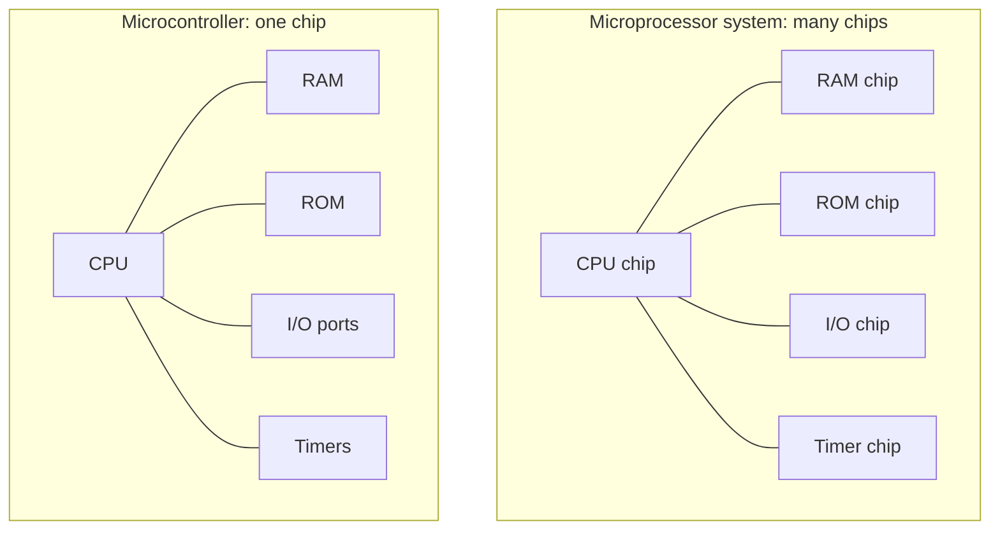

## Why should you care?

Suppose you are designing a ₹400 digital weighing scale for a kirana shop. You need something that reads the load sensor, does a little arithmetic and drives a small display.

You could use a microprocessor like the one in a PC. But then you would also need separate chips for memory, a timer and input/output, plus a bigger circuit board and more power. The scale would cost more than a customer would pay.

Or you could use a microcontroller: one small chip that already has the processor, memory, timers and I/O pins inside. One chip, a few rupees, a tiny board.

Choosing between these two is the first decision in almost every embedded design.

## In one line

A microprocessor is only a CPU on a chip and needs external memory and I/O chips, while a microcontroller puts a CPU, memory, timers and I/O ports on a single chip, making it the usual heart of an embedded system.

## Explained

### Q1. What is a microprocessor?

==A microprocessor is a CPU on a single chip; memory, timers and I/O must be added as separate chips.==

- It contains the ALU (arithmetic logic unit), registers and control unit, and little else.
- To build a working computer, you connect external RAM, ROM, I/O ports and timers through the address, data and control buses.
- It is designed for **general computing**: high speed, large memory, running many programs.
- Examples: Intel 8085 (8-bit), Intel 8086 (16-bit), Intel Core i5, AMD Ryzen.

### Q2. What is a microcontroller?

==A microcontroller is a single chip containing a CPU, RAM, ROM, I/O ports, timers and often a serial port and ADC.==

- It is a complete small computer on one chip, built for **control** tasks.
- It needs very few external parts: a crystal, a reset circuit and power.
- It is cheap, small and uses little power, which suits embedded systems.
- Examples: Intel 8051, Microchip PIC, Atmel AVR (used in Arduino Uno), ARM Cortex-M (STM32).

### Q3. How do they differ?

| Point | Microprocessor | Microcontroller |
|---|---|---|
| Contains | CPU only | CPU + RAM + ROM + I/O + timers |
| External chips | Many needed | Very few needed |
| Purpose | General computing | Dedicated control tasks |
| Speed | High (GHz) | Moderate (MHz) |
| Memory | Large, external (GB) | Small, on-chip (KB) |
| Power use | High | Low |
| Cost and size of system | High, large | Low, small |
| Bit-handling instructions | Few | Many (set or clear one pin) |
| Examples | 8085, 8086, Core i5 | 8051, PIC, AVR, ARM Cortex-M |

### Q4. Which one does an embedded system use, and why?

Most embedded systems use a **microcontroller**, because they need:
- **Low cost:** one chip instead of five or six.
- **Small size:** fits inside a remote, a watch or a sensor.
- **Low power:** runs for months on a battery.
- **Ready I/O:** pins can directly read switches and drive LEDs or relays.

Large embedded systems, such as a smartphone, a network router or a car's infotainment unit, use powerful **microprocessors** or systems-on-chip, because they need more speed and memory than a microcontroller offers.

### Q5. How does a microcontroller system look compared to a microprocessor system?

**Microprocessor system:** CPU chip + RAM chip + ROM chip + I/O chip + timer chip, all joined by external buses on a large board.

**Microcontroller system:** one microcontroller chip + crystal + reset circuit. The buses are inside the chip.

That is why the 8051 board you will use in practicals is so simple compared with an 8085 trainer kit, even though both do similar small jobs.

> [!beyond] Beyond the syllabus
> **Harvard vs von Neumann architecture.** A von Neumann processor keeps program and data in one shared memory, using one bus. A Harvard processor keeps them in separate memories with separate buses, so it can fetch an instruction and read data at the same time. The 8051 uses a Harvard-style design: separate program memory (ROM) and data memory (RAM). You will see this again in the 8051 architecture in Unit 3.

## Analogy and real-life example

### Analogy

A microprocessor is like hiring a skilled chef but having to buy the stove, fridge, utensils and gas connection separately. A microcontroller is like a food truck: kitchen, storage, stove and serving window all in one compact unit. The chef alone is more powerful, but the food truck is cheaper and ready to work anywhere.

### Real system: a microwave oven vs a laptop

- **Microwave oven:** a single microcontroller reads the keypad, runs the timer, drives the display and switches the magnetron. Total cost of the chip: a few dozen rupees.
- **Laptop:** a microprocessor (Core i5) with separate RAM sticks, an SSD, a chipset and many controllers. Far more powerful, far more expensive, and it needs a cooling fan.

## Diagram

## Key points

> [!important] Key points
> - Microprocessor: CPU only on a chip; needs external RAM, ROM, I/O and timers.
> - Microcontroller: CPU, RAM, ROM, I/O ports and timers on one chip.
> - Microprocessors suit general computing: high speed, large memory.
> - Microcontrollers suit embedded control: low cost, small size, low power.
> - Microcontrollers have strong bit-handling instructions for controlling single pins.
> - Microprocessor examples: 8085, 8086, Core i5. Microcontroller examples: 8051, PIC, AVR, ARM Cortex-M.
> - Most embedded systems use microcontrollers; large ones (smartphones, routers) use processors or SoCs.

## Common mistakes

> [!warning] Common mistake
> **"A microcontroller is just a slow microprocessor."** Speed is not the defining difference. The difference is what is on the chip: a microcontroller carries its own memory and I/O, so it can work almost alone.

> [!warning] Common mistake
> **"Arduino is a microcontroller."** Arduino is a development **board** and software platform. The microcontroller on an Arduino Uno is the ATmega328P chip.

## Exam questions

**Short answer (2–3 marks)**
1. Define microprocessor and microcontroller.
2. Why are microcontrollers preferred in embedded systems? Give three reasons.
3. Name two microprocessors and two microcontrollers.

**Long answer (5 marks)**
1. Differentiate between microprocessor and microcontroller on at least six points.
2. With a block diagram, compare a microprocessor-based system and a microcontroller-based system.

## Sources

- Shibu K V, *Introduction to Embedded Systems*, McGraw Hill, Ch. 2, "Core of the Embedded System" (verify).
- Muhammad Ali Mazidi and Janice Mazidi, *The 8051 Microcontroller and Embedded Systems*, Pearson, Ch. 1 (verify).
- Ajay V. Deshmukh, *Microcontrollers: Theory and Applications*, Tata McGraw Hill, Ch. 1 (verify).
