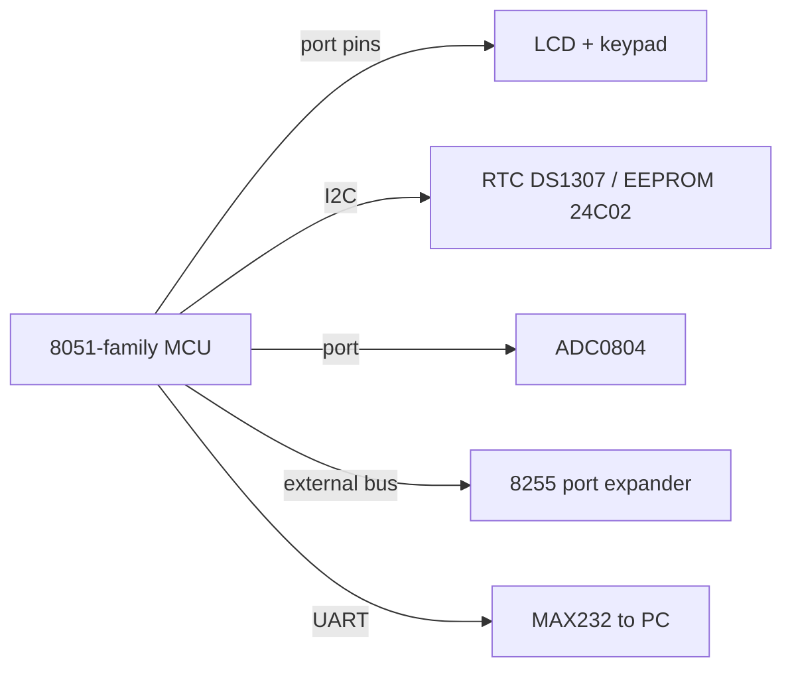

## Why should you care?

Imagine you built a working product on an AT89C51, and now the program has grown past 4 KB. Do you redesign the whole board and rewrite the code for a new chip? No. You pull out the AT89C51 and plug in an **AT89S52**: same pins, same instructions, double the memory. Your code runs unchanged.

That is possible because both chips belong to the same **processor family**.

And when the chip itself lacks something, say a clock that keeps time when power is off, you add an **external peripheral**, such as a real-time clock chip, beside it. Choosing the right family member and the right peripherals is a big part of embedded hardware design.

## In one line

A processor family is a group of chips sharing the same core and instruction set but differing in memory, peripherals and speed, so code moves easily between them; external peripherals are separate chips (RTC, EEPROM, ADC, LCD, port expander) added to a microcontroller to provide features it lacks.

## Explained

### Q1. What is a processor family? ⭐

==A processor family is a set of processors or microcontrollers that share the same core architecture and instruction set, but differ in memory size, peripherals, speed or package.==

- ==Code written for one member runs on the others== with little or no change.
- ==Members cover different price and feature levels==, so a designer picks the smallest one that fits.
- ==Upgrading is easy==: move to a bigger family member without relearning tools.

Examples: the **8051 family** (MCS-51), the **ARM Cortex-M family** (M0, M3, M4, M7), the **AVR family** (ATtiny, ATmega).

### Q2. What are the members of the 8051 family? ⭐

| Chip | Program memory | RAM | Timers | Note |
|---|---|---|---|---|
| ==8031== | None (external ROM needed) | 128 B | 2 | ROM-less version |
| ==8051== | 4 KB mask ROM | 128 B | 2 | The original (Intel, 1980) |
| ==8751== | 4 KB UV-EPROM | 128 B | 2 | Erased with ultraviolet light |
| ==8052== | 8 KB ROM | 256 B | 3 | Bigger version |
| ==AT89C51== | 4 KB flash | 128 B | 2 | Electrically reprogrammable (Atmel) |
| ==AT89S52== | 8 KB flash, in-system programmable | 256 B | 3 | Adds a watchdog timer |

All share the 8051 instruction set, so a program for the 8051 runs on every one of them.

### Q3. What are external peripherals? ⭐

==External peripherals are chips connected outside the microcontroller to add functions that it does not have on-chip.==

The basic 8051 has no ADC, no real-time clock, no EEPROM and only 32 I/O pins, so designs often add:

| Peripheral | Example chip | Adds |
|---|---|---|
| ==Port expander== | 8255 PPI | 24 more I/O lines |
| ==Real-time clock (RTC)== | DS1307 (I2C) | Date and time, kept by a coin cell |
| ==EEPROM== | 24C02 (I2C) | Settings that survive power-off |
| ==ADC / DAC== | ADC0804 / DAC0808 | Read analog sensors / produce analog output |
| ==Display and keypad== | 16×2 LCD (HD44780), 4×4 keypad | User interface |
| ==Level converter== | MAX232 | Converts 5 V UART to RS-232 levels for a PC |

### Q4. How are external peripherals connected? ⭐

- ==**Through port pins:**== the simplest way, e.g. an LCD on Port 1 and Port 2, a keypad on Port 3.
- ==**On the external bus (memory-mapped):**== the peripheral gets an address in the external data space, as with the 8255.
- ==**Through serial interfaces:**== I2C (RTC, EEPROM), SPI (SD card), UART (GSM, GPS modules).

Each connection uses pins, so the designer plans the pins first: which port drives what.

### Q5. How do you choose a family member and its peripherals?

Ask, in order:
1. ==**Memory:**== how big is the program and data? Leave room for growth.
2. ==**I/O pins:**== how many inputs and outputs are needed?
3. ==**On-chip peripherals:**== timers, UART, ADC, watchdog. Each one built in saves an external chip.
4. ==**Speed and power:**== fast enough, but low power if battery-run.
5. ==**Cost and availability:**== price at your volume, and whether it will still be made in five years.
6. ==**Tools:**== compiler, simulator and programmer support.

## Analogy and real-life example

### Analogy

A processor family is like a car model line: the base, mid and top variants share the same engine design and controls, but differ in features. Learning to drive one means you can drive all. External peripherals are accessories you fit later: a music system, a reverse camera, roof carriers.

### Real system: a school bell timer

- **Microcontroller:** AT89S52, chosen over the AT89C51 for 8 KB flash and the watchdog timer.
- **External peripherals:** a DS1307 RTC keeps the time even during power cuts; a 24C02 EEPROM stores the bell schedule; a 16×2 LCD and four keys let the office staff change times; a relay rings the bell.

## Diagram

## Key points

> [!important] Key points
> - Processor family: same core and instruction set; different memory, peripherals, speed, package.
> - Benefits: code reuse, easy upgrade, choice of cost and features.
> - 8051 family: 8031 (ROM-less), 8051 (4 KB ROM), 8751 (EPROM), 8052 (8 KB, 256 B RAM, 3 timers), AT89C51 (4 KB flash), AT89S52 (8 KB flash, ISP, watchdog).
> - External peripherals: chips added for missing features.
> - Examples: 8255 port expander, DS1307 RTC, 24C02 EEPROM, ADC0804, DAC0808, LCD, keypad, MAX232.
> - Connections: port pins, external bus (memory-mapped), serial (I2C, SPI, UART).
> - Selection: memory, I/O pins, on-chip peripherals, speed and power, cost, tools.

## Common mistakes

> [!warning] Common mistake
> **"Same family means identical chips."** Family members share instructions, but memory sizes, extra timers and special registers differ. A program using Timer 2 runs on an 8052 but not on an 8051, which has only two timers.

> [!warning] Common mistake
> **Adding external chips for features already on-chip.** Always check the datasheet first: a newer family member may include the ADC, EEPROM or watchdog you were about to add.

## Sources

- Muhammad Ali Mazidi and Janice Mazidi, *The 8051 Microcontroller and Embedded Systems*, Pearson, Ch. 1, 8051 family members (verify).
- Microchip (Atmel), *AT89S52* and *AT89C51* datasheets (verify).
- Shibu K V, *Introduction to Embedded Systems*, McGraw Hill (verify).
