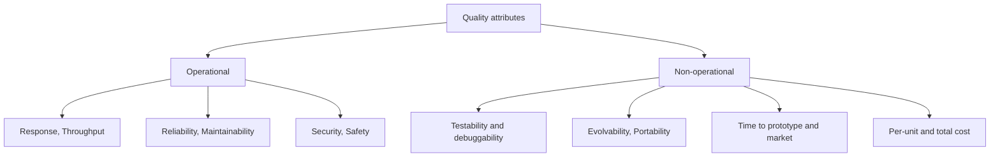

## Why should you care?

Two companies sell UPI soundboxes with the same features at the same price. Six months later, shopkeepers love one brand and avoid the other. Why?

- One announces payments instantly; the other sometimes lags by several seconds.
- One runs for months without trouble; the other freezes and needs a restart.
- One gets a remote fix when a bug appears; the other must be sent back to the company.

The features were equal. The **quality attributes** were not. These are the properties that decide whether a working device is also a **good** device, and they are what customers, reviewers and examiners judge.

## In one line

Quality attributes are the non-functional requirements of an embedded system: operational attributes (response, throughput, reliability, maintainability, security, safety) matter while it runs, and non-operational attributes (testability and debuggability, evolvability, portability, time to prototype and market, per-unit and total cost) matter before and after.

## Explained

### Q1. What are quality attributes, and how are they grouped?

A device's **functional requirements** say what it must do ("announce the payment amount"). Its **quality attributes** say how well it must do it ("within one second, every time, for years").

==Quality attributes are grouped into operational (considered while the system is running) and non-operational (considered during design, production and later life).==

| Operational | Non-operational |
|---|---|
| Response | Testability and debuggability |
| Throughput | Evolvability |
| Reliability | Portability |
| Maintainability | Time to prototype and market |
| Security | Per-unit and total cost |
| Safety | |

### Q2. What are response and throughput?

**Response:** how quickly the system reacts to an input or event.
- Example: a car's brake controller must respond in milliseconds; a weather logger can take a few seconds.

**Throughput:** how much work the system completes in a given time.
- Example: a barcode scanner at a supermarket counter scanning 50 items per minute; a network router forwarding a few million packets per second.

Response is about **how fast one event** is handled; throughput is about **how many** are handled per unit time.

### Q3. What is reliability, and how is it measured?

**Reliability** is how long the system works without failure.

- **MTBF** (Mean Time Between Failures): average working time between two failures. Higher is better.
- **MTTR** (Mean Time To Repair): average time to repair and restart after a failure. Lower is better.

$$\text{Availability} = \frac{\text{MTBF}}{\text{MTBF} + \text{MTTR}} \times 100\%$$

**Worked example:** a traffic-signal controller has MTBF = 2,000 hours and MTTR = 4 hours.
Availability = 2000 / (2000 + 4) × 100 = 2000 / 2004 × 100 ≈ **99.8%**.

### Q4. What are maintainability, security and safety?

**Maintainability:** how easily the system can be kept working: fixed, serviced or updated. Measured by MTTR. Example: a meter whose firmware can be updated remotely is highly maintainable.

**Security:** protecting the system and its data from unauthorised access, using the **CIA** ideas: **confidentiality** (secrets stay secret), **integrity** (data is not altered), **availability** (it works when needed). Example: a card-swipe machine encrypting the card data.

**Safety:** the system must not cause harm to people, property or the environment, even when it fails. Example: if a lift controller fails, the brakes must lock, not release.

### Q5. What are the non-operational quality attributes?

- **Testability and debuggability:** how easily the hardware and firmware can be tested and faults found (test points, debug ports, simulators).
- **Evolvability:** how easily the product can be upgraded with new features or technology.
- **Portability:** how easily the firmware can move to a different processor or platform. Code in Embedded C is more portable than assembly.
- **Time to prototype and time to market:** how quickly a working model, and then the product, can be made. Using COTS modules shortens this.
- **Per-unit and total cost:** the cost of each unit, and the whole cost including design, testing and support.

==MTBF measures reliability, MTTR measures maintainability, and availability is MTBF divided by (MTBF + MTTR).==

## Analogy and real-life example

### Analogy

Think of a city bus service. Response is how quickly a bus comes after you reach the stop. Throughput is how many passengers it carries per hour. Reliability is how rarely buses break down; maintainability is how fast a broken bus is back on the road. Safety is that the doors don't open while moving. Two bus services on the same route can have very different quality.

### Real system: a hospital patient monitor

| Attribute | What it means here |
|---|---|
| Response | Alarm within a second if heart rate becomes dangerous |
| Throughput | Several readings per second from each sensor |
| Reliability | Runs for months without failure |
| Maintainability | Faulty sensor module swapped in minutes |
| Security | Patient data encrypted on the hospital network |
| Safety | Electrically isolated from the patient |
| Testability | Self-test at every power-on |

## Diagram

## Key points

> [!important] Key points
> - Quality attributes: non-functional requirements that decide how well a system works.
> - Operational: response, throughput, reliability, maintainability, security, safety.
> - Non-operational: testability and debuggability, evolvability, portability, time to prototype and market, per-unit and total cost.
> - Response: speed of reaction to one event. Throughput: work done per unit time.
> - MTBF: mean time between failures (reliability). MTTR: mean time to repair (maintainability).
> - Availability = MTBF / (MTBF + MTTR) × 100%.
> - Security: confidentiality, integrity, availability. Safety: no harm to people or environment.

## Common mistakes

> [!warning] Common mistake
> **Mixing up response and throughput.** A system can respond quickly to one request yet handle few requests per second, or the reverse. In answers, define both and give a separate example for each.

> [!warning] Common mistake
> **Mixing up security and safety.** Security protects the **system** from people (hackers, theft). Safety protects **people** from the system (injury, fire). A pacemaker needs both.

## Exam questions

**Short answer (2–3 marks)**
1. Differentiate between operational and non-operational quality attributes.
2. Define MTBF and MTTR. An embedded system has MTBF = 1,000 h and MTTR = 10 h. Find its availability.
3. Differentiate between response and throughput.

**Long answer (5 marks)**
1. Explain the operational quality attributes of an embedded system with examples.
2. Explain the non-operational quality attributes of an embedded system with examples.

## Sources

- Shibu K V, *Introduction to Embedded Systems*, McGraw Hill, Ch. 3, operational and non-operational quality attributes (verify).
- Raj Kamal, *Embedded Systems: Architecture, Programming and Design*, Tata McGraw Hill, Ch. 1 (verify).
