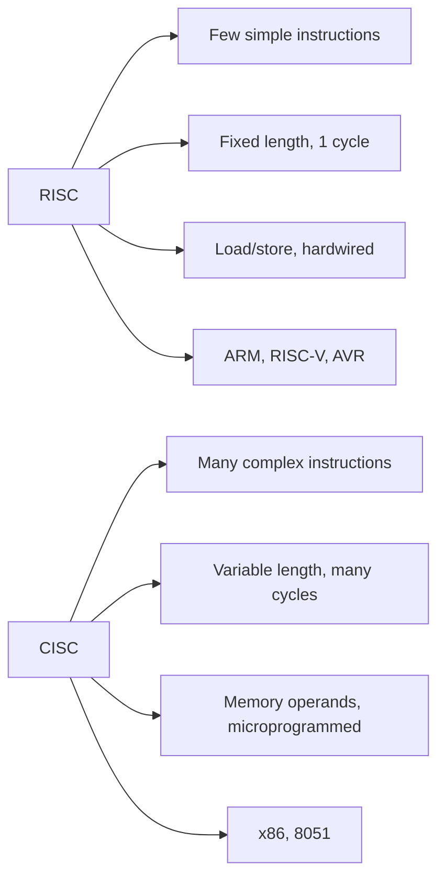

## Why should you care?

Your phone runs all day on one charge. A desktop processor of similar power needs a big fan and a 300-watt power supply. One major reason is the processor's **instruction set design**.

Almost every phone, smartwatch and modern microcontroller uses an **ARM** processor, which follows the **RISC** idea. Most desktops and laptops use Intel or AMD **x86** processors, which follow the **CISC** idea. Even Apple moved its Mac computers from Intel to its own ARM-based chips in 2020, largely for battery life.

When you choose a processor for an embedded product, you are often choosing between these two philosophies.

## In one line

RISC (Reduced Instruction Set Computer) uses a small set of simple, fixed-length instructions that mostly run in one clock cycle, while CISC (Complex Instruction Set Computer) uses a large set of powerful, variable-length instructions that may take several cycles each.

## Explained

### Q1. What is an instruction set?

The **instruction set** is the list of basic operations a processor understands, such as ADD, MOV, JUMP and MUL. Every program, whatever language it is written in, is finally turned into these instructions.

There are two ways to design this list:
- Give the processor **many powerful instructions**, so programs are short (CISC).
- Give it **few simple instructions** that run very fast, and let the compiler combine them (RISC).

### Q2. What is RISC?

==RISC: a small set of simple, fixed-length instructions, most executing in one clock cycle.==

Features:
- **Load/store architecture:** only LOAD and STORE instructions touch memory; all arithmetic works on registers.
- **Many general-purpose registers**, so data stays close to the CPU.
- **Fixed instruction length**, which makes decoding simple and fast.
- **Hardwired control unit** (fast logic circuits, no microcode).
- **Pipelining** is easy: the next instruction starts before the previous one finishes.

Examples: ARM, RISC-V, AVR (Arduino Uno), PIC.

### Q3. What is CISC?

==CISC: a large set of complex, variable-length instructions; one instruction can do several operations, including memory access.==

Features:
- **Many instructions and addressing modes**; arithmetic can work directly on memory.
- **Variable instruction length** (one to several bytes).
- **Fewer registers.**
- **Microprogrammed control unit:** each complex instruction runs as a small internal program.
- Instructions take **several clock cycles**, and pipelining is harder.

Examples: Intel x86 (8086 to Core i7), and the **8051**, which has over a hundred instructions of 1 to 3 bytes.

### Q4. How do RISC and CISC differ?

| Point | RISC | CISC |
|---|---|---|
| Number of instructions | Few, simple | Many, complex |
| Instruction length | Fixed | Variable |
| Cycles per instruction | Mostly one | Several |
| Memory access | Only LOAD and STORE | Many instructions can access memory |
| Registers | Many | Few |
| Control unit | Hardwired | Microprogrammed |
| Pipelining | Easy | Difficult |
| Program size | Larger (more instructions) | Smaller |
| Compiler's job | Harder | Easier |
| Examples | ARM, RISC-V, AVR | x86, 8051 |

### Q5. How does the same task look in each?

Task: multiply two numbers stored in memory and save the result.

**CISC (one instruction):**
```text
MUL [A], [B]        ; read A and B from memory, multiply, store in A
```

**RISC (four simple instructions):**
```text
LOAD  R1, A         ; bring A into a register
LOAD  R2, B         ; bring B into a register
MUL   R1, R1, R2    ; multiply registers
STORE A, R1         ; write the result back
```

The CISC program is shorter, but its one instruction takes many cycles. Each RISC instruction is quick and can be pipelined, so the total time is often similar or less, with simpler, lower-power hardware.

> [!beyond] Beyond the syllabus
> The line has blurred. Modern Intel and AMD chips accept CISC x86 instructions but internally break them into RISC-like "micro-operations". **RISC-V** is an open, royalty-free RISC instruction set; India's Shakti processors from IIT Madras are based on it.

## Analogy and real-life example

### Analogy

CISC is like a restaurant menu with a "Thali" option: one order brings dal, sabzi, roti, rice and sweet. Short to order, but the kitchen takes time preparing it. RISC is like ordering each item separately: more orders to place, but each is simple and comes out fast, and several cooks can work on different items at once (pipelining).

### Real system: phone vs desktop

- **Smartphone:** ARM (RISC) processor. Simple, efficient instructions keep power use low, so the battery lasts a day without a fan.
- **Desktop PC:** Intel/AMD x86 (CISC). Decades of software compatibility and high peak speed, with higher power use and a cooling fan.

## Diagram



## Key points

> [!important] Key points
> - RISC: Reduced Instruction Set Computer. CISC: Complex Instruction Set Computer.
> - RISC: few simple fixed-length instructions, mostly one cycle, load/store, many registers, hardwired control, easy pipelining.
> - CISC: many variable-length instructions, several cycles, memory operands, fewer registers, microprogrammed control.
> - RISC programs are longer; CISC programs are shorter.
> - RISC examples: ARM, RISC-V, AVR, PIC. CISC examples: x86, 8051.
> - RISC suits low-power embedded and mobile devices.

## Common mistakes

> [!warning] Common mistake
> **"RISC has fewer instructions, so it is less powerful."** RISC does the same work with more, simpler steps. Because each step is fast and can overlap with others, RISC chips are often as fast and use less power.

> [!warning] Common mistake
> **Calling the 8051 a RISC processor.** The 8051 is CISC: it has many instructions of different lengths (1 to 3 bytes) and several addressing modes, including direct memory operations.

## Exam questions

**Short answer (2–3 marks)**
1. Expand RISC and CISC. Give two examples of each.
2. What is a load/store architecture?
3. Why is pipelining easier in RISC processors?

**Long answer (5 marks)**
1. Differentiate between RISC and CISC architectures on at least six points.
2. Explain RISC and CISC with an example showing how the same task is coded in each.

## Sources

- Shibu K V, *Introduction to Embedded Systems*, McGraw Hill, Ch. 2, section on RISC and CISC processors (verify).
- David A. Patterson and John L. Hennessy, *Computer Organization and Design*, Ch. 2 (verify).
