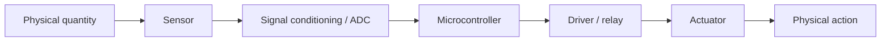

## Why should you care?

An automatic street light switches itself on at dusk and off at dawn. No one presses a button.

How does it "know" it is dark? A **sensor** (a light-dependent resistor) measures the light. The microcontroller reads that value, compares it with a limit and decides. Then an **actuator** (a relay) switches the lamp on.

A microcontroller on its own can only move bits around. Sensors are its eyes and ears; actuators are its hands. Without them, an embedded system cannot sense the world or change it. Every practical you do from Unit 2 onwards connects one of these to the 8051.

## In one line

A sensor converts a physical quantity (temperature, light, motion) into an electrical signal that the embedded system can read, and an actuator converts an electrical signal from the system into a physical action (light, sound, motion).

## Explained

### Q1. What is a sensor? ⭐

==A sensor detects a physical quantity and converts it into an electrical signal.==

- ==Physical quantities: temperature, light, sound==, pressure, distance, motion, humidity, gas.
- Output: a voltage, current or resistance change, or a digital value.
- ==A **transducer** is any device that converts energy from one form to another==. ==A sensor is an input transducer==; an actuator is an output transducer.

Examples: LM35 temperature sensor, LDR (light), PIR (human motion), ultrasonic sensor (distance), MQ-2 (gas/smoke), accelerometer (tilt, steps).

### Q2. What types of sensors are there? ⭐

| Basis | Types | Example |
|---|---|---|
| Output signal | ==**Analog:** continuous voltage== | LM35, LDR |
| | ==**Digital:** only 0/1==, or a digital number | PIR, push button, DHT11 |
| Power | ==**Active:** needs external power== | LM35, LDR, ultrasonic sensor |
| | ==**Passive:** generates its own signal== without external power | Thermocouple, piezoelectric sensor |
| Contact | ==**Contact**== | Thermometer probe, push button |
| | ==**Non-contact**== | IR thermometer, ultrasonic sensor |

The **PIR** (passive infrared) motion sensor is named "passive" because it only receives infrared and emits none; the module itself still needs a power supply.

### Q3. How does a microcontroller read an analog sensor?

A microcontroller works with digital numbers, so ==an analog voltage must first be converted by an **ADC**== (analog-to-digital converter).

Example: ==the LM35 gives **10 mV per °C**==.
- At 32 °C, its output is 32 × 10 mV = 320 mV.
- An 8-bit ADC with a 5 V reference divides 0–5 V into 256 steps, so one step ≈ 5 V / 256 ≈ 19.5 mV.
- 320 mV / 19.5 mV ≈ 16, so the ADC gives about **16**.
- The program converts back: 16 × 19.5 mV ≈ 312 mV ≈ 31 °C (close to 32 °C; the gap is the ADC's step size).

==The basic 8051 has no built-in ADC==, so an external ADC chip (such as the ADC0804) is used.

### Q4. What is an actuator? ⭐

==An actuator converts an electrical signal from the controller into a physical action such as motion, light or sound.==

| Actuator | Action | Example use |
|---|---|---|
| LED | Light | Status indicator |
| Buzzer | Sound | Alarm, key beep |
| Relay | ==Switches a high-power circuit== | Street lamp, water pump |
| DC motor | ==Continuous rotation== | Fan, toy car |
| Stepper motor | ==Rotation in fixed steps== | Printer, CNC machine |
| Servo motor | ==Turns to a set angle== | Robot arm, camera mount |
| Solenoid valve | Opens or closes a pipe | Washing machine water inlet |

### Q5. Why can't the 8051 drive a motor or lamp directly? ⭐

An 8051 port pin can supply or take ==only a few milliamperes at 5 V==. A motor may need an ampere; a street lamp runs on 230 V AC. Connecting them directly would damage the chip.

So a **driver** stands between the pin and the actuator:
- ==**Transistor or driver IC**== (e.g. ULN2003, L293D) for motors.
- ==**Relay** for mains devices==: the small coil current switches a separate high-power circuit.
- ==**Optocoupler**== to keep the high-voltage side electrically isolated from the controller.

==A sensor feeds the controller through signal conditioning or an ADC; an actuator is driven by the controller through a driver circuit.==

## Analogy and real-life example

### Analogy

Your body is an embedded system. Your skin, eyes and ears are sensors. Your brain is the microcontroller. Your muscles are actuators. When you touch a hot tawa, skin senses heat, the brain decides, and the muscles pull your hand back. Nerves play the role of the ADC and driver circuits, carrying and converting the signals.

### Real system: automatic plant watering

- **Sensor:** a soil-moisture sensor gives a voltage that falls as the soil dries.
- **ADC:** converts it to a number.
- **Controller:** if the number is below the limit, it decides to water.
- **Driver + actuator:** a transistor drives a relay, which switches on a small water pump; it switches off when the soil is moist again.

## Diagram

## Key points

> [!important] Key points
> - Sensor: converts a physical quantity into an electrical signal (input transducer).
> - Actuator: converts an electrical signal into a physical action (output transducer).
> - Sensor types: analog/digital, active/passive, contact/non-contact.
> - Sensor examples: LM35 (temperature, 10 mV/°C), LDR (light), PIR (motion), ultrasonic (distance), MQ-2 (gas).
> - Analog sensors need an ADC; the basic 8051 has no on-chip ADC (use ADC0804).
> - Actuator examples: LED, buzzer, relay, DC motor, stepper motor, servo, solenoid valve.
> - Actuators need drivers (transistor, ULN2003, L293D, relay, optocoupler) because port pins give only a few mA.

## Common mistakes

> [!warning] Common mistake
> **"Sensor and transducer mean exactly the same."** Every sensor is a transducer, but not every transducer is a sensor. A loudspeaker is a transducer (electrical to sound) but it is an actuator.

> [!warning] Common mistake
> **Connecting a motor or relay coil straight to a port pin.** The pin cannot supply that current, and the coil's voltage spike when switching off can destroy it. Always use a driver, and a diode across relay and motor coils.

## Exam questions

**Short answer (2–3 marks)**
1. Define sensor and actuator with two examples each. ⭐
2. Differentiate between analog and digital sensors.
3. Why is a driver circuit needed between a microcontroller and an actuator?

**Long answer (5 marks)**
1. Explain sensors and actuators in embedded systems, with their types and examples. ⭐
2. With a block diagram, explain how an embedded system reads a temperature sensor and controls a fan.

## Sources

- Shibu K V, *Introduction to Embedded Systems*, McGraw Hill, Ch. 2, sections on sensors, actuators and the I/O subsystem (verify).
- Texas Instruments, *LM35 Precision Centigrade Temperature Sensor* datasheet (10 mV/°C scale factor).
- Raj Kamal, *Embedded Systems: Architecture, Programming and Design*, Tata McGraw Hill (verify).
