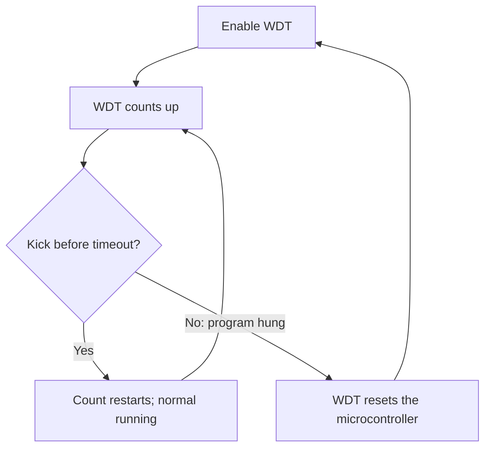

## Why should you care?

A traffic signal controller at a busy junction runs day and night. One day, electrical noise from a passing truck flips a bit in its RAM, and the program gets stuck in a loop. The lights freeze on green in both directions.

There is no one at the junction to press a reset button. A PC would show a frozen screen and wait for the user. An embedded system cannot wait.

The fix is a small hardware timer that keeps watching the program, like a watchdog watching a house. If the program stops "checking in", the watchdog resets the controller automatically, and the signal is back to normal within a second. Almost every serious embedded product has one.

## In one line

A watchdog timer (WDT) is a hardware timer that resets the microcontroller if the program fails to restart ("kick" or "feed") it within a set time, so that a system stuck because of a software bug or electrical noise recovers automatically.

## Explained

### Q1. What is a watchdog timer? ⭐

==A watchdog timer is a hardware timer that resets the processor when it counts to its limit, unless the program restarts it in time.==

- ==It runs independently of the program==, counting continuously once enabled.
- ==A healthy program "kicks" (feeds or refreshes) it regularly==, restarting its count before it reaches the limit.
- ==If the program hangs, the kicks stop==; the WDT reaches its limit (**timeout**) and **resets** the microcontroller.

After the reset, the system starts again from the beginning, exactly as at power-on.

### Q2. Why is a watchdog timer needed? ⭐

Embedded systems often run **unattended**, so they must recover on their own. A program can hang because of:

- ==**Software bugs:**== an endless loop, a wait for a flag that never comes, a stack overflow.
- ==**Electrical noise or power glitches:**== a spike corrupts a register or RAM, and the program jumps to a wrong address.
- ==**Hardware faults:**== a sensor stops responding and the code waits for it forever.

==The watchdog turns a permanent hang into a short restart.==

### Q3. How does a watchdog timer work? ⭐

1. ==**Enable**== the watchdog at the start of the program.
2. ==**The WDT counts up**== continuously from 0 towards its timeout value.
3. ==**The main loop kicks it**== by writing a special value (or sequence) to its register; the count goes back to 0.
4. ==**Normal running:**== the loop kicks the dog well before the timeout, so no reset ever happens.
5. ==**Program stuck:**== no kicks arrive; the count reaches the timeout.
6. ==**Timeout:**== the WDT resets the microcontroller, and the program restarts.

### Q4. Does the 8051 have a watchdog timer? ⭐

- ==The original 8051 and the AT89C51 have no watchdog==. Designers add an external watchdog chip (a supervisor IC).
- ==The **AT89S52** has a built-in watchdog==. It is enabled by writing **1EH** and then **E1H** to its **WDTRST** register (SFR address A6H), and the same two-byte sequence kicks it.
- ==Once enabled, it cannot be turned off== by the program; only a reset disables it. This stops a runaway program from disabling its own watchdog.
- ==At 12 MHz it times out after about 16 ms== (16,383 machine cycles), so the program must kick it more often than that.

### Q5. What are good practices for using a watchdog?

- ==**Kick it in one place only:**== in the main loop, after all tasks have run, not inside a delay loop or an interrupt routine (an ISR may keep running even when the main program is stuck).
- ==**Choose a sensible timeout:**== longer than the slowest normal loop, shorter than the time a hang can be tolerated.
- ==**Log the cause:**== on restart, check whether it was a watchdog reset and record it, so the bug can be found.
- ==**Never use it to hide bugs:**== a watchdog is a safety net, not a fix.

## Analogy and real-life example

### Analogy

A security guard on night duty must press a button at the control desk every 15 minutes. If he presses it on time, nothing happens. If he falls asleep and misses it, an alarm rings and the supervisor arrives to restart the shift. The button press is the "kick"; the alarm and restart are the watchdog reset.

### Real system: a mobile tower's power controller

A controller at a remote mobile tower switches between grid power, batteries and a diesel generator. No technician is on site. Its firmware kicks the watchdog at the end of each main-loop pass. If lightning-induced noise ever hangs the controller, the watchdog resets it within a fraction of a second, and power switching continues without anyone travelling to the site.

## Diagram

## Key points

> [!important] Key points
> - Watchdog timer (WDT): hardware timer that resets the microcontroller on timeout.
> - The program must kick (feed, refresh) it regularly; a hung program stops kicking.
> - Causes of hangs: software bugs, electrical noise, power glitches, hardware faults.
> - Steps: enable → count → kick restarts count → no kick → timeout → reset.
> - 8051/AT89C51: no WDT (use an external supervisor chip). AT89S52: built-in WDT, write 1EH then E1H to WDTRST (A6H).
> - Kick only in the main loop; choose a sensible timeout; log watchdog resets.

## Common mistakes

> [!warning] Common mistake
> **Kicking the watchdog inside a timer interrupt.** The timer ISR keeps running even when the main loop is stuck, so the watchdog never fires and the hang is never cured. Kick it from the main loop.

> [!warning] Common mistake
> **Confusing the watchdog timer with Timer 0 or Timer 1.** Timers 0 and 1 measure time for your program. The watchdog is a separate safety timer whose only job is to reset a stuck system.

## Exam questions

**Short answer (2–3 marks)**
1. What is a watchdog timer? Why is it needed? ⭐
2. What is meant by "kicking" or "feeding" the watchdog?
3. Why should the watchdog not be kicked from an interrupt routine?

**Long answer (5 marks)**
1. Explain the working of a watchdog timer with a flowchart. ⭐
2. Explain the watchdog timer, its need in embedded systems and good practices for using it, with an 8051-family example.

## Sources

- Microchip (Atmel), *AT89S52* datasheet, "Watchdog Timer (One-time Enabled with Reset-out)" section.
- Shibu K V, *Introduction to Embedded Systems*, McGraw Hill, Ch. 2, watchdog timer (verify).
- Michael Barr, *Programming Embedded Systems in C and C++*, O'Reilly (verify).
