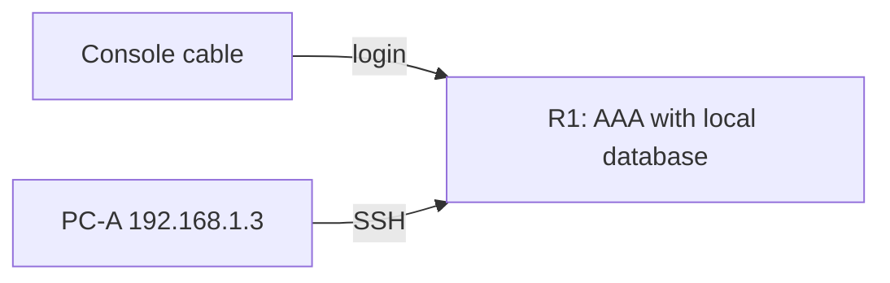

## Aim

To enable AAA on a Cisco router, authenticate console and remote (SSH) logins against local user accounts, and verify access from the console and from a remote client.

## Concepts used

- [[ssh-remote-access-practical]]: SSH set-up, repeated here on R1.
- [[authentication]] and [[authorization]]: who you are, and what you may do (Unit 2 theory).
- [[network-defense-best-practices]]: control admin access; record who did what.

**Why this matters.** With plain line passwords, every admin shares the same password, and the router cannot tell who logged in. If one person leaves, everyone's password must change. AAA gives each admin an individual account, applies one consistent login policy to every access method, and is the framework that later connects routers to central TACACS+ or RADIUS servers used in real companies.

## Setup

**Tool:** Cisco Packet Tracer (8.x or later).

### Devices and topology

Open your saved file from Practical 3. AAA is configured on **R1**. You will test from the **R1 console** and from **PC-A** (on R1's LAN) using SSH.



### Credentials used

| Item | Value |
|---|---|
| Local user | Admin1 |
| Password | admin1pa55 |
| Domain name | ccnasecurity.com |

## Code

### Step 1. Create the local user and enable AAA

```text
R1# configure terminal
R1(config)# username Admin1 secret admin1pa55
R1(config)# aaa new-model
R1(config)# aaa authentication login default local
```

### Step 2. Apply AAA to the console

```text
R1(config)# line console 0
R1(config-line)# login authentication default
R1(config-line)# exit
```

### Step 3. A named login list for SSH on the VTY lines

```text
R1(config)# ip domain-name ccnasecurity.com
R1(config)# crypto key generate rsa
How many bits in the modulus [512]: 1024
R1(config)# ip ssh version 2
R1(config)# aaa authentication login SSH-LOGIN local
R1(config)# line vty 0 4
R1(config-line)# login authentication SSH-LOGIN
R1(config-line)# transport input ssh
R1(config-line)# end
```

### Step 4. Verify

1. On R1, type `exit` until the console session ends, then press Enter. Log in as **Admin1**.
2. From PC-A: `ssh -l Admin1 192.168.1.1`.
3. Try a wrong password once from each place and note the result.

## Output

> [!warning] Replace with your own output
> The blocks below show what correct output looks like. After running the lab, paste your real output here, or save a screenshot in `content/assets/img/security-in-computing/` and link it with alt text.

**Console now asks for a username** (R1 console after logging out):

```output
User Access Verification

Username: Admin1
Password:

R1>
```

**Remote login with the same account** (PC-A):

```output
C:\>ssh -l Admin1 192.168.1.1

Password:

R1>
```

**Wrong password** (either method):

```output
% Login invalid
```

## Explanation

### What AAA means

| Letter | Question it answers | In this practical |
|---|---|---|
| Authentication | Who are you? | Username and password from the local database |
| Authorization | What may you do? | Default privilege level (not configured here) |
| Accounting | What did you do? | Needs a TACACS+ or RADIUS server (not in this practical) |

==AAA is a framework that separates authentication, authorization and accounting, and applies them consistently to every way of logging in.==

### What each command does

- `aaa new-model`: turns on AAA. From now on, AAA method lists control logins, not the old line passwords.
- `aaa authentication login default local`: the **default** list checks the **local** user database. It applies to any line that has no named list.
- `login authentication default` (console): use the default list on the console.
- `aaa authentication login SSH-LOGIN local`: a **named** list. Named lists let different lines use different methods.
- `login authentication SSH-LOGIN` (VTY): SSH logins use the named list.

### Default list versus named list

- ==A default list applies automatically to every line without a named list.==
- A named list must be applied to a line by name, so console and remote access can follow different rules.
- In a company, the list might read `group tacacs+ local`: try the central TACACS+ server first, and fall back to the local account only if the server is unreachable.

> [!beyond] Beyond the syllabus
> Server-based AAA with TACACS+ (Cisco) or RADIUS (open standard) gives every admin one account for all devices, central password changes, per-command authorization and a full accounting log of every command typed.

## Try it

1. Create a second user `Admin2` with password `admin2pa55`. Log in with it over SSH from PC-A. What advantage do individual accounts give over a shared line password?
2. Change the console to its own named list: `aaa authentication login CONSOLE-LOGIN local` and `login authentication CONSOLE-LOGIN` under `line console 0`. Does console login still work?

## Viva questions

1. What does AAA stand for? *Authentication, Authorization and Accounting.*
2. What does `aaa new-model` do? *It enables AAA; logins are then controlled by AAA method lists instead of line passwords.*
3. What is a method list? *An ordered list of authentication methods (for example local, TACACS+, RADIUS) applied to a login type.*
4. Difference between a default and a named method list? *The default list applies to all lines automatically; a named list applies only to lines it is assigned to.*
5. Why is local AAA weaker than server-based AAA? *Accounts exist on each device separately, there is no central accounting log, and changes must be repeated on every device.*
6. Name two AAA server protocols. *TACACS+ (Cisco, TCP 49) and RADIUS (open standard, UDP 1812/1813).*
7. Why keep a local account even when a AAA server exists? *As a fallback if the server cannot be reached.*

## Sources

- Cisco, *Authentication, Authorization, and Accounting Configuration Guide* for IOS (verify exact title for your IOS version).
- Cisco Networking Academy, CCNA Security Packet Tracer activity: Configure AAA Authentication on Cisco Routers, Part 1 (verify).
