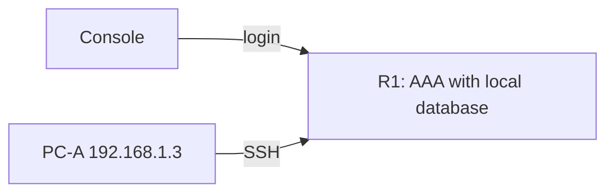

## Aim

To enable AAA on a Cisco router, authenticate console and remote (SSH) logins against local user accounts, and verify access from the console and from a remote client.

## Concepts used

- [[ssh-remote-access-practical]]: SSH set-up, repeated here on R1.
- [[authentication]] and [[authorization]]: who you are, and what you may do (Unit 2 theory).
- [[network-defense-best-practices]]: control admin access; record who did what.

**Why this matters.** With plain line passwords, every admin shares the same password, and the router cannot tell who logged in. If one person leaves, everyone's password must change. AAA gives each admin an individual account, applies one consistent login policy to every access method, and is the framework that later connects routers to central TACACS+ or RADIUS servers used in real companies.

## Before the lab

**Install or open**
- Cisco Packet Tracer 8.x or later.
- Your saved file **practical3.pkt** (Practicals 1–3 working).

**Revise first**
- [[authentication]] and [[authorization]]: the three letters of AAA.
- The SSH steps from [[ssh-remote-access-practical]]: you repeat them here on R1.

> [!warning] Read this before Step 3
> After `aaa new-model`, the console asks for a username. **Create the user (Step 2) before turning AAA on**, and save your file first, or you can lock yourself out of R1.

## Setup

**Tool:** Cisco Packet Tracer (8.x or later).

### Devices and topology

The topology from Practical 3. AAA is configured on **R1**. You will test from the **R1 console** and from **PC-A** (on R1's LAN) using SSH.



### Credentials used

| Item | Value |
|---|---|
| Local user | Admin1 |
| Password | admin1pa55 |
| Enable secret | ciscoenpa55 |
| Domain name | ccnasecurity.com |

## Steps

### Part A. AAA on the console

1. **Open your Practical 3 file and save a copy** as `practical4.pkt`.
   → **You should see:** the same topology as Practical 3.
2. **Create the local user and an enable secret on R1.**
   ```text
   configure terminal
   username Admin1 secret admin1pa55
   enable secret ciscoenpa55
   ```
   → **You should see:** no message.
3. **Turn on AAA.**
   ```text
   aaa new-model
   ```
   → **You should see:** no message. Your current console session stays open.
4. **Create the default login list using the local database.**
   ```text
   aaa authentication login default local
   ```
   → **You should see:** no message.
5. **Apply the default list to the console.**
   ```text
   line console 0
    login authentication default
   end
   ```
   → **You should see:** the prompt return to `R1#`.
6. **Test the console login.** Type `exit` to log out, then press Enter.
   → **You should see:** `R1 con0 is now available`, `Press RETURN to get started.`, then `User Access Verification` and `Username:`. Log in as `Admin1` / `admin1pa55`; you reach `R1>`. Type `enable` and `ciscoenpa55` to reach `R1#`.

### Part B. AAA for SSH on the VTY lines

7. **Set a domain name and generate RSA keys on R1.** (R3 has keys from Practical 3; R1 does not.)
   ```text
   configure terminal
   ip domain-name ccnasecurity.com
   crypto key generate rsa
   ```
   Answer `1024` at `How many bits in the modulus [512]:`.
   → **You should see:** `% Generating 1024 bit RSA keys, keys will be non-exportable...[OK]` and `%SSH-5-ENABLED: SSH 1.99 has been enabled`.
8. **Use SSH version 2.**
   ```text
   ip ssh version 2
   ```
   → **You should see:** no error.
9. **Create a named login list for SSH.**
   ```text
   aaa authentication login SSH-LOGIN local
   ```
   → **You should see:** no message.
10. **Apply the named list to the VTY lines and allow only SSH.**
    ```text
    line vty 0 4
     login authentication SSH-LOGIN
     transport input ssh
    end
    ```
    → **You should see:** the prompt return to `R1#`, and no `AAA: Warning` message.
11. **Log in from PC-A with SSH.** PC-A → Command Prompt → `ssh -l Admin1 192.168.1.1`, password `admin1pa55`.
    → **You should see:** `Password:`, then `R1>`. Type `exit`.
12. **Test a wrong password.** Repeat Step 11 with the password `wrong`.
    → **You should see:** `% Login invalid`.
13. **Save everything.** `copy running-config startup-config` on R1; File → Save.
    → **You should see:** `Building configuration... [OK]`.

## Code

Complete configuration added on **R1** in this practical:

```text
username Admin1 secret admin1pa55
enable secret ciscoenpa55
aaa new-model
aaa authentication login default local
aaa authentication login SSH-LOGIN local
ip domain-name ccnasecurity.com
crypto key generate rsa
! (answer 1024 at the modulus prompt)
ip ssh version 2
line console 0
 login authentication default
line vty 0 4
 login authentication SSH-LOGIN
 transport input ssh
```

## Output

> [!warning] Replace with your own output
> The blocks below show what correct output looks like. After running the lab, paste your real output here, or save a screenshot in `content/assets/img/security-in-computing/` and link it with alt text.

**Console now asks for a username** (R1 console after logging out):

```output
User Access Verification

Username: Admin1
Password:

R1>
```

**Remote login with the same account** (PC-A):

```output
C:\>ssh -l Admin1 192.168.1.1

Password:

R1>
```

**Wrong password** (either method):

```output
% Login invalid
```

## Explanation

### What AAA means

| Letter | Question it answers | In this practical |
|---|---|---|
| Authentication | Who are you? | Username and password from the local database |
| Authorization | What may you do? | Default privilege level (not configured here) |
| Accounting | What did you do? | Needs a TACACS+ or RADIUS server (not in this practical) |

==AAA is a framework that separates authentication, authorization and accounting, and applies them consistently to every way of logging in.==

### What each command does

- `aaa new-model`: turns on AAA. From now on, AAA method lists control logins, not the old line passwords.
- `aaa authentication login default local`: the **default** list checks the **local** user database. It applies to any line that has no named list.
- `login authentication default` (console): use the default list on the console.
- `aaa authentication login SSH-LOGIN local`: a **named** list. Named lists let different lines use different methods.
- `login authentication SSH-LOGIN` (VTY): SSH logins use the named list.

### Default list versus named list

- A default list applies automatically to every line without a named list.
- A named list must be applied to a line by name, so console and remote access can follow different rules.
- In a company, the list might read `group tacacs+ local`: try the central TACACS+ server first, and fall back to the local account only if the server is unreachable.

> [!beyond] Beyond the syllabus
> Server-based AAA with TACACS+ (Cisco) or RADIUS (open standard) gives every admin one account for all devices, central password changes, per-command authorization and a full accounting log of every command typed.

## Common errors and fixes

| Message or symptom | Cause | Fix |
|---|---|---|
| After Step 3 or 6, every console login gives `% Login invalid` | AAA was turned on before the user was created, or the username/password was mistyped (both case-sensitive) | Close the file **without saving** and reopen `practical3.pkt` (or your saved copy). Create the user first, then `aaa new-model` |
| `AAA: Warning authentication list "SSH-LOGIN" is not defined for LOGIN.` | The list name on the VTY line does not match the list created in Step 9 (for example `SSH_LOGIN` vs `SSH-LOGIN`) | Create the list with exactly the same name, or correct the name under `line vty 0 4` |
| The console still asks only `Password:`, not `Username:` | `aaa new-model` or `login authentication default` is missing | Repeat Steps 3–5 |
| `% Connection refused by remote host` when PC-A uses SSH | R1 has no RSA keys, or `transport input ssh` is missing | Do Step 7 on **R1** (not R3), and check `show ip ssh` says `SSH Enabled` |
| `% Please define a domain-name first.` | `crypto key generate rsa` typed before `ip domain-name` | Set the domain name, then generate the keys |
| `% Username:  timeout expired!` | The login prompt waited too long | Press Enter and log in again |

## Try it

1. Create a second user `Admin2` with password `admin2pa55`. Log in with it over SSH from PC-A. What advantage do individual accounts give over a shared line password?
2. Change the console to its own named list: `aaa authentication login CONSOLE-LOGIN local` and `login authentication CONSOLE-LOGIN` under `line console 0`. Does console login still work?

## Viva questions

1. What does AAA stand for? *Authentication, Authorization and Accounting.*
2. What does `aaa new-model` do? *It enables AAA; logins are then controlled by AAA method lists instead of line passwords.*
3. What is a method list? *An ordered list of authentication methods (for example local, TACACS+, RADIUS) applied to a login type.*
4. Difference between a default and a named method list? *The default list applies to all lines automatically; a named list applies only to lines it is assigned to.*
5. Why is local AAA weaker than server-based AAA? *Accounts exist on each device separately, there is no central accounting log, and changes must be repeated on every device.*
6. Name two AAA server protocols. *TACACS+ (Cisco, TCP 49) and RADIUS (open standard, UDP 1812/1813).*
7. Why keep a local account even when a AAA server exists? *As a fallback if the server cannot be reached.*

## Sources

- Cisco, *Authentication, Authorization, and Accounting Configuration Guide* for IOS (verify exact title for your IOS version).
- Cisco Networking Academy, CCNA Security Packet Tracer activity: Configure AAA Authentication on Cisco Routers, Part 1 (verify).
