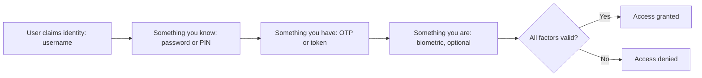

## Why should you care?

Every day you prove who you are to machines: a PIN at the ATM, a password on the college ERP, an OTP for UPI, your fingerprint for an Aadhaar-based ration or bank service, your face to unlock your phone.

If a system cannot tell the real you from someone pretending to be you, nothing else in security matters. Encryption protects nothing if the attacker logs in with your password. Most real breaches begin exactly there: a stolen, guessed or phished login.

Authentication is the front door of every system. This lecture covers how it works, and why one password alone is no longer enough.

## In one line

Authentication is the process of verifying that a user, device or system really is who or what it claims to be, using something it knows, has or is.

## Explained

### Q1. What is authentication? ⭐

==Authentication is the process of verifying a claimed identity before granting access.==

It has two steps:

1. **Identification:** you claim an identity (type a username, insert a card).
2. **Authentication:** you prove the claim (password, OTP, fingerprint).

It comes **before** authorization ([[authorization]]): first the system checks who you are, then it decides what you may do.

Authentication applies to people, devices (a laptop joining Wi-Fi), and systems (a router accepting OSPF updates, as in [[ospf-md5-authentication-practical]]).

### Q2. What are the factors of authentication? ⭐

==Authentication factors are the types of evidence used to prove identity.==

| Factor | Meaning | Examples |
|---|---|---|
| ==Something you know== | A secret in your memory | Password, PIN, security question |
| ==Something you have== | A physical object | Phone receiving OTP, smart card, hardware token |
| ==Something you are== | A body feature (biometric) | Fingerprint, face, iris |

Two further factors are sometimes added: **somewhere you are** (location) and **something you do** (typing rhythm, signature).

### Q3. What is multi-factor authentication (MFA)? ⭐

==Multi-factor authentication requires two or more different factors, so stealing one is not enough.==

- **ATM:** card (have) + PIN (know).
- **UPI payment:** registered phone and SIM (have) + UPI PIN (know).
- **Net banking:** password (know) + OTP on phone (have).

Two passwords are **not** MFA; both are "something you know". The factors must be of different types.

MFA stops most attacks based on stolen passwords, because the attacker also needs your phone or your finger.

### Q4. How do passwords work, and what are their weaknesses?

- ==**Storage:** systems store a salted hash==, never the password itself. A **hash** is a one-way fingerprint; a **salt** is random data added so that two equal passwords give different hashes.
- **Weaknesses:**
  - ==**Guessing and brute force:**== short or common passwords fall quickly.
  - ==**Reuse:**== one leaked site exposes all others (credential stuffing).
  - ==**Phishing:**== users type them into fake sites.
  - **Shoulder surfing and keyloggers.**
- **Good practice:** long passphrases, no reuse, a password manager, lockout after failed attempts, and MFA on top.

### Q5. What are tokens, OTPs and certificates?

- ==**One-time password (OTP):** a code valid for one login== or a short time; sent by SMS or generated by an authenticator app.
- ==**Hardware token / smart card:**== a physical device holding a secret or a private key.
- ==**Certificate-based authentication:**== the user or device proves it holds the private key matching a digital certificate ([[public-key-infrastructure]]). Used for VPNs, Wi-Fi and Digital Signature Certificates for income-tax and GST filing.
- ==**Passkeys:**== a newer password-free method; the phone or laptop holds a private key unlocked by fingerprint or face.

### Q6. What are biometrics and their limits? ⭐

==Biometric authentication uses a measurable body or behaviour feature to verify identity.==

- **Examples:** fingerprint, face, iris, voice. Aadhaar uses fingerprint, iris and face.
- **Two error types:**
  - ==**False acceptance (FAR):**== a wrong person is accepted. Dangerous.
  - ==**False rejection (FRR):**== the right person is rejected. Annoying.
- **Limits:**
  - ==**Cannot be changed if stolen:**== you cannot reset a fingerprint.
  - **Privacy:** biometric data is highly sensitive personal data.
  - **Spoofing:** fake fingerprints or photos, unless the sensor checks liveness.

> [!beyond] Beyond the syllabus
> Single sign-on (SSO) systems such as those built on SAML or OpenID Connect let users log in once and access many applications. Kerberos does this inside Windows domains using time-limited tickets.

## Analogy and real-life example

**Analogy: a hostel gate.** The guard asks your name (identification). Then he checks your ID card (something you have) and your face against the photo (something you are). On exam days, he also asks for your roll number (something you know). The more checks, the harder it is for an outsider to walk in.

**Real example: UPI.** To send money, you need your phone with the registered SIM (have), the UPI app's device binding, and your UPI PIN (know). A thief who learns your PIN cannot pay from his own phone; a thief who steals your phone still needs the PIN. This combination is why UPI fraud usually relies on tricking people, not breaking the system.

## Diagram

## Key points

> [!important] Key points
> - Authentication verifies a claimed identity; identification is the claim, authentication is the proof.
> - Authentication comes before authorization.
> - Factors: something you know, have, are (plus somewhere you are, something you do).
> - MFA uses two or more different factors; two passwords are not MFA.
> - Passwords are stored as salted hashes; weaknesses: guessing, reuse, phishing, shoulder surfing.
> - Other methods: OTP, hardware tokens, certificates, passkeys.
> - Biometrics: errors are false acceptance (FAR) and false rejection (FRR); cannot be changed if stolen.

## Common mistakes

> [!warning] Common mistake
> Calling a password plus a security question "two-factor". Both are things you know; it is still single-factor authentication.

> [!warning] Common mistake
> Saying passwords are stored "encrypted". Good systems store a one-way salted hash; encryption can be reversed, a hash cannot.

## Exam questions

**Short answer (2–3 marks)**
1. Define authentication. How is it different from identification?
2. List the three main authentication factors with examples. ⭐
3. What is multi-factor authentication? ⭐
4. What are FAR and FRR in biometrics?

**Long answer (5 marks)**
1. Explain the factors of authentication and multi-factor authentication with real examples. ⭐
2. Discuss the weaknesses of password-based authentication and how they can be reduced.
3. Explain biometric authentication, its types and its limitations. ⭐

## Sources

- Mark Rhodes-Ousley, *Information Security: The Complete Reference*, 2nd ed., McGraw-Hill, chapter on authentication and authorization (verify).
- Charles P. Pfleeger, Shari L. Pfleeger and Jonathan Margulies, *Security in Computing*, 5th ed., Pearson, Ch. 2 (verify).
- NIST Special Publication 800-63B, *Digital Identity Guidelines: Authentication and Lifecycle Management*.
