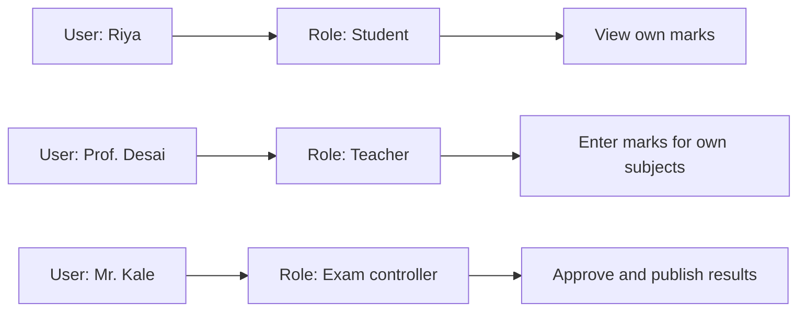

## Why should you care?

In the college ERP, a student, a class teacher, the exam controller and the principal all log in successfully. They are all **authenticated**. But should they all be able to change marks?

- A student should only **view** his own marks.
- A teacher should **enter** marks for her own subjects only.
- The exam controller should **approve and publish** results.
- Nobody should be able to change marks after publishing without a record.

Logging in answers "who are you?". Authorization answers "what are you allowed to do?". Most data leaks inside organisations happen not because someone broke in, but because someone had more access than they needed.

## In one line

Authorization is the process of deciding what an authenticated user or system is allowed to access and do, based on rules set by the organisation.

## Explained

### Q1. What is authorization? ⭐

==Authorization decides which resources an authenticated subject may access and which actions it may perform.==

Key terms:

- ==**Subject:**== who wants access (a user, a program, a device).
- ==**Object:**== what is accessed (a file, a table, a printer).
- ==**Permission (right):**== the allowed action (read, write, execute, delete, approve).

Authentication ([[authentication]]) always comes first. Together with accounting, these form **AAA**, which you configured in [[aaa-local-authentication-practical]].

### Q2. What principles guide authorization?

- ==**Least privilege:** give only the access needed== for the job, and no more.
- ==**Need to know:**== access to information only when the task requires it, even within your level.
- ==**Separation of duties:**== split critical tasks so no single person can complete them alone (one enters marks, another approves).
- ==**Default deny:**== if no rule allows it, access is refused.
- ==**Regular review:**== remove access when people change roles or leave.

==Least privilege limits the damage any one account can do if it is misused or stolen.==

### Q3. What is Discretionary Access Control (DAC)? ⭐

==In DAC, the owner of an object decides who else may access it.==

- Example: you create a Google Drive file and choose whom to share it with. Windows and Linux file permissions also work this way.
- ==**Advantage:** flexible and easy== for users.
- ==**Disadvantage:** depends on owners' judgement==; a careless owner can share sensitive data with anyone, and malware running as the owner gets all the owner's rights.

### Q4. What is Mandatory Access Control (MAC)? ⭐

==In MAC, the system enforces access using security labels set by an administrator; owners cannot change them.==

- Every subject has a **clearance** (for example Secret) and every object a **classification** (Top Secret, Secret, Confidential, Unclassified).
- ==**Rule:** access only if the clearance is high enough== (and need-to-know is met).
- Used in **military and government** systems; SELinux brings MAC to Linux.
- ==**Advantage:** very strong and consistent==. **Disadvantage:** rigid and hard to manage.

### Q5. What is Role-Based Access Control (RBAC)? ⭐

==In RBAC, permissions are given to roles, and users get permissions only by being assigned roles.==

| Role | Permissions in college ERP |
|---|---|
| Student | View own marks and attendance |
| Teacher | Enter marks and attendance for assigned subjects |
| Exam controller | Approve and publish results |
| Admin | Manage user accounts (not marks) |

- ==**Advantage:** easy to manage==: when a teacher joins, assign the Teacher role; when she leaves, remove it.
- Most business systems (ERP, banking, hospital software) use RBAC.

### Q6. What other access control methods are used?

- ==**Rule-based access control:**== access depends on system-wide rules, for example a firewall rule or "no logins after 10 p.m.".
- ==**Attribute-based access control (ABAC):**== decisions use attributes of the user, object and environment, for example "doctor + same department + on duty + hospital network".
- ==**Access Control List (ACL):**== a list attached to an object saying which subjects have which permissions. Router ACLs (practicals 5 and 6) apply the same idea to network traffic.
- ==**Capability list:**== the opposite view: a list attached to each subject of what it can access.

### Q7. How is authorization different from authentication? ⭐ [2M]

| Point | Authentication | Authorization |
|---|---|---|
| ==Question== | Who are you? | What may you do? |
| ==Order== | Comes first | Comes after authentication |
| ==Based on== | Password, OTP, fingerprint | Roles, permissions, policies |
| Example | Logging in to the ERP | Being allowed to enter marks only for your subjects |

### Q8. Differentiate between DAC and MAC. ⭐ [2M]

| Point | DAC | MAC |
|---|---|---|
| ==Who decides access== | The owner of the object | The system, using labels set by an administrator |
| ==Flexibility== | Flexible | Rigid |
| ==Security== | Weaker; depends on owners | Strong and consistent |
| Example | Sharing a Google Drive file | Military Secret/Top Secret documents |

### Q9. Compare DAC, MAC and RBAC. ⭐

| Point | DAC | MAC | RBAC |
|---|---|---|---|
| ==Access decided by== | Owner of the object | System labels (clearance vs classification) | The user's role |
| ==Flexibility== | High | Low | Medium |
| ==Management effort== | Low for owners, hard to control centrally | High | Low: change roles, not each user |
| ==Main risk== | Careless sharing | Rigid, hard to change | Roles grow too broad over time |
| ==Typical use== | Personal files, Windows/Linux permissions | Military, government | Business systems: ERP, banking, hospitals |

### Q10. Design role-based access control for a college ERP system.

| Role | Permissions |
|---|---|
| ==Student== | View own marks, attendance and fee status |
| ==Teacher== | Enter marks and attendance for assigned subjects only |
| ==HOD== | View all marks of the department; approve teachers' entries |
| ==Exam controller== | Approve and publish results; no editing after publishing |
| ==Accounts staff== | Manage fees; no access to marks |
| ==System admin== | Create users and assign roles; no access to marks |

Separation of duties: teachers enter, the exam controller publishes, and every change is logged.

> [!beyond] Beyond the syllabus
> Large companies manage access with Identity and Access Management (IAM) and Privileged Access Management (PAM) tools, which grant admin rights only for a limited time and record every privileged session.

## Analogy and real-life example

**Analogy: a hotel key card.** At check-in, the receptionist verifies your ID (authentication). Your key card then opens only your room, the gym and the pool, and only until check-out (authorization). Housekeeping cards open every room on one floor (a role). The manager's card opens everything. The lock does not care who you are; it checks what the card allows.

**Real example: hospital records.** Under role-based access, a receptionist can see appointment details but not diagnoses, a nurse can see records of patients in her ward, and a doctor can see and update records of his own patients. Every access is logged, so misuse can be traced.

## Diagram

## Key points

> [!important] Key points
> - Authorization decides what an authenticated subject may access and do.
> - Subject (who), object (what), permission (allowed action).
> - Principles: least privilege, need to know, separation of duties, default deny, regular review.
> - DAC: owner decides; flexible but risky.
> - MAC: system enforces labels (clearance vs classification); strong but rigid; military use.
> - RBAC: permissions assigned to roles, roles to users; easy to manage; common in business.
> - Others: rule-based, attribute-based (ABAC), ACLs (per object), capability lists (per subject).

## Common mistakes

> [!warning] Common mistake
> Mixing up authentication and authorization. Logging in successfully (authentication) does not mean you may do everything (authorization).

> [!warning] Common mistake
> Thinking RBAC means "one role per user". A user can hold several roles; for example, a teacher who is also the exam controller gets the permissions of both.

## Sources

- Mark Rhodes-Ousley, *Information Security: The Complete Reference*, 2nd ed., McGraw-Hill, chapter on authentication and authorization (verify).
- Charles P. Pfleeger, Shari L. Pfleeger and Jonathan Margulies, *Security in Computing*, 5th ed., Pearson, Ch. 2 (verify).
- NIST Special Publication 800-162, *Guide to Attribute Based Access Control (ABAC) Definition and Considerations*.
