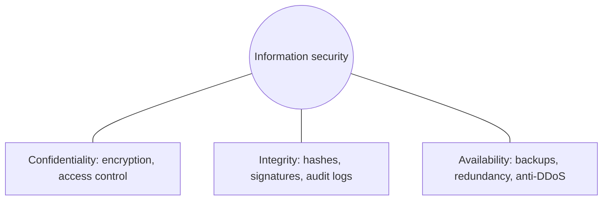

## Why should you care?

Think of your semester marks stored in the university system. Three different things can go wrong:

1. A classmate sees your marks without permission.
2. Someone changes your 38 to 48, or your 48 to 38.
3. On result day, the website is down and nobody can see anything.

These are three different failures, needing three different defences. Every security problem you will meet in this course, from a stolen password to a flooded server room, breaks at least one of these three goals. That is why they are the first thing any security professional checks.

## In one line

The CIA triad is the three core goals of information security: Confidentiality (only authorised people can see data), Integrity (data is accurate and changed only by authorised means) and Availability (data and systems work when needed).

## Explained

### Q1. What is the CIA triad? ⭐

==The CIA triad is the model of the three goals of information security: Confidentiality, Integrity and Availability.==

- ==It is used to **design** controls==: which goal does this control protect?
- ==It is used to **analyse** incidents==: which goal was broken?
- ==It is used to **rate impact**== in [[risk-analysis]]: how badly would losing C, I or A hurt?

The three goals often pull against each other, so the right balance depends on the asset.

### Q2. What is confidentiality? ⭐

==Confidentiality means information is disclosed only to authorised people, processes or systems.==

| Threats | Controls |
|---|---|
| Eavesdropping on networks | ==Encryption== |
| Stolen passwords | ==Strong authentication, multi-factor login== |
| Excess access by staff | ==Access control, least privilege== |
| Lost laptops and pen drives | ==Disk encryption== |
| Shoulder surfing, social engineering | Training, privacy screens |

Example: only you and your college can see your marks; Aadhaar numbers in a database are masked or encrypted.

### Q3. What is integrity? ⭐

==Integrity means information is accurate and complete, and is changed only in authorised ways.==

| Threats | Controls |
|---|---|
| Unauthorised changes (tampering) | ==Access control, audit logs== |
| Changes in transit | ==Hashes, digital signatures, message authentication codes== |
| Accidental errors | ==Input validation, maker–checker approval== |
| Malware corrupting files | Antivirus, backups, file-integrity monitoring |

Integrity also covers ==**authenticity** (data really comes from who it claims)== and ==**non-repudiation** (the sender cannot later deny sending it)==. Example: a bank transfer amount cannot be altered between your phone and the bank.

### Q4. What is availability? ⭐

==Availability means systems and data are accessible to authorised users when they need them.==

| Threats | Controls |
|---|---|
| DoS and DDoS attacks | ==Traffic filtering, anti-DDoS services== |
| Hardware failure | ==Redundant servers, RAID disks== |
| Ransomware | ==Offline backups, tested recovery== |
| Power cuts, fire, flood | ==UPS, generators, a disaster-recovery site== |
| Unplanned maintenance | Change management |

Example: IRCTC must stay up when lakhs of users book Tatkal tickets at 10 a.m.

### Q5. Is there a balance between the three?

Yes. ==Strengthening one can weaken another==:

- ==**More confidentiality can reduce availability:**== five-step logins and strict encryption slow users down; a lost key can lock everyone out.
- ==**More availability can reduce confidentiality:**== copying data to many servers and backups means more places it can leak.
- ==**Integrity checks add delay:**== approvals and verification slow down transactions.

==The right balance depends on the asset==:

| System | Most important goal |
|---|---|
| Hospital patient records | Integrity and availability |
| Defence plans | Confidentiality |
| Stock exchange trading | Availability and integrity |

### Q6. What is the opposite of CIA?

The ==**DAD triad** describes what attackers aim for==:

| CIA goal | Broken by | Example |
|---|---|---|
| Confidentiality | ==**Disclosure**== | Customer data leaked online |
| Integrity | ==**Alteration**== | Marks changed in the database |
| Availability | ==**Destruction / Denial**== | Website taken down by DDoS |

When you analyse an incident, ask: was data disclosed, altered or destroyed?

### Q7. For a hospital records system, which CIA goal matters most, and how is each protected?

==In a hospital, integrity and availability matter most, because wrong or missing records can harm patients.==

- ==**Integrity (highest):**== wrong blood group or dose can kill. Protect with access control, audit logs and change approval.
- ==**Availability (highest):**== doctors need records in emergencies, at any hour. Protect with redundant servers, offline backups and a UPS.
- ==**Confidentiality (high):**== health data is very sensitive under the DPDP Act. Protect with role-based access, encryption and masking.

> [!beyond] Beyond the syllabus
> The Parkerian hexad extends CIA to six elements by adding possession (control), authenticity and utility. For example, an encrypted backup whose key is lost still has confidentiality and integrity, but no utility.

## Analogy and real-life example

**Analogy: a sealed exam paper.** The university sends question papers to colleges. **Confidentiality:** the packet is sealed and nobody sees the paper before the exam. **Integrity:** the seal proves nobody swapped or changed the questions. **Availability:** the packet reaches every centre on time on exam day. A leak, a wrong paper or a late paper are each a different failure.

**Real example: UPI.** Your UPI PIN is never shown to the merchant (confidentiality). The amount and recipient are protected so they cannot be altered in transit (integrity). The system must work at any hour for crores of transactions a day (availability). If any one fails, people stop trusting digital payments.

## Diagram

## Key points

> [!important] Key points
> - CIA triad: Confidentiality, Integrity, Availability, the three goals of information security.
> - Confidentiality: only authorised people see data. Controls: encryption, access control, authentication.
> - Integrity: data is accurate and changed only in authorised ways. Controls: hashes, digital signatures, audit logs, validation.
> - Availability: systems work when needed. Controls: backups, redundancy, UPS, anti-DDoS, disaster recovery.
> - The goals must be balanced; the priority depends on the asset.
> - DAD triad (attacker's view): Disclosure, Alteration, Destruction/Denial.

## Common mistakes

> [!warning] Common mistake
> Thinking encryption protects all three goals. Encryption protects confidentiality. It does not stop someone deleting the file (availability), and plain encryption alone does not prove the data was not changed (integrity needs hashes or signatures).

> [!warning] Common mistake
> Forgetting that availability is a security goal. A server crash or power cut with no backup is a security failure even if no attacker was involved.

## Sources

- Mark Rhodes-Ousley, *Information Security: The Complete Reference*, 2nd ed., McGraw-Hill, Ch. 4, "Secure Design Principles" (verify).
- William Stallings, *Cryptography and Network Security*, Pearson, Ch. 1, "Computer Security Concepts" (verify).
- Charles P. Pfleeger, Shari L. Pfleeger and Jonathan Margulies, *Security in Computing*, 5th ed., Pearson, Ch. 1 (verify).
