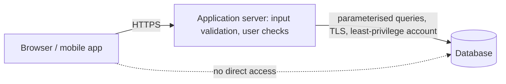

## Why should you care?

A college result website has a search box: "Enter your roll number". Behind it, the code builds a database query by gluing the roll number into a SQL statement.

A student types this instead of a roll number:

`' OR '1'='1`

The page now shows the marks of **every** student in the college. With a slightly different input, he could change marks or delete the table.

The database itself was well protected. The hole was in the **application** that talks to it. Users rarely reach a database directly; they reach it through web and mobile apps. If the app is careless, all the database layers in [[database-security-layers]] can be bypassed through the front door.

## In one line

Database application security protects the way applications connect to and query a database, through least-privilege app accounts, safe credential storage, parameterised queries, input validation and controlled access paths, so the application cannot be used to misuse the data.

## Explained

### Q1. What is database application security?

==Database application security covers the controls in and around the applications that use a database, so that the application itself cannot be turned against the data.==

Most systems use a **three-tier architecture**:

1. ==**Presentation tier:**== the browser or mobile app.
2. ==**Application tier:**== the web/app server running the business logic.
3. ==**Data tier:**== the database server.

Users should never connect to the data tier directly. Every request passes through the application, so the application must be trustworthy.

### Q2. How should applications connect to the database? ⭐

- ==**A dedicated application account**== for each application, never a person's account or the DBA account.
- ==**Least privilege:**== the account gets only the rights it needs (for example SELECT and INSERT on certain tables, no DROP).
- ==**Separate accounts for separate jobs:**== a reporting module gets read-only access; the admin module gets more.
- ==**Encrypted connections**== (TLS) between the app server and the database.
- ==**Firewall rules**== that allow database connections only from the app servers.

### Q3. How should database credentials be stored?

==Database passwords used by applications must never be written in plain text inside source code.==

- ==**Not in the code:**== code is shared, copied and often uploaded to GitHub by mistake.
- ==**Use configuration outside the code:**== protected configuration files or environment variables with strict file permissions.
- ==**Better: a secrets manager**== (a vault service) that supplies the password at run time.
- ==**Rotate passwords**== regularly and immediately when a developer leaves.

### Q4. What is SQL injection? ⭐

==SQL injection is an attack in which user input is inserted into a SQL query in a way that changes the query's meaning.==

Unsafe code (builds the query by joining strings):

```sql
SELECT * FROM results WHERE roll_no = '<user input>';
```

If the input is `' OR '1'='1`, the query becomes:

```sql
SELECT * FROM results WHERE roll_no = '' OR '1'='1';
```

`'1'='1'` is always true, so every row is returned. Other inputs can update or delete data. Injection has been one of the most common web application risks for many years (OWASP Top 10).

### Q5. How is SQL injection prevented? ⭐

- ==**Parameterised queries (prepared statements):**== the query and the data are sent separately, so input is always treated as data, never as SQL code. This is the main defence.
- ==**Stored procedures**== with parameters, used in the same safe way.
- ==**Input validation:**== accept only expected formats (a roll number must be digits).
- ==**Least privilege:**== even if injection succeeds, a read-only account cannot delete tables.
- ==**Error handling:**== never show raw database errors to users; they reveal table names.
- ==**Web Application Firewall (WAF)**== as an extra layer, not a replacement.

### Q6. What other controls protect database applications?

- ==**Pass the real user's identity:**== the application should check each user's rights (a teacher sees only her classes), not rely on its own broad account.
- ==**Row-level checks in the app or database**== so one user cannot read another's records by changing an ID in the URL.
- ==**Limit data returned:**== select only the columns needed; mask sensitive fields.
- ==**Log application actions**== with the real user's name, not only the shared app account.
- ==**Secure development:**== code review and security testing before release ([[secure-application-design]], Unit 4).

### Q7. What are parameterised queries? ⭐ [2M]

==A parameterised query (prepared statement) sends the SQL command and the user's input separately, so input is always treated as data, never as SQL code.==

- **Example (Python):** `cursor.execute("SELECT * FROM results WHERE roll_no = %s", (roll,))`
- ==**Main defence**== against SQL injection.

### Q8. Why should applications not use the DBA account? [2M]

- ==**DBA has full control:**== it can read, change or drop every database on the server.
- ==**If the application is hacked**==, the attacker gets all of that power.
- ==**Use least privilege instead:**== a dedicated account with only the rights the application needs.

> [!beyond] Beyond the syllabus
> Many developers use an ORM (Object-Relational Mapper) such as Django ORM or Hibernate, which builds parameterised queries automatically. Injection is still possible if developers bypass the ORM with raw SQL strings.

## Analogy and real-life example

**Analogy: a bank teller.** Customers never walk into the vault; they hand a form to the teller (the application), who fetches only what the form asks for. A good teller reads the form as data. A careless teller who reads aloud whatever is written ("give me ₹500, and also open locker 12") and obeys every word is exactly what an injectable application does.

**Real example: the "IDOR" leak pattern.** Many data leaks in Indian and global apps came from URLs like `.../report?id=1045`. Changing the number to 1046 showed someone else's report, because the application checked that the user was logged in but not whether the record was **theirs**. The database was fine; the application's authorization was missing.

## Diagram



## Key points

> [!important] Key points
> - Users reach databases through applications; the application must not become a path to misuse the data.
> - Three tiers: presentation, application, data; no direct user access to the data tier.
> - App connections: dedicated least-privilege accounts, separate accounts per job, TLS, firewall rules.
> - Credentials: never in source code; use protected config or a secrets manager; rotate regularly.
> - SQL injection: user input changes the meaning of a SQL query.
> - Prevention: parameterised queries (main defence), stored procedures, input validation, least privilege, safe error messages, WAF.
> - Also: check each user's rights per record, return only needed data, log real user actions, secure development.

## Common mistakes

> [!warning] Common mistake
> Relying only on input validation or "removing quotes" to stop SQL injection. Attackers find ways around filters. Parameterised queries are the reliable fix.

> [!warning] Common mistake
> Checking only that the user is logged in, not whether the requested record belongs to them. This is an authorization failure, not an authentication one.

## Sources

- Mark Rhodes-Ousley, *Information Security: The Complete Reference*, 2nd ed., McGraw-Hill, chapter on database security (verify).
- OWASP, *SQL Injection Prevention Cheat Sheet*, cheatsheetseries.owasp.org.
- OWASP Top 10:2021, A03 Injection.
