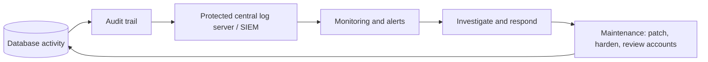

## Why should you care?

Three weeks after results are published, a student complains that his marks were lowered. The ERP shows the current marks, but:

- Who changed them?
- When, and from which computer?
- Was it a teacher's account, an admin, or someone who stole a password?

If the database kept no audit trail, nobody can answer. The innocent cannot be cleared and the guilty cannot be found.

Prevention controls (accounts, privileges, encryption) can fail or be misused by people who are allowed in. **Auditing and monitoring** are the detective controls that notice and prove what happened. **Server maintenance** keeps all the other controls working as software ages.

## In one line

Database auditing records who did what and when in a database, monitoring watches that activity to detect misuse in time, and server maintenance keeps the database server patched, hardened and reviewed so its protections stay effective.

## Explained

### Q1. What is database auditing? ⭐

==Database auditing is the recording of selected database activities, such as logins, data changes and privilege changes, in a protected audit trail.==

An audit record typically stores:

- ==**Who:**== the database user and, ideally, the real application user.
- ==**What:**== the action and object (UPDATE on `marks`).
- ==**When:**== date and time (from a synchronised clock, as in [[ntp-syslog-practical]]).
- ==**Where from:**== client IP address or host.
- ==**Result:**== success or failure.

Auditing supports **accountability**, **investigation** and **compliance**.

### Q2. What should be audited? ⭐

Auditing everything slows the database and buries useful events. Focus on:

- ==**Logins:**== especially failed logins and logins at unusual times.
- ==**Privileged actions:**== everything done by DBA and admin accounts.
- ==**Privilege and account changes:**== GRANT, REVOKE, new users, password resets.
- ==**Structure changes (DDL):**== CREATE, ALTER, DROP of tables.
- ==**Access to sensitive data:**== reads and changes to marks, salaries, Aadhaar or health columns.
- ==**Security setting changes:**== turning auditing off is itself a red flag.

### Q3. How is the audit trail protected?

==An audit trail is only useful if the people being audited cannot change or delete it.==

- ==**Send audit logs off the server**== to a central log server or SIEM, as in central syslog.
- ==**Separate duties:**== DBAs should not be able to edit or purge audit records alone.
- ==**Write-once or append-only storage**== for long-term audit logs.
- ==**Retention period:**== keep logs as long as policy and law require.
- ==**Synchronised time**== so events from different servers can be put in order.

### Q4. What is database monitoring? ⭐

==Database monitoring is the continuous review of database activity and health to detect misuse, attacks and problems quickly.==

- ==**Real-time alerts:**== many failed logins, a bulk export of a sensitive table, a DROP outside a change window.
- ==**Baselines:**== learn normal behaviour (who queries what, how much) and flag unusual patterns.
- ==**Database Activity Monitoring (DAM) tools:**== watch queries independently of the database, so even DBA actions are seen.
- ==**Health monitoring:**== disk space, failed backups, performance, which also affect availability.

Auditing **records**; monitoring **watches and alerts**.

### Q5. What does database server maintenance include? (part 1)

==Server maintenance is the regular work that keeps the database server and its security controls up to date and effective.==

- ==**Patching:**== apply security updates to the DBMS and OS promptly, after testing.
- ==**Hardening:**== follow CIS Benchmarks; disable unused features, sample databases and default accounts.
- ==**Account reviews:**== regularly remove unused accounts and excess privileges, especially after staff leave.
- ==**Password and key rotation**== for service, application and admin accounts.

### Q6. What does database server maintenance include? (part 2)

- ==**Vulnerability scanning:**== scan the server and DBMS for missing patches and weak settings.
- ==**Backup checks:**== confirm jobs succeed and test restores ([[database-backup-and-recovery]]).
- ==**Log management:**== rotate and archive logs so disks do not fill up and stop the database.
- ==**Change management:**== every change is planned, approved, recorded and reversible.
- ==**Capacity and health checks:**== disk, memory and performance, before they cause outages.

==Maintenance is continuous; an unpatched, unreviewed database slowly becomes insecure even if nobody touches it.==

### Q7. Differentiate between auditing and monitoring. ⭐ [2M]

| Point | Auditing | Monitoring |
|---|---|---|
| ==Purpose== | Record what happened | Watch activity and alert in time |
| ==When used== | After the event: investigation, proof, compliance | During the event: detection and response |
| ==Output== | Audit trail (logs) | Alerts, dashboards |
| Example | Who changed the marks table last month | Alert on 100 failed logins in a minute |

> [!beyond] Beyond the syllabus
> Under India's DPDP Act 2023 and the related rules, organisations must take reasonable security safeguards for personal data, including logging and monitoring access, and must report personal data breaches. Database audit logs are often the main evidence used in such reports.

## Analogy and real-life example

**Analogy: CCTV and a visitor register in a bank.** The register records who entered the strong room and when (auditing). The guard watching the CCTV screens notices someone acting strangely and raises an alarm (monitoring). The building manager services the locks, alarms and cameras every month so they keep working (maintenance). Without any one of these, a theft might go unnoticed or unproven.

**Real example: the marks-change complaint.** With auditing on the `marks` table, the college can show that the change was made at 11:47 p.m. through a teacher's account from an outside IP address. That points to a stolen password, not the teacher, and leads to a password reset, MFA for staff, and a monitoring rule that alerts on mark changes after results are published.

## Diagram

## Key points

> [!important] Key points
> - Auditing records selected database activities: who, what, when, where from, result.
> - Audit: logins (esp. failed), privileged actions, privilege/account changes, DDL, sensitive data access, security setting changes.
> - Protect audit trails: send off-server, separation of duties, append-only storage, retention, synchronised time.
> - Monitoring: real-time alerts, baselines, Database Activity Monitoring tools, health checks. Auditing records; monitoring alerts.
> - Server maintenance: patching, hardening (CIS Benchmarks), account reviews, credential rotation, vulnerability scans, backup checks, log management, change management, capacity checks.

## Common mistakes

> [!warning] Common mistake
> Keeping audit logs only on the database server, where the DBA or an attacker with admin rights can delete them.

> [!warning] Common mistake
> Turning on auditing for everything. The database slows down and important events are lost in the noise; audit what matters.

## Sources

- Mark Rhodes-Ousley, *Information Security: The Complete Reference*, 2nd ed., McGraw-Hill, chapter on database security (verify).
- Center for Internet Security, *CIS Benchmarks* for database servers (verify current versions).
- *Digital Personal Data Protection Act, 2023*, Government of India.
