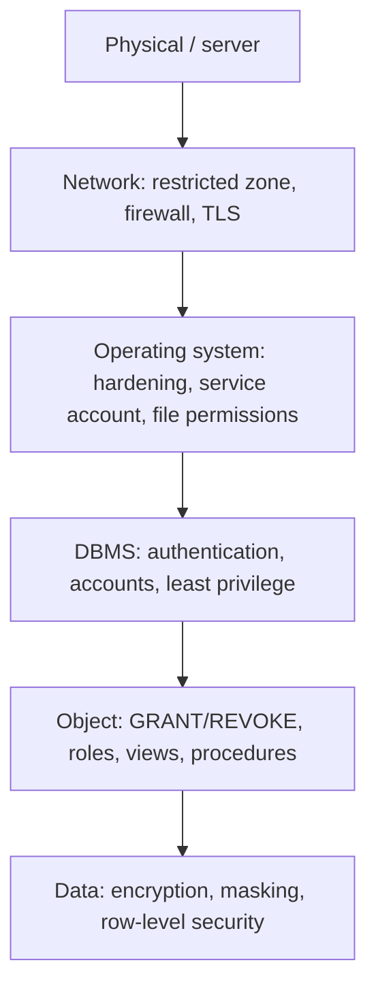

## Why should you care?

Nearly everything valuable an organisation has ends up in a database: student marks, patient records, bank balances, Aadhaar-linked details, salaries.

Attackers know this. Breaking into a web server or a PC is usually only a step on the way to the database behind it. And a database can be reached in many ways: through the network, through the operating system it runs on, through the database's own accounts, and through the applications that use it.

Protecting only one of these paths leaves the others open. That is why database security is built in **layers**, the onion model of [[defense-models]] applied to one critical system.

## In one line

Database security layers protect a database at every level, from the physical server, network and operating system, through the database software and its accounts, down to individual objects and data, so that a failure at one layer does not expose the data.

## Explained

### Q1. Why is database security built in layers? ⭐

==Database security layers are independent levels of protection around the data, each guarding a different path to it.==

- ==**Many paths to the data:**== network, OS, database accounts, applications, backups.
- ==**One weak layer is not fatal:**== others still protect the data.
- ==**Different people manage different layers:**== network team, system admins, database administrators (DBAs), developers.

### Q2. What are the outer layers: physical and network?

- ==**Physical / server level:**== the database server is in a locked server room or a secured data centre; only authorised staff can touch it.
- ==**Network level:**==
  - Place the database in a **restricted zone** ([[zones-of-trust]]), never directly reachable from the internet.
  - ==**Firewall rules:**== allow the database port (for example 3306 for MySQL, 1433 for SQL Server) only from the application servers that need it.
  - ==**Encrypt connections**== between applications and the database (TLS).

### Q3. What is operating system level security?

==The OS layer protects the server the database runs on, because whoever controls the OS can usually control the database files.==

- ==**Harden and patch the OS:**== remove unneeded services and software.
- ==**Run the database under its own low-privilege OS account**==, not as root or Administrator.
- ==**Protect database files:**== only the database service account may read data and log files.
- ==**Limit OS logins**== on the database server to a few administrators.

### Q4. What is database (DBMS) level security? ⭐

==The DBMS layer controls who can connect to the database and what each account may do inside it.==

- ==**Authentication:**== strong passwords or OS/directory authentication; no blank or default passwords.
- ==**Separate accounts:**== one per person or per application; no shared logins.
- ==**Remove or lock defaults:**== sample databases, demo users, default admin names.
- ==**Least privilege for accounts:**== application accounts get only the rights they need, never DBA rights.
- ==**Limit admin (DBA) access**== and record its use.

### Q5. What is object level security? ⭐

==Object level security controls access to individual database objects such as tables, views, procedures and columns.==

- ==**Privileges:**== `GRANT` and `REVOKE` specific rights (SELECT, INSERT, UPDATE, DELETE) on specific objects.
- ==**Roles:**== group privileges into roles (for example `teacher_role`) and assign roles to users.
- ==**Views:**== show only certain columns or rows; for example, a view of student names and marks without phone numbers.
- ==**Stored procedures:**== users may run a procedure that updates marks in a controlled way, without direct UPDATE rights on the table.

### Q6. What is data level security? ⭐

==Data level security protects the data values themselves, even if someone gets past the other layers.==

- ==**Encryption at rest:**== Transparent Data Encryption (TDE) encrypts the whole database files; column encryption protects fields such as Aadhaar or card numbers.
- ==**Masking:**== show only part of a value (`XXXX-XXXX-1234`) to users who do not need the whole.
- ==**Row-level security:**== each user sees only rows they are allowed to (a teacher sees only her own classes).
- ==**Integrity constraints:**== primary keys, foreign keys and checks keep data correct.

> [!beyond] Beyond the syllabus
> Some databases support **tokenisation**: the real card or Aadhaar number is stored in a separate secure vault and replaced everywhere else by a random token, so a stolen copy of the main database is useless. In India, RBI rules have required card-on-file tokenisation instead of storing card numbers since October 2022.

## Analogy and real-life example

**Analogy: a bank's strong room.** The bank building has a guard (physical), the strong room is in the basement away from the public counter (network zone), only certain staff hold strong-room keys (OS and DBMS accounts), each locker has its own key (object level), and valuables inside are sealed in envelopes (data encryption). A thief who gets past the guard still faces four more barriers.

**Real example: a college ERP.** The database sits on a server in a restricted zone; only the ERP application server can connect to it. The ERP uses its own database account with limited rights. Teachers see marks only through views filtered by their subjects, and students' Aadhaar numbers are stored encrypted and shown masked.

## Diagram

## Key points

> [!important] Key points
> - Database security is layered because there are many paths to the data and different teams manage each layer.
> - Physical/server: locked, controlled access.
> - Network: restricted zone, firewall allowing the DB port only from app servers, encrypted connections.
> - OS: hardening, patching, low-privilege service account, protected data files.
> - DBMS: strong authentication, separate accounts, defaults removed, least privilege, limited DBA access.
> - Object: GRANT/REVOKE, roles, views, stored procedures.
> - Data: encryption (TDE, column), masking, row-level security, integrity constraints.

## Common mistakes

> [!warning] Common mistake
> Connecting the application to the database with the DBA or `root` account "to avoid permission errors". If the application is hacked, the attacker gets full control of every database on the server.

> [!warning] Common mistake
> Thinking database encryption alone is enough. If an attacker logs in with a valid account, the database decrypts the data for him; access control is still needed.

## Exam questions

**Short answer (2–3 marks)**
1. Why is database security implemented in layers?
2. What is object level security? Give two techniques. ⭐
3. How do views improve database security? ⭐
4. What is data masking?

**Long answer (5 marks)**
1. Explain the layers of database security with a diagram. ⭐
2. Explain DBMS-level and object-level security controls in detail. ⭐
3. Describe how you would secure the database of a college ERP at each layer.

## Sources

- Mark Rhodes-Ousley, *Information Security: The Complete Reference*, 2nd ed., McGraw-Hill, chapter on database security (verify).
- Center for Internet Security, *CIS Benchmarks* for MySQL, PostgreSQL, Oracle Database and Microsoft SQL Server (verify current versions).
- Charles P. Pfleeger, Shari L. Pfleeger and Jonathan Margulies, *Security in Computing*, 5th ed., Pearson, chapter on databases (verify).
