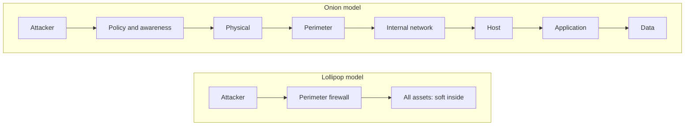

## Why should you care?

A company spends lakhs on a powerful firewall at its internet connection. Inside, every PC trusts every other PC, passwords are weak, and the file server is open to everyone.

One day an employee opens an email attachment. The malware is now **inside** the firewall. Nothing stops it from spreading to every machine and the file server. The expensive firewall did not even see it.

This happens again and again. The problem is not a bad firewall; it is a bad **model** of defence. This lecture compares two models: one strong wall, or many layers.

## In one line

The lollipop model protects a network with a single hard outer perimeter and little inside it, while the onion model uses many layers of defence so that if one fails, others still protect the assets.

## Explained

### Q1. What is a defense model?

==A **defense model** is the overall plan for where security controls are placed around the assets.==

It answers: if an attacker gets past one control, what stops them next?

Two classic models are:
- ==the **lollipop model** (perimeter only)==, and
- ==the **onion model** (layered, also called defense in depth)==.

### Q2. What is the lollipop model?

==The lollipop model protects assets with one hard outer shell, such as a perimeter firewall, while the inside is soft and trusts everything.==

Like a lollipop: ==a hard candy shell around a soft, chewy centre==.

- The firewall at the internet edge is the only real control.
- Everything inside the network is treated as trusted.
- Once the shell is cracked, the attacker can reach everything.

It was common in the 1990s, when networks had one internet connection and all users sat inside the office.

### Q3. What are the weaknesses of the lollipop model?

- ==**One point of failure:**== a single misconfiguration or bug in the perimeter exposes everything.
- ==**No protection from insiders:**== employees and contractors are already inside.
- ==**Malware walks in through users:**== email, USB drives and web downloads bypass the perimeter.
- ==**No detection inside:**== once in, attackers move freely and quietly, often for months.
- ==**Today's networks have no single edge:**== laptops at home, mobile phones, cloud servers and partner links all cross the "wall".

### Q4. What is the onion model?

==The onion model (defense in depth) places several independent layers of security around the assets, so that an attacker must defeat every layer to reach the data.==

Like an onion: many layers, and you must peel them one by one.

Typical layers, outside to inside:

1. Policies, procedures and awareness
2. Physical security (guards, locks, CCTV)
3. Perimeter (firewall, VPN)
4. Internal network (segmentation, IDS)
5. Host (patching, antivirus, hardening)
6. Application (secure code, authentication)
7. Data (encryption, access control, backups)

### Q5. Why is the onion model better?

- ==**No single point of failure:**== if the firewall is bypassed, host controls and encryption still protect the data.
- ==**Slows attackers down:**== each layer costs the attacker time and effort.
- ==**More chances to detect:**== each layer can log and alert, so the attack is noticed before the core is reached.
- ==**Covers insiders:**== inner layers (access control, encryption) also limit what employees can do.

==Lollipop: one strong outer layer. Onion: many layers, each able to stop or detect an attack.==

### Q6. Lollipop vs onion: comparison

| Point | Lollipop model | Onion model |
|---|---|---|
| ==Layers== | One (perimeter) | Many |
| ==Inside the network== | Trusted, soft | Protected, segmented |
| ==If perimeter fails== | Everything exposed | Inner layers still protect |
| ==Insider threats== | Not handled | Limited by inner layers |
| ==Detection== | Mostly at the edge | At every layer |
| ==Cost and effort== | Lower | Higher, but justified for valuable assets |
| Also called | Perimeter security | Defense in depth, layered security |

> [!beyond] Beyond the syllabus
> Modern organisations go one step further with **zero trust**: no user or device is trusted just because it is inside the network. Every request is checked for identity, device health and permission, every time (NIST SP 800-207).

## Analogy and real-life example

**Analogy: a bank branch versus a lollipop.** A shop with one strong shutter and nothing inside is a lollipop: break the shutter and the cash counter is open. A bank branch is an onion: a guard at the door, CCTV, a counter with glass, a strong room with a time lock, a locker that needs two keys, and an alarm linked to the police. A thief who passes the guard still faces five more layers.

**Real example: the AIIMS ransomware attack, 2022.** Once the malware was inside, it spread across many servers and computers, which suggests weak inner layers. What saved the data was one inner layer that held: secondary database servers that were not infected and were disconnected quickly. One working layer made recovery possible.

## Diagram

## Key points

> [!important] Key points
> - A defense model decides where controls are placed around assets.
> - Lollipop model: hard outer shell (perimeter firewall), soft trusted inside; one point of failure; no defence against insiders or malware already inside.
> - Onion model (defense in depth): many independent layers: policy, physical, perimeter, network, host, application, data.
> - Onion advantages: no single point of failure, slows attackers, more chances to detect, limits insiders.
> - Modern extension: zero trust (verify every request).

## Common mistakes

> [!warning] Common mistake
> Thinking defense in depth means buying several firewalls from different vendors. The layers must be of **different kinds** (physical, network, host, application, data, people), so one type of attack cannot defeat them all.

> [!warning] Common mistake
> Saying the lollipop model has no firewall. It does; it has **only** the perimeter firewall and nothing behind it.

## Exam questions

**Short answer (2–3 marks)**
1. What is the lollipop model of defense?
2. What is defense in depth?
3. List the layers of the onion model.
4. Give two weaknesses of the lollipop model.

**Long answer (5 marks)**
1. Explain the lollipop and onion models of defense with diagrams.
2. Compare the lollipop and onion models. Why is the onion model preferred today?
3. Explain with an example how defense in depth protects data even after the perimeter is breached.

## Sources

- Mark Rhodes-Ousley, *Information Security: The Complete Reference*, 2nd ed., McGraw-Hill, Ch. 4, "Secure Design Principles": the lollipop model and the onion model (verify).
- NIST Special Publication 800-207, *Zero Trust Architecture*.
- News reports on the AIIMS New Delhi ransomware attack, November 2022.
