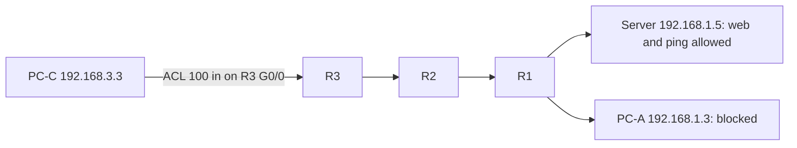

## Aim

To configure, apply and verify an extended numbered access control list that allows a remote LAN to reach only the web service and ping on a server, and blocks all its other traffic to the server LAN.

## Concepts used

- [[authorization]]: ACLs are a form of rule-based access control.
- [[zones-of-trust]]: controlling traffic between parts of the network.
- [[network-defense-best-practices]]: least privilege and default deny applied to traffic.

**Why this matters.** By default a router forwards every packet it has a route for. In a college, that means a student lab can reach the accounts server, the exam server and staff PCs on any port. An ACL is the router's rule list: it decides, packet by packet, what may pass. Extended ACLs can match source, destination, protocol and port, so you can allow "web to this server" while blocking everything else.

## Setup

**Tool:** Cisco Packet Tracer (8.x or later).

### Devices and topology

Open your saved file from **Practical 4**. Each Unit 2 practical starts from this same file, so the ACLs of one practical do not affect the next.

The **server (192.168.1.5)** on R1's LAN already runs HTTP and FTP in Packet Tracer. Check Services → HTTP and FTP are **On**.



### Policy

| Traffic from 192.168.3.0/24 | Action |
|---|---|
| Web (HTTP) to server 192.168.1.5 | Permit |
| Ping to server 192.168.1.5 | Permit |
| Anything else to 192.168.1.0/24 | Deny |
| Anything else (to other networks) | Permit |

## Code

### Step 1. Test before the ACL

From PC-C: ping 192.168.1.3 (PC-A), ping 192.168.1.5, open Web Browser to `http://192.168.1.5`, and run `ftp 192.168.1.5`. All should work.

### Step 2. Create ACL 100 on R3

```text
R3# configure terminal
R3(config)# access-list 100 remark Allow web and ping to server, block rest of 192.168.1.0
R3(config)# access-list 100 permit tcp 192.168.3.0 0.0.0.255 host 192.168.1.5 eq www
R3(config)# access-list 100 permit icmp 192.168.3.0 0.0.0.255 host 192.168.1.5 echo
R3(config)# access-list 100 deny ip 192.168.3.0 0.0.0.255 192.168.1.0 0.0.0.255
R3(config)# access-list 100 permit ip any any
```

### Step 3. Apply it inbound on R3's LAN interface

```text
R3(config)# interface g0/0
R3(config-if)# ip access-group 100 in
R3(config-if)# end
```

### Step 4. Verify

From PC-C, repeat all four tests from Step 1, then on R3:

```text
R3# show access-lists
R3# show ip interface g0/0
```

## Output

> [!warning] Replace with your own output
> The blocks below show what correct output looks like. After running the lab, paste your real output here, or save a screenshot in `content/assets/img/security-in-computing/` and link it with alt text.

**Test results from PC-C**

| Test | Result |
|---|---|
| `http://192.168.1.5` in browser | Page loads |
| `ping 192.168.1.5` | Replies |
| `ping 192.168.1.3` | `Reply from 192.168.3.1: Destination host unreachable.` |
| `ftp 192.168.1.5` | Fails (times out) |

**Rule matches** (`show access-lists` on R3):

```output
Extended IP access list 100
    10 permit tcp 192.168.3.0 0.0.0.255 host 192.168.1.5 eq www (12 match(es))
    20 permit icmp 192.168.3.0 0.0.0.255 host 192.168.1.5 echo (4 match(es))
    30 deny ip 192.168.3.0 0.0.0.255 192.168.1.0 0.0.0.255 (8 match(es))
    40 permit ip any any
```

The match counters show which rule handled each test.

## Explanation

### How an extended ACL statement is built

`access-list 100 permit tcp 192.168.3.0 0.0.0.255 host 192.168.1.5 eq www`

| Part | Meaning |
|---|---|
| `100` | ==Numbers 100–199 (and 2000–2699) are extended ACLs== |
| `permit` / `deny` | Action |
| `tcp`, `icmp`, `ip` | Protocol (`ip` matches everything) |
| `192.168.3.0 0.0.0.255` | Source network and **wildcard mask** |
| `host 192.168.1.5` | Destination (same as `192.168.1.5 0.0.0.0`) |
| `eq www` | Destination port 80 |

### How the router processes the list

- ==The router checks statements from top to bottom and stops at the first match.==
- ==Every ACL ends with an invisible `deny any`== (the implicit deny). Without the last `permit ip any any`, PC-C could reach nothing beyond R3.
- Order matters: if the `deny ip … 192.168.1.0` line came first, web and ping to the server would also be blocked.

### Where to apply it

- ==Place extended ACLs close to the source== of the traffic, so unwanted packets are dropped before they use links across the network. That is why ACL 100 is on R3, not R1.
- `in` filters packets arriving on the interface; `out` filters packets leaving it.
- Only **one ACL per interface, per direction, per protocol**.

> [!beyond] Beyond the syllabus
> Named extended ACLs (`ip access-list extended NAME`) let you insert or delete single lines by sequence number, which makes editing much easier than with numbered ACLs. Practical 6 uses named ACLs for IPv6.

## Try it

Change the policy so that PC-C may also use **FTP** to the server, but still may not ping PC-A. Where in the list must the new line go, and why? (Hint: `show access-lists` shows sequence numbers; `ip access-list extended 100` lets you add `25 permit …`.)

## Viva questions

1. Difference between a standard and an extended ACL? *Standard matches only the source address; extended matches source, destination, protocol and port.*
2. What number ranges are used for extended ACLs? *100–199 and 2000–2699.*
3. What is a wildcard mask? *A mask where 0 means "must match" and 1 means "ignore"; 0.0.0.255 matches a /24 network.*
4. What is the implicit deny? *An invisible `deny any` at the end of every ACL that drops anything not matched earlier.*
5. Where should extended ACLs be placed, and why? *Close to the source, so unwanted traffic is dropped early.*
6. How many ACLs can be applied to one interface? *One per direction (in/out) per protocol.*
7. What does `eq www` mean? *Destination port equal to 80 (HTTP).*

## Sources

- Cisco, *Security Configuration Guide: Access Control Lists* for IOS (verify exact title for your IOS version).
- Cisco Networking Academy, CCNA Security Packet Tracer activity: Configuring Extended ACLs (verify).
