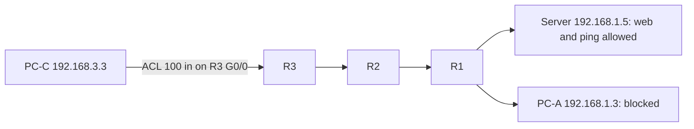

## Aim

To configure, apply and verify an extended numbered access control list that allows a remote LAN to reach only the web service and ping on a server, and blocks all its other traffic to the server LAN.

## Concepts used

- [[authorization]]: ACLs are a form of rule-based access control.
- [[zones-of-trust]]: controlling traffic between parts of the network.
- [[network-defense-best-practices]]: least privilege and default deny applied to traffic.

**Why this matters.** By default a router forwards every packet it has a route for. In a college, that means a student lab can reach the accounts server, the exam server and staff PCs on any port. An ACL is the router's rule list: it decides, packet by packet, what may pass. Extended ACLs can match source, destination, protocol and port, so you can allow "web to this server" while blocking everything else.

## Before the lab

**Install or open**
- Cisco Packet Tracer 8.x or later.
- Your saved file **practical4.pkt**. Every Unit 2 practical (5 to 8) starts from this same file, so the ACLs of one practical do not affect the next.
- R1's console asks for a login since Practical 4: **Admin1 / admin1pa55**, enable secret **ciscoenpa55**.

**Revise first**
- **Wildcard masks:** the opposite of a subnet mask. 0 means "must match", 1 means "ignore". /24 → `0.0.0.255`; a single host → `0.0.0.0` or the word `host`.
- **Common ports:** HTTP 80 (`www`), FTP 21, SSH 22, Telnet 23.
- [[authorization]]: default deny and least privilege.

## Setup

**Tool:** Cisco Packet Tracer (8.x or later).

### Devices and topology

The Practical 4 topology. The **server (192.168.1.5)** on R1's LAN already runs HTTP and FTP in Packet Tracer. The ACL is configured on **R3**.



### Policy

| Traffic from 192.168.3.0/24 | Action |
|---|---|
| Web (HTTP) to server 192.168.1.5 | Permit |
| Ping to server 192.168.1.5 | Permit |
| Anything else to 192.168.1.0/24 | Deny |
| Anything else (to other networks) | Permit |

## Steps

### Part A. Test before the ACL

1. **Open your Practical 4 file and save a copy** as `practical5.pkt`.
   → **You should see:** the Practical 4 topology, all links green.
2. **Check the server's services.** Server → Services → **HTTP**: both HTTP and HTTPS **On**; **FTP**: Service **On**.
   → **You should see:** both services switched on (they are on by default).
3. **Run four tests from PC-C.** Command Prompt: `ping 192.168.1.3` and `ping 192.168.1.5`. Web Browser: `http://192.168.1.5`. Command Prompt: `ftp 192.168.1.5` (user `cisco`, password `cisco`, then `quit`).
   → **You should see:** all four work: ping replies, the Packet Tracer default web page, and `220- Welcome to PT Ftp server`.

### Part B. Build ACL 100 on R3

4. **Enter configuration mode on R3 and add a remark.**
   ```text
   configure terminal
   access-list 100 remark Allow web and ping to server, block rest of 192.168.1.0
   ```
   → **You should see:** no message.
5. **Permit web to the server.**
   ```text
   access-list 100 permit tcp 192.168.3.0 0.0.0.255 host 192.168.1.5 eq www
   ```
   → **You should see:** no message.
6. **Permit ping to the server.**
   ```text
   access-list 100 permit icmp 192.168.3.0 0.0.0.255 host 192.168.1.5 echo
   ```
   → **You should see:** no message.
7. **Deny everything else to the server LAN.**
   ```text
   access-list 100 deny ip 192.168.3.0 0.0.0.255 192.168.1.0 0.0.0.255
   ```
   → **You should see:** no message.
8. **Permit all other traffic.**
   ```text
   access-list 100 permit ip any any
   end
   ```
   → **You should see:** the prompt return to `R3#`.
9. **Check the list before applying it.** `show access-lists`
   → **You should see:** `Extended IP access list 100` with four lines numbered 10, 20, 30 and 40, and no matches yet.

### Part C. Apply and test

10. **Apply ACL 100 inbound on R3's LAN interface.**
    ```text
    configure terminal
    interface g0/0
     ip access-group 100 in
    end
    ```
    → **You should see:** the prompt return to `R3#`. `show ip interface g0/0` now shows `Inbound access list is 100`.
11. **Repeat the four tests from Step 3.**
    → **You should see:** the web page loads; `ping 192.168.1.5` replies; `ping 192.168.1.3` gives `Reply from 192.168.3.1: Destination host unreachable.`; FTP fails with a time-out.
12. **See which rule handled each test.** On R3: `show access-lists`.
    → **You should see:** match counters, for example `(12 match(es))`, on the lines that handled your tests.
13. **Save everything.** `copy running-config startup-config` on R3; File → Save.
    → **You should see:** `Building configuration... [OK]`.

## Code

Complete configuration added on **R3** in this practical:

```text
access-list 100 remark Allow web and ping to server, block rest of 192.168.1.0
access-list 100 permit tcp 192.168.3.0 0.0.0.255 host 192.168.1.5 eq www
access-list 100 permit icmp 192.168.3.0 0.0.0.255 host 192.168.1.5 echo
access-list 100 deny ip 192.168.3.0 0.0.0.255 192.168.1.0 0.0.0.255
access-list 100 permit ip any any
interface g0/0
 ip access-group 100 in
```

## Output

> [!warning] Replace with your own output
> The blocks below show what correct output looks like. After running the lab, paste your real output here, or save a screenshot in `content/assets/img/security-in-computing/` and link it with alt text.

**Test results from PC-C**

| Test | Result |
|---|---|
| `http://192.168.1.5` in browser | Page loads |
| `ping 192.168.1.5` | Replies |
| `ping 192.168.1.3` | `Reply from 192.168.3.1: Destination host unreachable.` |
| `ftp 192.168.1.5` | Fails (times out) |

**Rule matches** (`show access-lists` on R3):

```output
Extended IP access list 100
    10 permit tcp 192.168.3.0 0.0.0.255 host 192.168.1.5 eq www (12 match(es))
    20 permit icmp 192.168.3.0 0.0.0.255 host 192.168.1.5 echo (4 match(es))
    30 deny ip 192.168.3.0 0.0.0.255 192.168.1.0 0.0.0.255 (8 match(es))
    40 permit ip any any
```

## Explanation

### How an extended ACL statement is built

`access-list 100 permit tcp 192.168.3.0 0.0.0.255 host 192.168.1.5 eq www`

| Part | Meaning |
|---|---|
| `100` | ==Numbers 100–199 (and 2000–2699) are extended ACLs== |
| `permit` / `deny` | Action |
| `tcp`, `icmp`, `ip` | Protocol (`ip` matches everything) |
| `192.168.3.0 0.0.0.255` | Source network and **wildcard mask** |
| `host 192.168.1.5` | Destination (same as `192.168.1.5 0.0.0.0`) |
| `eq www` | Destination port 80 |

### How the router processes the list

- ==The router checks statements from top to bottom and stops at the first match.==
- ==Every ACL ends with an invisible `deny any`== (the implicit deny). Without the last `permit ip any any`, PC-C could reach nothing beyond R3.
- Order matters: if the `deny ip … 192.168.1.0` line came first, web and ping to the server would also be blocked.

### Where to apply it

- ==Place extended ACLs close to the source== of the traffic, so unwanted packets are dropped before they use links across the network. That is why ACL 100 is on R3, not R1.
- `in` filters packets arriving on the interface; `out` filters packets leaving it.
- Only **one ACL per interface, per direction, per protocol**.

> [!beyond] Beyond the syllabus
> Named extended ACLs (`ip access-list extended NAME`) let you insert or delete single lines by sequence number, which makes editing much easier than with numbered ACLs. Practical 6 uses named ACLs for IPv6.

## Common errors and fixes

| Message or symptom | Cause | Fix |
|---|---|---|
| `% Invalid input detected at '^' marker.` on `ip access-group 100 in` | Typed in global configuration mode | Enter the interface first: `interface g0/0`, then the command |
| Nothing changes after applying; `show access-lists` shows no matches | Applied on the wrong interface or in the wrong direction | `show ip interface g0/0` must say `Inbound access list is 100`. Remove a wrong one with `no ip access-group 100 in` on that interface |
| Web and ping to the server are also blocked | The `deny` line was entered before the `permit` lines | Lines are checked top to bottom. Remove the list (`no access-list 100`) and enter it again in the order of Steps 5–8 |
| PC-C cannot reach anything beyond R3, not even R2 | `permit ip any any` is missing, so the implicit deny blocks everything else | Add `access-list 100 permit ip any any` |
| Lines are accepted but never match | Subnet mask used instead of wildcard (`255.255.255.0` instead of `0.0.0.255`) | Re-enter with wildcard masks |
| Typing `no access-list 100 permit icmp …` deleted the **whole** list | For numbered ACLs, `no access-list 100 …` removes the entire list | Re-enter it. To remove one line safely, use `ip access-list extended 100`, then `no 20` (the sequence number) |
| Browser shows `Request Timeout` even before the ACL | HTTP service is off on the server | Turn HTTP **On** (Step 2) |

## Try it

Change the policy so that PC-C may also use **FTP** to the server, but still may not ping PC-A. Where in the list must the new line go, and why? (Hint: `show access-lists` shows sequence numbers; `ip access-list extended 100` lets you add `25 permit …`.)

## Viva questions

1. Difference between a standard and an extended ACL? *Standard matches only the source address; extended matches source, destination, protocol and port.*
2. What number ranges are used for extended ACLs? *100–199 and 2000–2699.*
3. What is a wildcard mask? *A mask where 0 means "must match" and 1 means "ignore"; 0.0.0.255 matches a /24 network.*
4. What is the implicit deny? *An invisible `deny any` at the end of every ACL that drops anything not matched earlier.*
5. Where should extended ACLs be placed, and why? *Close to the source, so unwanted traffic is dropped early.*
6. How many ACLs can be applied to one interface? *One per direction (in/out) per protocol.*
7. What does `eq www` mean? *Destination port equal to 80 (HTTP).*

## Sources

- Cisco, *Security Configuration Guide: Access Control Lists* for IOS (verify exact title for your IOS version).
- Cisco Networking Academy, CCNA Security Packet Tracer activity: Configuring Extended ACLs (verify).
