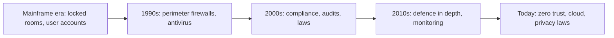

## Why should you care?

Your college stores names, phone numbers, Aadhaar-linked fee receipts and marks for every student. Suppose:

- a former employee still has a working login and quietly changes some marks,
- a laptop with the full student list is stolen from a car,
- the exam portal goes down for six hours on result day.

Nobody "hacked" anything clever in the first two cases, and the third may not be an attack at all. Yet each one is a security failure: information was changed, exposed, or unavailable when needed.

Information security is the discipline that prevents these failures, notices them when they happen, and recovers from them.

## In one line

Information security is the protection of information and the systems that hold it from unauthorised access, use, disclosure, change or destruction, so that it stays confidential, correct and available.

## Explained

### Q1. What is information security? ⭐

==Information security protects information, in any form, from unauthorised access, use, disclosure, disruption, modification or destruction.==

Three words in that definition matter:

- **Information, in any form:** a database, an email, a printed result sheet, or what a staff member says on the phone.
- ==**Unauthorised:**== the problem is not use of data, but use by the wrong person or in the wrong way.
- ==**Disruption:** making data unavailable== is also a security failure.

==Its three goals are confidentiality, integrity and availability==, together called the **CIA triad**. Lecture 6 covers them in detail: [[cia-triad]].

### Q2. How is it different from IT security and cybersecurity?

| Term | Protects | Example |
|---|---|---|
| Information security | ==Information in every form==: digital, paper, spoken | Locking the exam-paper cupboard |
| IT / computer security | ==Computers, networks and software== | Patching a server |
| Cybersecurity | ==Systems and data connected to the internet==, against online attacks | Blocking a phishing site |

==Information security is the widest of the three.== The other two are parts of it. In daily use people often treat the words as the same; in an exam, state the difference.

### Q3. Why is information protection important? ⭐

- ==**Information is an asset.**== Customer lists, designs and records have money value, like machines or buildings.
- ==**Business depends on it.**== If UPI or a bank's core system stops, payments stop. Downtime costs money every minute.
- ==**Law requires it.**== In India, the IT Act 2000 and the Digital Personal Data Protection (DPDP) Act 2023 make organisations responsible for protecting personal data.
- ==**Trust.**== One public breach can drive customers away for years.
- ==**Safety.**== In hospitals, power grids and railways, a security failure can hurt people.

### Q4. How did security start? (1960s–1980s)

- ==**Mainframe era:** a few large computers in locked rooms==. Security meant guards, locked doors and user accounts on a shared machine.
- **Military research:** the US defence sector studied how to keep secret and non-secret users on one computer safely. Early security models came from this work.
- ==**1988, the Morris worm:** a self-spreading program== slowed thousands of internet computers. It showed that a connected network can be attacked from anywhere. The first computer emergency response team (CERT/CC) was set up soon after.

==Lesson of this era: connecting computers creates new risks.==

### Q5. How did security practice change after the internet? (1990s–today) ⭐

| Era | Main idea | Typical tools |
|---|---|---|
| ==1990s, perimeter== | Build a wall around the network | Firewalls, antivirus |
| ==2000s, compliance== | Follow laws and standards | Audits, ISO 27001, PCI DSS, IT Act 2000 (amended 2008) |
| ==2010s, defence in depth== | Assume one layer will fail; add many layers | IDS/IPS, SIEM, encryption everywhere |
| ==Today, zero trust and cloud== | Trust no user or device by default; check every request | Multi-factor login, cloud security, DPDP Act 2023 |

==Security moved from a one-time product (a firewall) to a continuous process (prevent, detect, respond, recover).==

### Q6. Is security a technical problem or a business problem?

Both. ==Technology alone fails if people and processes are weak==.

- ==**People:**== a staff member who clicks a phishing link bypasses the best firewall.
- ==**Process:**== who approves a new login? Who removes it when someone leaves? How often are backups tested?
- ==**Technology:**== firewalls, encryption, access control, monitoring.

Good security balances these three and is ==driven by business needs==: protect what matters most, at a cost the organisation can justify. Lectures 2 and 3 build on this: [[security-methodology]] and [[justifying-security-investment]].

### Q7. Why is security called a process and not a product? [2M]

==Security is a continuous process because threats, systems and people keep changing.==

- ==**A product protects only one layer**== at one moment; a firewall does nothing against a stolen password or a missing backup.
- ==**The process repeats:**== prevent, detect, respond and recover, then review and improve.

> [!beyond] Beyond the syllabus
> Security teams often describe their work with the NIST Cybersecurity Framework functions: Govern, Identify, Protect, Detect, Respond and Recover. It is a useful checklist when you join a company's security team.

## Analogy and real-life example

**Analogy: a bank branch.** A branch does not protect money with one lock. It has a guard at the door (access control), a vault (encryption), CCTV (monitoring), a rule that two officers open the vault together (process), and insurance plus records at head office (recovery). Information security does the same for data: many layers, people and rules, not one product.

**Real example: AIIMS New Delhi, November 2022.** Ransomware encrypted the hospital's e-Hospital servers and services ran on paper for more than a week. The data came back largely because some secondary database servers were untouched and were cut off from the network at once. Prevention failed; recovery planning worked.

## Diagram

## Key points

> [!important] Key points
> - Information security protects information in any form from unauthorised access, use, disclosure, disruption, modification or destruction.
> - Its goals are the CIA triad: confidentiality, integrity, availability.
> - Information security is wider than IT security and cybersecurity; those are parts of it.
> - Reasons to protect information: it is an asset, business depends on it, law requires it (IT Act 2000, DPDP Act 2023), trust and safety.
> - Evolution: physical/mainframe → perimeter → compliance → defence in depth → zero trust and cloud.
> - Security is a continuous process (prevent, detect, respond, recover), not a one-time product.
> - Security needs people, process and technology together.

## Common mistakes

> [!warning] Common mistake
> "Security means stopping hackers." Most incidents also include mistakes, lost devices, insiders and outages. Availability failures count too.

> [!warning] Common mistake
> "We have a firewall, so we are secure." A firewall is one layer. It does nothing against a stolen password used from inside, or a deleted file with no backup.

## Sources

- Mark Rhodes-Ousley, *Information Security: The Complete Reference*, 2nd ed., McGraw-Hill, Ch. 1 (verify).
- Charles P. Pfleeger, Shari L. Pfleeger and Jonathan Margulies, *Security in Computing*, 5th ed., Pearson, Ch. 1 (verify).
- Nina Godbole, *Information Systems Security*, Wiley India, Ch. 1 (verify).
- NIST Computer Security Resource Center glossary, entry "information security".
- News reports on the AIIMS New Delhi ransomware attack, November 2022.
