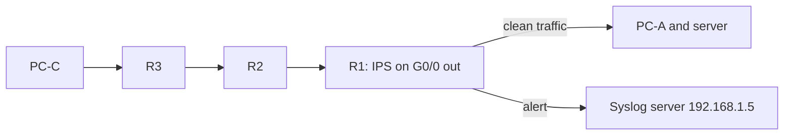

## Aim

To configure the Cisco IOS Intrusion Prevention System on a router using the CLI, modify a signature so that it alerts and drops matching packets, and verify the alerts on the syslog server.

## Concepts used

- [[ids-ips]]: intrusion detection and prevention (Unit 3 theory).
- [[ntp-syslog-practical]]: alerts are sent to the syslog server with correct timestamps.
- [[threats-and-attacks]]: reconnaissance such as ping sweeps.

**Why this matters.** Firewalls and ACLs decide by address and port. Many attacks use allowed ports but carry a recognisable pattern: a known exploit, a scan, a malformed packet. An **IPS** compares traffic against a library of **signatures** (attack patterns) and can block a match in real time, while logging an alert for the security team.

## Before the lab

**Install or open**
- Cisco Packet Tracer 8.x or later.
- Your saved file **practical4.pkt** (no ACLs or firewall yet). The syslog server from Practical 2 must be working.
- R1's console login: **Admin1 / admin1pa55**, enable secret **ciscoenpa55**.

**Revise first**
- IDS versus IPS: an IDS only watches and alerts; an IPS sits in the traffic path and can block.
- Syslog severity levels from [[ntp-syslog-practical]]: IPS alerts arrive as level 4 (Warning) messages.
- **Signature:** a pattern that identifies a known attack, like a fingerprint.

## Setup

**Tool:** Cisco Packet Tracer (8.x or later).

### Devices and topology

The Practical 4 topology. IPS is configured on **R1**, inspecting traffic **leaving** R1 into its LAN (G0/0 out), which protects PC-A and the server. The syslog server (192.168.1.5) receives the alerts.



### Security license

Like Practical 7, IOS IPS needs the security technology package, enabled on **R1** in Steps 3–5.

## Steps

### Part A. Baseline and licence

1. **Open your Practical 4 file and save a copy** as `practical8.pkt`.
   → **You should see:** the Practical 4 topology, all links green.
2. **Confirm normal connectivity.** PC-C: `ping 192.168.1.3`.
   → **You should see:** replies. After the IPS this must fail.
3. **Enable the security licence on R1.** Log in to R1's console, then:
   ```text
   enable
   configure terminal
   license boot module c2900 technology-package securityk9
   ```
   At `ACCEPT? [yes/no]:`, type `yes`.
   → **You should see:** `% use 'write' command to make license boot config take effect on next boot`.
4. **Save and reload R1.**
   ```text
   end
   copy running-config startup-config
   reload
   ```
   Press Enter at `Proceed with reload? [confirm]`.
   → **You should see:** R1 restart, then `Username:`. Log in again as Admin1 and type `enable`.
5. **Check the licence.** `show version`
   → **You should see:** the `security` row shows `securityk9`.

### Part B. Set up IPS

6. **Create a folder for the signature files.** In privileged mode:
   ```text
   mkdir ipsdir
   ```
   Press Enter at `Create directory filename [ipsdir]?`.
   → **You should see:** `Created dir flash:ipsdir`.
7. **Point IPS to the folder, name the rule and send alerts to syslog.**
   ```text
   configure terminal
   ip ips config location flash:ipsdir
   ip ips name iosips
   ip ips notify log
   ```
   → **You should see:** no error.
8. **Load only the basic signature set.**
   ```text
   ip ips signature-category
    category all
     retired true
    exit
    category ios_ips basic
     retired false
    exit
   exit
   ```
   At `Do you want to accept these changes? [confirm]`, press **Enter**.
   → **You should see:** the prompt return to `R1(config)#`, possibly after messages about applying the category configuration.
9. **Apply the IPS rule to traffic leaving R1 towards its LAN.**
   ```text
   interface g0/0
    ip ips iosips out
   exit
   ```
   → **You should see:** messages such as `%IPS-6-ENGINE_BUILDS_STARTED` and `%IPS-6-ENGINE_READY` while the signature engines load.

### Part C. Make signature 2004 alert and drop

10. **Enable signature 2004 (ICMP echo request) and set its actions.**
    ```text
    ip ips signature-definition
     signature 2004 0
      status
       retired false
       enabled true
      exit
      engine
       event-action produce-alert
       event-action deny-packet-inline
      exit
     exit
    exit
    ```
    At `Do you want to accept these changes? [confirm]`, press **Enter**.
    → **You should see:** the prompt return to `R1(config)#`.

### Part D. Test

11. **Ping from outside into R1's LAN.** PC-C: `ping 192.168.1.3`.
    → **You should see:** `Request timed out.` four times.
12. **Read the alert.** Look at R1's console, then Server → Services → SYSLOG.
    → **You should see:** `%IPS-4-SIGNATURE: Sig:2004 Subsig:0 Sev:25 ICMP Echo Request [192.168.3.3:0 -> 192.168.1.3:0] …` in both places.
13. **Ping from inside to outside.** PC-A: `ping 192.168.3.3`.
    → **You should see:** replies. PC-A's requests leave through G0/1, and the replies coming back are not signature 2004.
14. **Check the IPS status.** On R1: `show ip ips all`.
    → **You should see:** `Event notification through syslog is enabled` and, under Interface GigabitEthernet0/0, `Outgoing IPS rule is iosips`.
15. **Save everything.** `copy running-config startup-config` on R1; File → Save.
    → **You should see:** `Building configuration... [OK]`.

## Code

Complete configuration added on **R1** in this practical:

```text
license boot module c2900 technology-package securityk9
! (accept, save and reload)
! privileged mode:  mkdir ipsdir
ip ips config location flash:ipsdir
ip ips name iosips
ip ips notify log
ip ips signature-category
 category all
  retired true
 category ios_ips basic
  retired false
interface g0/0
 ip ips iosips out
ip ips signature-definition
 signature 2004 0
  status
   retired false
   enabled true
  engine
   event-action produce-alert
   event-action deny-packet-inline
```

## Output

> [!warning] Replace with your own output
> The blocks below show what correct output looks like. After running the lab, paste your real output here, or save a screenshot in `content/assets/img/security-in-computing/` and link it with alt text.

**Test results**

| Test | Result |
|---|---|
| PC-C `ping 192.168.1.3` | Request timed out (echo request dropped by IPS) |
| PC-A `ping 192.168.3.3` | Replies (requests leave via G0/1; replies are not signature 2004) |

**Alert at the syslog server** (example entry):

```output
%IPS-4-SIGNATURE: Sig:2004 Subsig:0 Sev:25 ICMP Echo Request [192.168.3.3:0 -> 192.168.1.3:0] VRF:NONE RiskRating:25
```

**IPS status** (`show ip ips all`, excerpt):

```output
IPS Signature File Configuration Status
    Configured Config Locations: flash:ipsdir/
...
IPS Syslog and SDEE Notification Status
    Event notification through syslog is enabled
...
IPS Rule Configuration
    IPS name iosips
Interface Configuration
    Interface GigabitEthernet0/0
        Inbound IPS rule is not set
        Outgoing IPS rule is iosips
```

## Explanation

### What each part does

- `ip ips config location flash:ipsdir`: ==where the router stores signature files and settings==.
- `ip ips name iosips`: creates the IPS rule that is later applied to an interface.
- `ip ips notify log`: send alerts as syslog messages.
- **Signature categories:** the router has limited memory, so ==retire all signatures first, then un-retire only the `ios_ips basic` set==.
- `ip ips iosips out` on G0/0: inspect packets leaving R1 towards the protected LAN.

### Modifying a signature

- **Signature 2004** matches ICMP echo request (ping) packets.
- `retired false` / `enabled true`: load it and switch it on.
- ==`produce-alert` logs the event; `deny-packet-inline` drops the packet.==
- Together they turn a detection into a **prevention**: the ping is both recorded and stopped.

### IDS versus IPS

| Point | IDS | IPS |
|---|---|---|
| Position | Watches a copy of traffic | Sits in the traffic path (inline) |
| Action | Alerts only | Alerts and blocks |
| Risk | Attack may succeed before anyone reacts | A wrong signature can block legitimate traffic |

==An IDS detects and alerts; an IPS detects and blocks inline.==

> [!beyond] Beyond the syllabus
> Cisco has since retired IOS IPS on routers in favour of dedicated platforms such as Snort-based Firepower devices. Snort is open source, and its rule format is a good next step for students interested in security operations.

## Common errors and fixes

| Message or symptom | Cause | Fix |
|---|---|---|
| `% Invalid input detected at '^' marker.` on any `ip ips` command | The security licence is not active | Do Steps 3–5; the licence works only after the reload |
| `%Error Creating dir flash:ipsdir (Directory already exists)` | The folder was created earlier | Nothing to fix; continue with Step 7 |
| Changes to categories or signature 2004 have no effect | `n` was typed, or Enter was not pressed, at `Do you want to accept these changes? [confirm]` | Repeat Step 8 or Step 10 and press **Enter** at the prompt |
| PC-C's ping still succeeds | Signature 2004 not enabled or still retired, or IPS applied on the wrong interface or direction | Check `show ip ips all`: G0/0 must show `Outgoing IPS rule is iosips`. Repeat Step 10 |
| Ping is blocked but no alert reaches the syslog server | `ip ips notify log` missing, `logging host 192.168.1.5` missing from Practical 2, or SYSLOG service off | Add the missing command; check Server → Services → SYSLOG is **On** |
| After the reload, R1 asks `Username:` and rejects you | Wrong credentials (case-sensitive) | Use **Admin1 / admin1pa55** from Practical 4 |

## Try it

1. Change signature 2004 to `produce-alert` only (remove `deny-packet-inline` with `no event-action deny-packet-inline`). Does PC-C's ping now succeed? Is the alert still logged? What kind of system have you turned the IPS into?
2. Apply the IPS on **G0/1 in** instead of G0/0 out. Which pings are now affected?

## Viva questions

1. What is an IPS? *A system that inspects traffic inline, compares it with attack signatures, and can alert and block matching packets.*
2. Difference between IDS and IPS? *An IDS only detects and alerts; an IPS sits inline and can drop malicious traffic.*
3. What is a signature? *A pattern that identifies a known attack or suspicious activity.*
4. Why are most signature categories retired? *To save router memory and CPU; only the needed set is loaded.*
5. What do `produce-alert` and `deny-packet-inline` do? *Produce-alert logs the event; deny-packet-inline drops the matching packet.*
6. What is a false positive in IPS? *Legitimate traffic wrongly matched as an attack and blocked.*
7. Why send IPS alerts to a syslog server? *To keep a central, time-stamped record that the security team can review and correlate.*

## Sources

- Cisco, *Security Configuration Guide: Cisco IOS Intrusion Prevention System* (verify exact title for your IOS version).
- Cisco Networking Academy, CCNA Security Packet Tracer activity: Configure IOS Intrusion Prevention System (IPS) Using CLI (verify).
