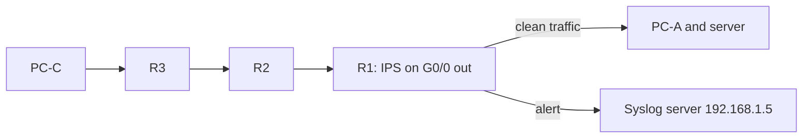

## Aim

To configure the Cisco IOS Intrusion Prevention System on a router using the CLI, modify a signature so that it alerts and drops matching packets, and verify the alerts on the syslog server.

## Concepts used

- [[ids-ips]]: intrusion detection and prevention (Unit 3 theory).
- [[ntp-syslog-practical]]: alerts are sent to the syslog server with correct timestamps.
- [[threats-and-attacks]]: reconnaissance such as ping sweeps.

**Why this matters.** Firewalls and ACLs decide by address and port. Many attacks use allowed ports but carry a recognisable pattern: a known exploit, a scan, a malformed packet. An **IPS** compares traffic against a library of **signatures** (attack patterns) and can block a match in real time, while logging an alert for the security team.

## Setup

**Tool:** Cisco Packet Tracer (8.x or later).

### Devices and topology

Open your saved file from **Practical 4**. IPS is configured on **R1**, inspecting traffic **leaving** R1 into its LAN (G0/0 out), which protects PC-A and the server. The syslog server (192.168.1.5) from Practical 2 receives the alerts.

R1's console asks for a login since Practical 4: use **Admin1 / admin1pa55**.



### Security license

Like Practical 7, IOS IPS needs the security technology package. Enable it on **R1** first:

```text
R1(config)# license boot module c2900 technology-package securityk9
ACCEPT? [yes/no]: yes
R1(config)# end
R1# copy running-config startup-config
R1# reload
```

## Code

### Step 1. Confirm normal connectivity

From PC-C: `ping 192.168.1.3` and `ping 192.168.1.5`. Both reply.

### Step 2. Signature storage and the IPS rule

```text
R1# mkdir ipsdir
R1# configure terminal
R1(config)# ip ips config location flash:ipsdir
R1(config)# ip ips name iosips
R1(config)# ip ips notify log
```

### Step 3. Load only the basic signature category

```text
R1(config)# ip ips signature-category
R1(config-ips-category)# category all
R1(config-ips-category-action)# retired true
R1(config-ips-category-action)# exit
R1(config-ips-category)# category ios_ips basic
R1(config-ips-category-action)# retired false
R1(config-ips-category-action)# exit
R1(config-ips-category)# exit
Do you want to accept these changes? [confirm]   (press Enter)
```

### Step 4. Apply IPS to the LAN interface

```text
R1(config)# interface g0/0
R1(config-if)# ip ips iosips out
R1(config-if)# exit
```

### Step 5. Modify signature 2004 (ICMP echo request): alert and drop

```text
R1(config)# ip ips signature-definition
R1(config-sigdef)# signature 2004 0
R1(config-sigdef-sig)# status
R1(config-sigdef-sig-status)# retired false
R1(config-sigdef-sig-status)# enabled true
R1(config-sigdef-sig-status)# exit
R1(config-sigdef-sig)# engine
R1(config-sigdef-sig-engine)# event-action produce-alert
R1(config-sigdef-sig-engine)# event-action deny-packet-inline
R1(config-sigdef-sig-engine)# exit
R1(config-sigdef-sig)# exit
R1(config-sigdef)# exit
Do you want to accept these changes? [confirm]   (press Enter)
```

### Step 6. Verify

```text
PC-C> ping 192.168.1.3
PC-A> ping 192.168.3.3
R1# show ip ips all
Server: Services → SYSLOG
```

## Output

> [!warning] Replace with your own output
> The blocks below show what correct output looks like. After running the lab, paste your real output here, or save a screenshot in `content/assets/img/security-in-computing/` and link it with alt text.

**Test results**

| Test | Result |
|---|---|
| PC-C `ping 192.168.1.3` | Request timed out (echo request dropped by IPS) |
| PC-A `ping 192.168.3.3` | Replies (requests leave via G0/1; replies are not signature 2004) |

**Alert at the syslog server** (example entry):

```output
%IPS-4-SIGNATURE: Sig:2004 Subsig:0 Sev:25 ICMP Echo Request [192.168.3.3:0 -> 192.168.1.3:0] VRF:NONE RiskRating:25
```

**IPS status** (`show ip ips all`, excerpt):

```output
IPS Signature File Configuration Status
    Configured Config Locations: flash:ipsdir/
...
IPS Syslog and SDEE Notification Status
    Event notification through syslog is enabled
...
IPS Rule Configuration
    IPS name iosips
Interface Configuration
    Interface GigabitEthernet0/0
        Inbound IPS rule is not set
        Outgoing IPS rule is iosips
```

## Explanation

### What each part does

- `ip ips config location flash:ipsdir`: ==where the router stores signature files and settings==.
- `ip ips name iosips`: creates the IPS rule that is later applied to an interface.
- `ip ips notify log`: send alerts as syslog messages.
- **Signature categories:** the router has limited memory, so ==retire all signatures first, then un-retire only the `ios_ips basic` set==.
- `ip ips iosips out` on G0/0: inspect packets leaving R1 towards the protected LAN.

### Modifying a signature

- **Signature 2004** matches ICMP echo request (ping) packets.
- `retired false` / `enabled true`: load it and switch it on.
- ==`produce-alert` logs the event; `deny-packet-inline` drops the packet.==
- Together they turn a detection into a **prevention**: the ping is both recorded and stopped.

### IDS versus IPS

| Point | IDS | IPS |
|---|---|---|
| Position | Watches a copy of traffic | Sits in the traffic path (inline) |
| Action | Alerts only | Alerts and blocks |
| Risk | Attack may succeed before anyone reacts | A wrong signature can block legitimate traffic |

==An IDS detects and alerts; an IPS detects and blocks inline.==

> [!beyond] Beyond the syllabus
> Cisco has since retired IOS IPS on routers in favour of dedicated platforms such as Snort-based Firepower devices. Snort is open source, and its rule format is a good next step for students interested in security operations.

## Try it

1. Change signature 2004 to `produce-alert` only (remove `deny-packet-inline` with `no event-action deny-packet-inline`). Does PC-C's ping now succeed? Is the alert still logged? What kind of system have you turned the IPS into?
2. Apply the IPS on **G0/1 in** instead of G0/0 out. Which pings are now affected?

## Viva questions

1. What is an IPS? *A system that inspects traffic inline, compares it with attack signatures, and can alert and block matching packets.*
2. Difference between IDS and IPS? *An IDS only detects and alerts; an IPS sits inline and can drop malicious traffic.*
3. What is a signature? *A pattern that identifies a known attack or suspicious activity.*
4. Why are most signature categories retired? *To save router memory and CPU; only the needed set is loaded.*
5. What do `produce-alert` and `deny-packet-inline` do? *Produce-alert logs the event; deny-packet-inline drops the matching packet.*
6. What is a false positive in IPS? *Legitimate traffic wrongly matched as an attack and blocked.*
7. Why send IPS alerts to a syslog server? *To keep a central, time-stamped record that the security team can review and correlate.*

## Sources

- Cisco, *Security Configuration Guide: Cisco IOS Intrusion Prevention System* (verify exact title for your IOS version).
- Cisco Networking Academy, CCNA Security Packet Tracer activity: Configure IOS Intrusion Prevention System (IPS) Using CLI (verify).
