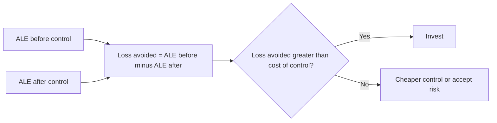

## Why should you care?

You are the IT head of a mid-sized company in Pune. You ask the management for ₹15 lakh for a new firewall, backup system and staff training. The finance director asks: "Nothing has gone wrong in five years. Why should we spend this money? What do we get back?"

If your only answer is "it is safer", you will not get the money. Security spending competes with salaries, marketing and new machines. To win it, you must explain security in the language of business: money saved, money earned, risk reduced and rules followed.

## In one line

Justifying security investment means showing management, in business terms, that the benefit of a security control (losses avoided, efficiency gained, compliance met, new business enabled) is worth more than its cost.

## Explained

### Q1. Why is security investment hard to justify?

- ==**Success is invisible.**== When security works, nothing happens, and "nothing happened" looks like wasted money.
- ==**Losses are uncertain.**== A breach may or may not happen this year.
- ==**It does not sell products directly.**== Unlike a new machine, a firewall does not produce anything.
- ==**Cost is now, benefit is later.**== The bill comes today; the attack it stops may come in two years.

==Security investment is justified by comparing the cost of a control with the expected loss it prevents and the business value it adds.==

### Q2. How costly is a breach?

A breach costs far more than fixing the computers:

| Cost | Example |
|---|---|
| ==Direct== | Investigation, restoring systems, ransom, legal fees |
| ==Lost business== | Downtime, customers leaving |
| ==Regulatory== | Penalties under the DPDP Act 2023 or sector regulators such as RBI |
| ==Reputation== | Loss of trust, lower share price, harder hiring |

According to IBM's 2025 Cost of a Data Breach report, the average cost of a breach to an organisation in India reached about ₹22 crore (INR 220 million), 13% more than in 2024. Phishing was the most common cause.

### Q3. What business benefits does security bring?

Security is not only loss prevention. It also helps the business:

- ==**Business agility:**== a secure network lets the company launch online services, allow remote work and connect partners quickly, because the risks are already managed.
- ==**Cost reduction:**== fewer incidents, less downtime, automated monitoring instead of manual checks, and sometimes lower cyber-insurance premiums.
- ==**Portability:**== good security policies and controls let staff work safely from any device or location, and let systems move to the cloud.
- ==**Compliance:**== meeting legal and customer requirements (DPDP Act, RBI rules, ISO 27001) avoids penalties and wins contracts.
- ==**Trust:**== customers choose the bank or app they believe is safe.

### Q4. How is the money value calculated? (ALE)

Security teams estimate the **expected yearly loss** from a risk:

$$ALE = SLE \times ARO$$

- ==**SLE** (Single Loss Expectancy): money lost in one incident==.
- ==**ARO** (Annualised Rate of Occurrence): how many times a year== it is expected.
- ==**ALE** (Annualised Loss Expectancy): expected loss per year==.

How to find SLE and ARO is covered in [[risk-analysis]]. Here we use ALE to judge a control.

### Q5. How do we decide whether a control is worth buying? (ROSI)

==**Return on Security Investment (ROSI)** compares the loss avoided with the cost of the control==:

$$ROSI = \frac{(ALE_{before} - ALE_{after}) - \text{Annual cost of control}}{\text{Annual cost of control}}$$

- ==ROSI **above 0**: the control saves more than it costs==; buy it.
- ==ROSI **below 0**: the control costs more than it saves==; look for a cheaper option or accept the risk.

==A control is worth buying when the reduction in expected yearly loss is greater than its yearly cost.==

### Q6. Worked example

A college ERP server is hit by ransomware about once in 4 years (ARO = 0.25). Each attack costs ₹8,00,000 in downtime and recovery (SLE).

- ALE before = ₹8,00,000 × 0.25 = **₹2,00,000 per year**.
- An offline backup system plus endpoint protection costs **₹50,000 per year** and is expected to cut the loss per attack to ₹1,00,000.
- ALE after = ₹1,00,000 × 0.25 = **₹25,000 per year**.
- Loss avoided = 2,00,000 − 25,000 = ₹1,75,000.
- ROSI = (1,75,000 − 50,000) / 50,000 = **2.5**, that is 250%.

Every rupee spent saves ₹2.50 more than it costs, so the investment is justified.

### Q7. What else, besides numbers, convinces management?

- ==**Speak in business terms:**== "two days of admissions downtime", not "a missing patch".
- ==**Link to goals:**== show how security supports a new online service or a big client contract.
- ==**Use real incidents:**== AIIMS 2022, or a competitor's breach.
- ==**Show legal duty:**== DPDP Act obligations, RBI or CERT-In directions.
- ==**Measure and report:**== after spending, report results such as fewer incidents and faster recovery, so the next request is easier.

> [!beyond] Beyond the syllabus
> Large companies also use Total Cost of Ownership (TCO), which adds staff time, licences, training and maintenance over several years to the purchase price, and cyber-insurance, which transfers part of the financial risk.

## Analogy and real-life example

**Analogy: a helmet and vehicle insurance.** You pay for a helmet and insurance every year even though you have never had an accident. You do it because the cost is small compared with the possible loss, and because the law requires it. Security investment follows the same logic, but the security team must show the numbers, because the "accident" is less visible.

**Real example: digital payments.** Indian banks spend heavily on fraud detection and two-factor checks for UPI and cards. This spending is what lets them offer instant payments to crores of customers (business agility) while keeping fraud losses and RBI penalties low.

## Diagram

## Key points

> [!important] Key points
> - Security is hard to justify because success is invisible, losses are uncertain, and costs come before benefits.
> - Breach costs: direct, lost business, regulatory penalties, reputation.
> - Business benefits of security: agility, cost reduction, portability, compliance, customer trust.
> - ALE = SLE × ARO (expected yearly loss).
> - ROSI = (ALE before − ALE after − annual cost of control) / annual cost of control.
> - Invest when the loss avoided is greater than the cost of the control.
> - Present security in business language, linked to business goals and laws.

## Common mistakes

> [!warning] Common mistake
> Spending more on a control than the asset is worth. Protecting a ₹50,000 asset with a ₹2 lakh system fails the ROSI test, however secure it is.

> [!warning] Common mistake
> Counting only direct costs. Lost customers, legal penalties and reputation often cost more than the repair.

## Exam questions

**Short answer (2–3 marks)**
1. Why is it difficult to justify investment in security?
2. Define SLE, ARO and ALE.
3. What is ROSI? State its formula.
4. List any four business benefits of security.

**Long answer (5 marks)**
1. Explain how an organisation can justify its investment in information security.
2. A server worth ₹10,00,000 loses 40% of its value in one attack, expected once every 2 years. A control costing ₹60,000 per year reduces the loss per attack to 10% of the value. Calculate ALE before and after, and ROSI. Should the control be bought?
3. Explain business agility, cost reduction and portability as benefits of security investment.

## Sources

- Mark Rhodes-Ousley, *Information Security: The Complete Reference*, 2nd ed., McGraw-Hill, Ch. 1, "Justifying Security Investment" (verify).
- IBM, *Cost of a Data Breach Report 2025*; India findings in the IBM India newsroom release of 7 August 2025.
- Charles P. Pfleeger, Shari L. Pfleeger and Jonathan Margulies, *Security in Computing*, 5th ed., Pearson, sections on risk analysis and cost of controls (verify).
