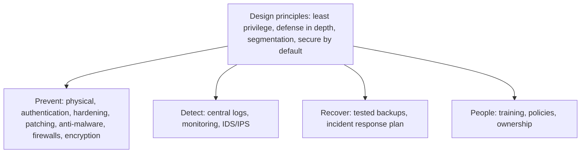

## Why should you care?

Most successful attacks are not clever. Year after year, investigations find the same causes:

- a known bug that was never patched,
- a default or reused password,
- an admin account used for daily email,
- no backup, or a backup that was never tested,
- nobody reading the logs until it was too late.

Each of these has a simple, cheap fix that has been known for years. Best practices are that list of fixes. If an organisation does them consistently, most everyday attacks fail. This lecture brings together everything in Unit 1 into a practical checklist.

## In one line

Network defense best practices are proven, everyday measures (secure physical access, strong authentication, hardening and patching, least privilege, segmentation, monitoring, backups, training and an incident plan) that together stop or limit most attacks.

## Explained

### Q1. What are network defense best practices?

==Best practices are widely accepted security measures that, applied consistently, protect against the most common attacks.==

They come from experience and from published guides such as the CIS Critical Security Controls, NIST guidelines and vendor hardening guides (CIS Benchmarks).

They are grouped here into:
- ==design principles (how to think)==, and
- ==operational practices (what to do every day)==.

### Q2. What design principles guide network defense? ⭐

- **Least privilege:** give each user and system only the access it needs, no more.
- **Defense in depth:** many independent layers ([[defense-models]]).
- **Segmentation:** separate systems into zones of trust ([[zones-of-trust]]).
- **Secure by default:** new systems start locked down; features are turned on only when needed.
- **Fail securely:** if a control fails, it should block, not allow (a firewall that crashes should not pass all traffic).
- ==**Separation of duties:**== no single person can complete a sensitive task alone.
- ==**Keep it simple:**== simple designs have fewer hidden mistakes.

==Key design principles: least privilege, defense in depth, segmentation, secure by default, fail securely.==

### Q3. Practices 1–4: physical, passwords, hardening, patching ⭐

1. ==**Secure the physical environment:**== lock server rooms and network cabinets; control who enters; protect against fire and power failure.
2. ==**Strong authentication:**== change all default passwords; use long passphrases; turn on multi-factor login for admins, email and VPN.
3. ==**Harden systems:**== disable unused services, ports and accounts; follow CIS Benchmarks for routers, servers and PCs; use SSH instead of Telnet (practical 3).
4. ==**Patch promptly:**== keep an inventory of all systems and software; apply security updates quickly, critical ones first.

### Q4. Practices 5–8: malware, firewalls, encryption, admin access ⭐

5. ==**Protect against malware:**== endpoint protection on every PC and server, kept updated; block risky attachments and USB auto-run.
6. ==**Firewalls and filtering:**== at the perimeter and between zones; default-deny rules; review rules regularly and remove old ones.
7. ==**Encrypt sensitive data:**== in transit (HTTPS, VPN, SSH) and at rest (disk and database encryption).
8. ==**Control admin access:**== separate admin accounts from daily accounts; restrict admin access to the management zone; use AAA to record who did what (practical 4).

### Q5. Practices 9–12: monitoring, backups, people, plan ⭐

9. ==**Monitor and log:**== central syslog with correct time (practical 2), IDS/IPS at boundaries, and someone who actually reviews alerts.
10. ==**Back up and test recovery:**== follow the 3-2-1 rule (3 copies, 2 types of media, 1 offline or off-site); test restores regularly.
11. ==**Train people:**== regular awareness on phishing, passwords and reporting incidents. People are part of the defence, not just a weakness.
12. ==**Plan for incidents:**== a written incident response plan: who to call, how to isolate systems, how to report (CERT-In expects certain incidents to be reported within 6 hours).

==Back up, patch, use least privilege, monitor logs, and train people: these stop most real attacks.==

### Q6. How does an organisation keep these practices working?

- ==**Document** them as policies and standards== ([[security-methodology]]).
- ==**Assign owners:**== every practice has a responsible person.
- ==**Audit regularly:**== check that patches, backups and rule reviews are actually being done.
- ==**Review after incidents:**== each incident teaches something; update the practices.
- ==**Prioritise by risk:**== start with the practices that reduce the biggest risks ([[risk-analysis]]).

Best practices are not a one-time setup. They are habits that must be checked, like a vehicle's regular service.

> [!beyond] Beyond the syllabus
> The CIS Critical Security Controls (version 8) group best practices into 18 controls and three implementation groups, so a small college can start with the basic group and grow from there.

## Analogy and real-life example

**Analogy: personal health.** Doctors cannot prevent every disease, but washing hands, vaccination, exercise, regular check-ups and a first-aid kit prevent most everyday illness and limit damage when it comes. Network defense best practices are the hygiene habits of an organisation: boring, cheap, and very effective.

**Real example: the WannaCry ransomware outbreak, 2017.** WannaCry spread worldwide through a Windows flaw for which Microsoft had already released a patch about two months earlier. Organisations that had patched, blocked the vulnerable file-sharing port at their firewalls, and kept offline backups were largely unaffected. Those that had not lost data and days of work.

## Diagram

## Key points

> [!important] Key points
> - Best practices: proven, everyday measures that stop or limit most attacks.
> - Design principles: least privilege, defense in depth, segmentation, secure by default, fail securely, separation of duties, keep it simple.
> - Practices: physical security; strong and multi-factor authentication; hardening; prompt patching; anti-malware; firewalls with default deny; encryption in transit and at rest; separate admin accounts.
> - Detect: central logging with synchronised time, IDS/IPS, alert review.
> - Recover: 3-2-1 backups with tested restores; incident response plan.
> - People: regular awareness training.
> - Keep them working with documentation, owners, audits and reviews.

## Common mistakes

> [!warning] Common mistake
> "We take backups" without ever testing a restore. Many organisations discover during an attack that their backups were incomplete, corrupted or encrypted by the same ransomware.

> [!warning] Common mistake
> Collecting logs but never reading them. Logging is a detective control only if someone reviews the alerts.

## Exam questions

**Short answer (2–3 marks)**
1. What is the principle of least privilege? ⭐
2. Explain "fail securely" with an example.
3. What is the 3-2-1 backup rule? ⭐
4. Why should admin accounts be separate from daily-use accounts?

**Long answer (5 marks)**
1. Explain any ten best practices for network defense. ⭐
2. Explain the design principles that guide secure network defense. ⭐
3. "Most successful attacks exploit basic failures." Justify this statement and explain the best practices that prevent such failures.

## Sources

- Mark Rhodes-Ousley, *Information Security: The Complete Reference*, 2nd ed., McGraw-Hill, Ch. 4, "Best Practices for Network Defense" (verify).
- Center for Internet Security, *CIS Critical Security Controls*, version 8 (verify version).
- J. H. Saltzer and M. D. Schroeder, "The Protection of Information in Computer Systems", *Proceedings of the IEEE*, 1975.
