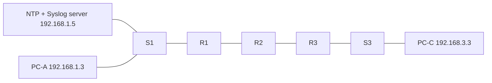

## Aim

To configure routers to take their time from an authenticated NTP server and to send their log messages, with timestamps, to a central syslog server.

## Concepts used

- [[ospf-md5-authentication-practical]]: this practical starts from that topology.
- [[information-security-overview]]: availability and integrity of records.
- Logging and monitoring are detective controls ([[security-methodology]], Q7).

**Why this matters.** When something goes wrong at 2 a.m., the first questions are "what happened, on which device, and when?" Logs answer the first two; correct time answers the third. If three routers have three different clocks, you cannot put events in order. If logs stay only on the router, an attacker who gets in can erase them. A central syslog server with synchronised time fixes both.

## Setup

**Tool:** Cisco Packet Tracer (8.x or later).

### Devices and topology

Open your saved file from Practical 1 (three 2911 routers with OSPF and MD5 authentication working). Add one **Server-PT** to switch S1. One server will run both NTP and syslog.



### Server settings

| Setting | Value |
|---|---|
| IP address / mask / gateway | 192.168.1.5 / 255.255.255.0 / 192.168.1.1 |
| Services → NTP | On; Authentication **Enable**; Key **1**; Password **NTPpa55** |
| Services → SYSLOG | On |

All other addresses are the same as in Practical 1. Ping 192.168.1.5 from R3 before you start: OSPF must already carry the route.

## Code

### Step 1. NTP with authentication on R1

```text
enable
configure terminal
ntp authenticate
ntp authentication-key 1 md5 NTPpa55
ntp trusted-key 1
ntp server 192.168.1.5 key 1
ntp update-calendar
end
```

Repeat **exactly the same commands** on R2 and R3.

### Step 2. Timestamps and syslog on R1

```text
configure terminal
service timestamps log datetime msec
logging host 192.168.1.5
end
```

Repeat on R2 and R3.

### Step 3. Generate a log message

On each router, enter and leave configuration mode, or shut and re-enable an unused interface:

```text
configure terminal
interface g0/2
 shutdown
 no shutdown
end
```

(On R2, g0/2 is in use. Use g0/0 instead.)

### Step 4. Verify

```text
R1# show clock
R1# show ntp status
R1# show logging
```

Then on the server: **Services → SYSLOG** and read the message list.

## Output

> [!warning] Replace with your own output
> The blocks below show what correct output looks like. After running the lab, paste your real output here, or save a screenshot in `content/assets/img/security-in-computing/` and link it with alt text.

**Router clock now synchronised** (`show ntp status` on R1, first line):

```output
Clock is synchronized, stratum 2, reference is 192.168.1.5
```

NTP can take a minute or two to synchronise. If it says `unsynchronized`, wait and run the command again.

**Logging to the server is on** (`show logging` on R1, relevant lines):

```output
Syslog logging: enabled (0 messages dropped, 0 messages rate-limited, 0 flushes, 0 overruns, xml disabled, filtering disabled)
    ...
    Trap logging: level informational, 0 message lines logged
        Logging to 192.168.1.5  (udp port 514, audit disabled, link up),
```

**Messages received at the server** (Services → SYSLOG, example entries):

```output
Time                      HostName       Message
<date> 10:15:22.415       192.168.1.1    %SYS-5-CONFIG_I: Configured from console by console
<date> 10:16:03.120       10.2.2.1       %LINK-5-CHANGED: Interface GigabitEthernet0/2, changed state to administratively down
```

The timestamps of all three routers now agree with the server's clock.

## Explanation

### NTP commands

- `ntp authenticate`: accept time only from an authenticated source.
- `ntp authentication-key 1 md5 NTPpa55`: define key 1. ==The key number and password must match the NTP server.==
- `ntp trusted-key 1`: mark key 1 as trusted.
- `ntp server 192.168.1.5 key 1`: take time from this server, using key 1.
- `ntp update-calendar`: also write the correct time into the router's hardware clock, so it survives a reload.

Without authentication, an attacker could run a fake NTP server and shift a router's clock, making logs useless as evidence and breaking time-based checks such as certificate validity.

### Syslog commands

- `service timestamps log datetime msec`: stamp every log message with date and time to the millisecond.
- `logging host 192.168.1.5`: send a copy of every log message to the syslog server (UDP port 514).

==Central logging keeps a copy of events outside the device, so an attacker who breaks into a router cannot simply erase the evidence.==

### Syslog severity levels

Every message carries a level; in `%SYS-5-CONFIG_I` the **5** is the level.

| Level | Name | Level | Name |
|---|---|---|---|
| 0 | Emergency | 4 | Warning |
| 1 | Alert | 5 | Notification |
| 2 | Critical | 6 | Informational |
| 3 | Error | 7 | Debugging |

Lower number means more serious. By default the router sends levels 0–6 (informational and above) to the server.

> [!beyond] Beyond the syllabus
> In real networks, logs from hundreds of devices go into a SIEM (Security Information and Event Management) system, which correlates them and raises alerts. You meet SIEM in Unit 3 theory.

## Try it

1. On R3, change the NTP key password to `WrongKey` (`ntp authentication-key 1 md5 WrongKey`), reload the router's clock with `clock set 00:00:00 1 Jan 2020` in privileged mode, and wait. Does `show ntp status` ever reach `synchronized`? Why not? Restore the correct key.
2. On R1, try `logging trap warnings`. Generate a `CONFIG_I` message again. Does it still reach the server? Explain using the severity table.

## Viva questions

1. Why must all network devices have the same time? *To put events from different devices in the correct order during troubleshooting and incident investigation; logs are also legal evidence.*
2. What is NTP and which port does it use? *Network Time Protocol, which synchronises clocks over a network; UDP port 123.*
3. What is a stratum in NTP? *The distance from a reference clock; stratum 1 is directly connected to one, and each hop adds 1.*
4. Why authenticate NTP? *So a router accepts time only from a trusted server, not from an attacker's fake server.*
5. What is syslog and which port does it use? *A standard for sending log messages to a central server; UDP port 514.*
6. In `%LINK-5-CHANGED`, what does 5 mean? *Severity level 5, Notification.*
7. Which is more serious, level 2 or level 6? *Level 2 (Critical); lower numbers are more serious.*
8. Why send logs to a server instead of keeping them only on the router? *The router's buffer is small and lost on reload, and an intruder could delete it; a central copy is safe and searchable.*

## Sources

- Cisco, *Basic System Management Configuration Guide*, chapters on NTP and system message logging (verify exact titles for your IOS version).
- Cisco Networking Academy, CCNA Security Packet Tracer activity on syslog, NTP and SSH (verify).
- RFC 5905, *Network Time Protocol Version 4*; RFC 5424, *The Syslog Protocol*.
