## Why should you care?

You open your bank's website for the very first time. You have never met the bank, never exchanged a secret key with it, and the network between you is full of strangers. Yet within a second, your browser and the bank agree on a secret key that nobody else knows, and the padlock appears.

How can two strangers agree on a secret while everyone is listening? Symmetric encryption cannot do it ([[symmetric-encryption]], the key distribution problem).

Public-key cryptography solves it. It also lets you **sign** documents digitally, which is how income-tax returns, GST filings and company forms in India are signed every day.

## In one line

Public-key (asymmetric) encryption uses a pair of mathematically linked keys, a public key that anyone may know and a private key kept secret, so that strangers can communicate securely and sign data without sharing a secret first.

## Explained

### Q1. What is public-key encryption? ⭐

==Public-key (asymmetric) encryption uses two different but related keys: a public key shared with everyone and a private key kept only by its owner.==

- What one key locks, only the other key can unlock.
- ==**Private key cannot be worked out from the public key**== in any practical time.
- Each person needs only **one** key pair, so $n$ users need $n$ pairs, not $n(n-1)/2$ shared keys.

The idea was published by Diffie and Hellman in 1976; RSA followed in 1977.

### Q2. How is it used for confidentiality? ⭐

==To send a secret message, encrypt with the receiver's public key; only the receiver's private key can decrypt it.==

1. Riya gets Amit's **public key** (from his website, email, or a certificate).
2. She encrypts the message with it.
3. Only Amit's **private key** can decrypt it. Even Riya cannot decrypt it again.

No secret had to be shared in advance. Anyone may send Amit a confidential message; only Amit can read it.

### Q3. How is it used for digital signatures? ⭐

==A digital signature is created with the sender's private key and verified with the sender's public key.==

1. Amit computes a **hash** (a short fingerprint) of the document.
2. He encrypts the hash with his **private key**: this is the signature.
3. Anyone uses Amit's **public key** to check it.

A valid signature proves:
- ==**Authentication:**== it came from Amit.
- ==**Integrity:**== the document was not changed.
- ==**Non-repudiation:**== Amit cannot later deny signing it.

### Q4. What are the common public-key algorithms?

| Algorithm | Based on | Used for |
|---|---|---|
| ==RSA== | Difficulty of factoring large numbers | Encryption, signatures; 2048-bit keys or more |
| ==Diffie–Hellman (DH)== | Discrete logarithm problem | Agreeing on a shared secret key, not encryption |
| ==ECC (Elliptic Curve)== | Elliptic curve mathematics | Signatures and key agreement with short keys (256-bit ECC ≈ 3072-bit RSA) |
| ==DSA / ECDSA== | Discrete logarithm / elliptic curves | Digital signatures only |

ECC is popular on phones because its short keys need less computing power.

### Q5. Small RSA example ⭐

1. Choose primes $p = 3$, $q = 11$. Then $n = p \times q = 33$.
2. $\phi(n) = (p-1)(q-1) = 2 \times 10 = 20$.
3. Choose $e = 3$ (shares no factor with 20). **Public key** = $(e, n) = (3, 33)$.
4. Find $d$ with $e \times d \bmod 20 = 1$: $d = 7$, since $21 \bmod 20 = 1$. **Private key** = $(7, 33)$.
5. Encrypt $M = 4$: $C = 4^3 \bmod 33 = 64 \bmod 33 = 31$.
6. Decrypt: $31^7 \bmod 33 = 4$. The original message returns.

Real RSA uses primes hundreds of digits long.

### Q6. Why use both symmetric and public-key encryption together? ⭐

| Point | Symmetric | Public-key |
|---|---|---|
| Keys | One shared key | Public + private pair |
| Speed | Very fast | Hundreds of times slower |
| Key distribution | Hard | Easy |
| Non-repudiation | No | Yes (signatures) |

==Hybrid encryption uses public-key cryptography to exchange a random symmetric key, then symmetric encryption for the data.==

This is how HTTPS (TLS), secure email and VPNs work: the slow public-key step happens once, then fast AES protects everything else.

### Q7. Numerical: RSA with p = 5, q = 11 and e = 3. Find n, φ(n) and d. [2M]

- ==**n**== = p × q = 5 × 11 = **55**
- ==**φ(n)**== = (p − 1)(q − 1) = 4 × 10 = **40**
- ==**d**== must satisfy e × d mod 40 = 1. 3 × 27 = 81, and 81 mod 40 = 1, so **d = 27**.

Public key = (3, 55); private key = (27, 55).

> [!beyond] Beyond the syllabus
> A large quantum computer could break RSA and ECC. NIST published its first post-quantum standards in 2024 (for example ML-KEM for key exchange and ML-DSA for signatures), and browsers have begun using them alongside classical algorithms.

## Analogy and real-life example

**Analogy: a letterbox with a slot.** Anyone walking by can drop a letter through the slot (encrypt with the public key). Only the owner has the key to open the box and read the letters (decrypt with the private key). For signatures, think of a wax seal only you own: anyone can recognise it, nobody else can make it.

**Real example: Digital Signature Certificates (DSC) in India.** Company directors and tax professionals sign income-tax returns, GST returns and company filings with a DSC on a USB token. The private key never leaves the token; the government portal checks the signature with the public key in the certificate. The signature is legally valid under the IT Act 2000.

## Diagram

```mermaid
flowchart TB
  accTitle: Public-key encryption and digital signatures
  accDescr: For confidentiality, the sender encrypts with the receiver's public key and the receiver decrypts with their own private key. For a signature, the sender signs a hash with their own private key and anyone verifies it with the sender's public key.
  subgraph Confidentiality
    A1[Riya: plaintext] -->|encrypt with Amit's PUBLIC key| B1[Ciphertext]
    B1 -->|decrypt with Amit's PRIVATE key| C1[Amit: plaintext]
  end
  subgraph Signature
    A2[Amit: hash of document] -->|sign with Amit's PRIVATE key| B2[Signature]
    B2 -->|verify with Amit's PUBLIC key| C2[Anyone: valid or not]
  end
```

## Key points

> [!important] Key points
> - Public-key (asymmetric) encryption: public key shared, private key secret; one locks, the other unlocks.
> - Confidentiality: encrypt with the receiver's public key, decrypt with the receiver's private key.
> - Digital signature: sign the hash with the sender's private key, verify with the sender's public key.
> - Signatures give authentication, integrity and non-repudiation.
> - Algorithms: RSA (factoring), Diffie–Hellman (key agreement), ECC (short keys), DSA/ECDSA (signatures).
> - RSA: n = p × q; φ(n) = (p−1)(q−1); e·d mod φ(n) = 1; C = Mᵉ mod n; M = Cᵈ mod n.
> - Hybrid encryption: public-key to exchange a symmetric key, symmetric for the data (HTTPS, VPN).

## Common mistakes

> [!warning] Common mistake
> Encrypting a confidential message with your **own** private key. Anyone can decrypt that with your public key; it is a signature, not secrecy. For confidentiality, use the **receiver's public** key.

> [!warning] Common mistake
> Saying public-key encryption replaces symmetric encryption. It is too slow for bulk data; in practice the two are always used together.

## Sources

- William Stallings, *Cryptography and Network Security*, Pearson, chapters on public-key cryptography and RSA, and on digital signatures (verify).
- Mark Rhodes-Ousley, *Information Security: The Complete Reference*, 2nd ed., McGraw-Hill, chapter on encryption (verify).
- W. Diffie and M. Hellman, "New Directions in Cryptography", *IEEE Transactions on Information Theory*, 1976.
